# Builder 4-week syllabus

> [!abstract] Outcome
> In four weeks a builder-track learner can unpack the frozen jargon, pass the cumulative check, and complete two studio cases at rubric ≥ 10/12. This is a **sequence**, not more content.

Skip a week-1 concept only if you can teach it to someone else with a number. Use [[AI Career Diagnostic]] if you are not on the builder bridge.

## Pass bar

| Gate | Bar |
|---|---|
| Concept flashcards | Idea preserved aloud, not wording |
| Each assigned case | ≥ 10/12 on [[How to Study a Technical Case]] |
| [[Technical Cumulative Check]] | ≥ 16/20, plus a written why on every miss |
| Week 4 project brief | One page using [[Project Brief Template]] — original domain, not Northline |

Time: **10–15 hours/week**. Less than 8 hours: stretch to six weeks; do not skip cases.

## Week 1 — Measure before you generate · 10–12 h

**Concepts:** [[Tokens, Context, and Cost]] · [[Leakage and Contamination]] · [[Metrics That Decide]] · [[Attention, Memory, and Inference]] · [[Context Engineering]] · [[Structured Outputs and Contracts]]

**Do:** hide flashcards; recompute the token bill and the precision/recall table.

**Case:** none yet.

**Exit:** you can say what a token, a held-out set, and a bound argument are without opening the note.

## Week 2 — Find, adapt, train · 10–12 h

**Concepts:** [[Retrieval Quality]] · [[Adaptation Methods]] · [[Embeddings and Similarity]] · [[The Training Loop]] · [[The Agent Loop]] · [[Untrusted Context and Injection]]

**Case (closed-note):** [[Case - Split Integrity]] *or* [[Case - Evaluation Harness]] — pick one.

**Exit:** 10/12 on that case. If below, restudy the weak rubric row; do not start week 3.

## Week 3 — Serve, sample, see · 10–14 h

**Concepts:** [[Sampling and Decoding]] · [[Calibration]] · [[Quantization]] · [[Vision and Multimodal Systems]]

**Cases (closed-note):** [[Case - Prompt RAG Fine-Tune]] **and** one of [[Case - Retrieval Failure Autopsy]], [[Case - Serving Capacity]], [[Case - Agent Permissions]], [[Case - Vision Field Slice]].

**Exit:** two cases at ≥ 10/12. Take [[Technical Cumulative Check]] at the end of the week (or first day of week 4).

## Week 4 — Own a role · 10–15 h

1. Open one profile from [[Technical AI Careers]].
2. Draw its operating loop from [[Technical Role Deep Dive Framework]] without looking.
3. Run four drills from [[Technical Interview Drills]] (include drills 9 and 10).
4. File a [[Project Brief Template]] for one beginner or intermediate project on that role. No Northline copy-paste.
5. Optional overlay: if the job is healthcare, finance, or government, read the matching thickened note in [[Industry Overlay Hub]].

**Exit:** brief + two interview stories using [[Interview Story Template]].

```mermaid
gantt
    title Builder 4-week sequence
    dateFormat X
    axisFormat %s
    section Week1
    Concepts 1-6           :a1, 0, 1
    section Week2
    Concepts 7-12          :a2, 1, 1
    One split or eval case :a3, 1, 1
    section Week3
    Concepts 13-16         :a4, 2, 1
    Two studio cases       :a5, 2, 1
    Cumulative check       :a6, 2, 1
    section Week4
    Role + drills + brief  :a7, 3, 1
```

The gantt units are weeks, not dates. Start any Monday.

## If you fail a gate

- Missed check items: restudy only those concept notes; retake after one sleep.
- Case < 10/12: rewrite the six closed-note items; do not read the worked path a second time until you have a new draft.
- No time for week 4: stop after the check. A role profile without cases is a map, not evidence.

## Visuals

- [[Builder Path Infographic]]
- [[Concept Spine Infographic]]
- [[RAG Autopsy Infographic]]

## Not this syllabus

Explorers: [[Everything AI - Home]] depth “Explorer.”  
Non-builders: [[Learning Path Builder]] Layer 2 for your bridge — do not force these 16 notes.

Spine policy: [[Concept Spine Freeze]].
