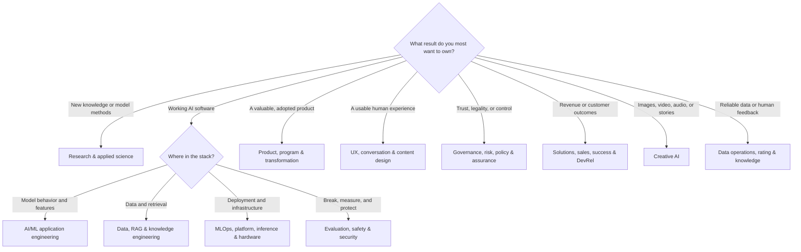

# Choose Your AI Career

Choose by the **work you want to repeat**, not by whichever title is fashionable. Then verify your fit against actual job descriptions.

## Fast router

## Match your preferred work

| You enjoy… | Start with… | Also compare… |
|---|---|---|
| experiments, papers, uncertainty, new methods | [[AI ML Research Scientist]], [[Applied Scientist]] | [[Research Engineer]], [[AI Safety and Alignment Researcher]] |
| shipping model-powered product features | [[AI Engineer]], [[ML Engineer]] | [[LLM Engineer]], [[Agentic AI Engineer]] |
| reliable data pipelines and knowledge systems | [[ML Data Engineer]], [[RAG and Knowledge Engineer]] | [[Taxonomist and Ontology Specialist]], [[Knowledge Manager]] |
| deployment, scaling, cost, latency, reliability | [[MLOps Engineer]], [[AI Platform Engineer]] | [[Inference and Performance Engineer]], [[AI Hardware and Accelerator Engineer]] |
| attacks, defenses, misuse cases, threat models | [[AI Security Engineer]], [[AI Red Teamer]] | [[Responsible AI Specialist]], [[AI Evaluation Engineer]] |
| metrics, test design, failure analysis | [[AI Evaluation Engineer]] | [[AI Auditor and Assurance Specialist]], [[Model Risk Manager]] |
| deciding what to build and why | [[AI Product Manager]] | [[Technical AI Product Manager]], [[AI Business Analyst]] |
| coordinating complex adoption | [[AI Program Manager]], [[AI Transformation Lead]] | [[AI Strategy Consultant]], [[AI Automation Specialist]] |
| systems thinking with customers | [[AI Solutions Architect]], [[AI Sales Engineer]] | [[AI Customer Success Manager]], [[AI Developer Relations and Advocate]] |
| revenue, positioning, or ecosystem deals | [[AI Enterprise Account Executive]], [[AI Product Marketing Manager]] | [[AI Strategic Partnerships Manager]], [[AI Sales Engineer]] |
| customer questions, incidents, or platform abuse | [[AI Technical Support and User Operations Specialist]], [[AI Trust and Safety Operations Specialist]] | [[AI Customer Success Manager]], [[Responsible AI Specialist]] |
| enterprise AI executive ownership | [[Chief AI Officer and Head of AI]] | [[AI Transformation Lead]], [[AI Program Manager]], [[AI Governance Specialist]] |
| human behavior and interaction design | [[AI UX and Product Designer]], [[AI UX Researcher]] | [[Conversation Designer]], [[AI Content Designer]] |
| rapid workflow improvement with little code | [[AI Automation Specialist]] | [[AI Business Analyst]], [[Prompt and Context Engineer]] |
| making visual, video, voice, or music work | [[Generative AI Creative Director]] | [[AI Image and Graphic Creator]], [[AI Video Producer]], [[AI Audio and Music Specialist]] |
| policy, control design, documentation, evidence | [[AI Governance Specialist]], [[AI Policy Analyst]] | [[AI Compliance and Privacy Specialist]], [[AI Auditor and Assurance Specialist]] |
| labeling, rating, feedback quality, operations | [[Data Annotator and AI Rater]], [[Human-Feedback Specialist|Human Feedback Specialist]] | [[AI Data Operations Manager]], [[Synthetic Data Engineer]] |
| teaching and community enablement | [[AI Trainer and Educator]] | [[AI Developer Relations and Advocate]], [[AI Talent and Recruiting Specialist]] |

## Match your starting background

> [!career] No technical background yet
> Start with [[01 AI Systems and Vocabulary]], [[08 Generative AI Systems]], [[12 Evaluation Testing and Observability]], and [[15 Product UX Business and Change]]. Strong first comparisons: [[AI Business Analyst]], [[AI Automation Specialist]], [[AI Product Manager]], [[Conversation Designer]], [[AI Trainer and Educator]], [[Data Annotator and AI Rater]], and governance roles. Technical roles remain open; add [[03 Python SQL Git and Software Foundations]] and [[02 Math and Statistics for AI]].

> [!career] Software engineer
> Bridge through [[05 Machine Learning]], [[07 Transformers and Foundation Models]], [[09 Prompt Context and Tool Use]], [[10 RAG and Knowledge Systems]], [[12 Evaluation Testing and Observability]], and [[13 Deployment MLOps and Economics]]. Compare [[AI Engineer]], [[ML Engineer]], [[Agentic AI Engineer]], [[AI Platform Engineer]], and [[AI Security Engineer]].

> [!career] Analyst, scientist, or quantitative professional
> Add [[04 Data Foundations]], [[05 Machine Learning]], causal and experimental thinking, SQL/Python, and evaluation. Compare [[Data Scientist - AI ML]], [[Applied Scientist]], [[AI Evaluation Engineer]], [[AI Business Analyst]], and [[Model Risk Manager]].

> [!career] Designer, writer, or creator
> Add [[AI Interaction and UX]], multimodal model literacy, evaluation, provenance, accessibility, and U.S. copyright basics. Compare design, conversation, content, and creative-media roles.

> [!career] Product, operations, consulting, or leadership
> Add [[AI Product Discovery and Delivery]], workflow analysis, adoption measurement, economics, governance, and enough architecture to challenge assumptions. Compare product, program, strategy, transformation, solutions, automation, go-to-market, support, trust-and-safety operations, and executive-ownership roles. [[Chief AI Officer and Head of AI]] is a senior destination reached through substantial operating leadership, not a first AI job.

> [!career] Legal, risk, audit, privacy, or public policy
> Add [[14 Security Privacy Safety and Responsible AI]], [[US AI Law and Policy Orientation]], model/data lifecycle literacy, control testing, and evidence design. Compare governance, responsible AI, compliance/privacy, model risk, assurance, ethics, and policy roles.

## Three-posting test

Before committing to a title:

1. Collect three current U.S. postings from different employers.
2. Ignore the title; highlight deliverables, decisions, stakeholders, minimum evidence, and tool categories.
3. Map each to [[Job Title Crosswalk]].
4. Choose the role profile that covers at least two-thirds of the recurring work.
5. Put employer-specific tools in a small gap list; do not rebuild your whole curriculum around one posting.

## If you are split between two roles

Pick a **primary role** that owns the outcome and a **secondary edge** that differentiates you. Useful combinations include:

- AI Product Manager + evaluation
- AI Engineer + security
- RAG and Knowledge Engineer + ontology
- AI UX Designer + conversation design
- AI Governance Specialist + technical evaluation
- Creative Director + provenance and copyright operations
- AI Sales Engineer + a regulated-industry overlay

Next: [[Learning Path Builder]].
