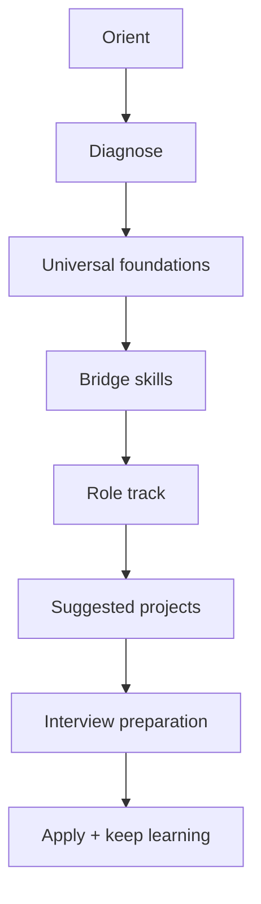

# Everything AI

> [!abstract] Learn the field. Choose a role. Build evidence. Prepare for the interview.
> A U.S.-focused, beginner-to-advanced learning vault for the major job functions in the AI economy. Current research cutoff: **August 24, 2026**.

> [!warning] A living field
> AI titles are not standardized. Employers frequently rename or combine jobs. This vault maps work by **function**, then supplies title aliases so you can recognize the same work in job postings. See [[Coverage, Evidence, and Limits]].

## Vault inventory · 2026-08-24

| Material | Included |
|---|---:|
| Obsidian Markdown notes | 226 |
| Full role tracks | 63 |
| Foundations + bridge-skill modules | 33 |
| Technical concept notes | 16 (frozen) |
| Technical studio cases + drills | 10 + 10 |
| Tool categories | 22 |
| U.S. industry overlays | 10 (3 teaching-length) |
| Flashcards | 1010 |
| Notes with quizzes or knowledge checks | 134 |
| Mermaid diagrams + interactive Canvas | 144 + 1 |

Counts describe the current vault inventory, not an official census of AI occupations. Role coverage follows the functional method in [[Coverage, Evidence, and Limits]]. Studio cases are teaching scenarios, not measured deployments.

## Current update · 2026-08-24

| Added | What it gives you |
|---|---|
| Visual and language polish · 2026-08-25 | A calmer reading width, clearer hierarchy, more consistent table/callout rhythm, responsive sizing, and an explicit route through the AI infrastructure/DevOps section |
| [[Notion Import Guide]] | Notion-ready derivative: full and split ZIP packs, standard Markdown links/callouts, copied visuals, static Base/Canvas replacements, and a CSV note catalog |
| [[AI Tools and Practices Update — 2026-08-24]] | Eight transferable technical practices, current protocol/API/evaluation signals, role-specific evidence, a 10-question knowledge check, 12 flashcards, and four project briefs |
| Technical role overlays | All 23 technical profiles now include an August 24 practice checkpoint linked to the update layer |
| [[Tool Atlas — 2026-08-24 Update]] | Current free/open versus managed tool paths, a 90-minute proof-of-concept protocol, a reusable tool card, and a decision rubric |
| [[Microsoft Azure DevOps and Foundry]] | Azure delivery layer: DevOps work/review/pipelines/environments plus Foundry hosted agents, MCP/Toolboxes, WIF, evaluation gates, traces, and rollback |
| [[Case - Azure DevOps Foundry Release Gate]] | Worked release decision for a synthetic claims agent, with identities, thresholds, failure injects, quiz, flashcards, and interview transfer |
| [[Azure DevOps Foundry Release Dossier Template]] | Reusable release evidence record for identities, pipeline gates, MCP/Toolbox review, staging traces, approval, and rollback |
| [[Cloudflare and Vercel AI]] | Current edge/web AI platform comparison: Workers AI, Agents, AI Gateway, AI Search, Workflows, AI SDK 7, WorkflowAgent, Sandbox, Connect, and Fluid Compute |
| [[Case - Edge AI Platform Choice]] | Worked Cloudflare/Vercel decision for a multi-tenant agent with retrieval, approvals, generated-code isolation, budgets, fallback, and cross-platform traces |
| [[AI Expansion Atlas — 2026-08-24]] | Twelve next-wave domains: agent interoperability, AI SRE, on-device/private AI, provenance, reasoning compute, document intelligence, privacy, sustainability, coding agents, physical AI, AI for science, and realtime interaction |
| [[MCP Deep Dive — 2026-08-24]] | End-to-end MCP study layer: 2026 protocol migration, primitives, transports, OAuth, security, conformance, operations, quizzes, flashcards, and projects |
| [[AI DevOps and Cloud Engineering — 2026-08-24]] | AI × DevOps/cloud engineering track: delivery lifecycle, cloud comparison, IaC, OIDC/WIF, evaluation gates, Kubernetes, observability, supply chain, FinOps, role practice, projects, interview prep, quiz, and flashcards |
| [[OWASP and AI Security — 2026]] | Deep LLM/Agentic Top 10 study layer with data security, secure MCP, AIBOM, COMPASS, control stack, quizzes, flashcards, and projects |
| [[Case - OWASP Agentic Security Review]] | Worked OWASP pilot decision with injection, identity, tool, memory, MCP, output, denial-of-wallet, recovery, and release gates |
| Research refresh | Official documentation checked for MCP, OpenAI Agents SDK, Gemini Interactions and caching, Microsoft Foundry, vLLM, OpenTelemetry GenAI conventions, and NIST TEVV |

> [!tip] Start with the newest layer
> Use the dated update notes for volatile tools and practices, then return to the stable role tracks and concept spine. Keep older dated notes as evidence of what was true at the time instead of erasing the learning trail.

> [!info] If you are pursuing AI infrastructure, DevOps, or cloud engineering
> Follow [[AI DevOps and Cloud Engineering — 2026-08-24]] → [[Microsoft Azure DevOps and Foundry]] or [[Cloudflare and Vercel AI]] → [[Case - Azure DevOps Foundry Release Gate]] or [[Case - Edge AI Platform Choice]] → [[Technical Interview Drills]]. This route moves from system boundaries to delivery evidence, then to a provider-specific case and interview transfer.

## Start in three steps

1. Read [[How to Use This Vault]].
2. Take the [[AI Career Diagnostic]] or use [[Choose Your AI Career]].
3. Generate your route with [[Learning Path Builder]] or the [[Builder 4-Week Syllabus]], then open a role profile in [[AI Career Atlas]]. Builders should complete [[Technical Skills Hub]] and two cases in [[Technical Studio]] before treating a role track as complete.

## The vault

| Area | Use it for |
|---|---|
| [[Foundations Hub]] | AI literacy through production-system concepts |
| [[Core Skills Hub]] | Transferable practice: prompting, research, evaluation, communication, and workflow design |
| [[Technical Studio]] | Frozen 16 concepts + jargon, then worked cases |
| [[Visual Maps Hub]] | Infographics for the builder path, spine, and RAG autopsy |
| [[AI Career Atlas]] | Role families, profiles, title aliases, and adjacent-role boundaries |
| [[AI Tool Atlas]] | Free-first and paid tool choices by job and task |
| [[Assessment Center]] | Diagnostic quizzes, answer keys, flashcards, and readiness checks |
| [[Interview and Portfolio Hub]] | Interview patterns, question banks, portfolio strategy, and project selection |
| [[Industry Overlay Hub]] | What changes in healthcare, finance, government, education, manufacturing, and other U.S. sectors |
| [[AI Glossary]] | Plain-language vocabulary and acronyms |
| [[Research Method and Source Policy]] | How information was selected, dated, and verified |

## Choose a depth

> [!level] Explorer — 8–15 hours
> Learn [[01 AI Systems and Vocabulary]], [[08 Generative AI Systems]], [[12 Evaluation Testing and Observability]], and [[14 Security Privacy Safety and Responsible AI]], then survey three role profiles.

> [!level] Career switcher — 80–180 hours
> Complete universal foundations, your bridge modules, one role profile, its flashcards and quiz, two suggested projects, and the appropriate interview pathway.

> [!level] Advanced practitioner — targeted
> Use the diagnostic to skip mastered material. Concentrate on architecture, evaluation, reliability, security, economics, governance, and the advanced sections of your role profile.

## Visual navigation

- [[Visual Maps Hub]]
- [[AI Career Landscape.canvas|Open the visual AI career landscape]]
- [[AI System Lifecycle Map]]
- [[Job Title Crosswalk]]
- [[Free-First Tool Paths]]

## Dynamic explorers

![[Role Explorer.base#All roles]]

![[Source Review.base#Review queue]]

## Research status

The vault uses **as-of dates**, source links near claims, and a review queue. Start with [[AI Tools and Practices Update — 2026-08-24]] for the latest technical layer, [[August 2026 Research Brief]] for the market and policy context, then consult [[Source Registry]] for primary references.

> [!tip] The durable advantage
> Do not memorize product menus. Learn how to define a problem, choose an approach, test behavior, quantify tradeoffs, document risk, and communicate decisions. Those abilities transfer when models and tools change.
