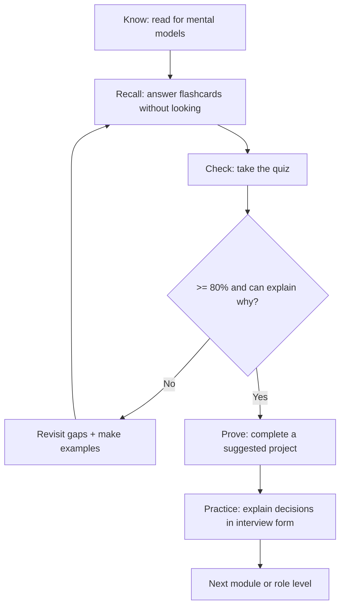

# How to Use This Vault

This is a **map, textbook, quiz bank, flashcard deck, project-idea library, interview guide, and technical case studio**. It deliberately excludes prescriptive labs and paid-course dependencies. Technical practice lives in [[Technical Studio]] as worked decision cases, not step-by-step tutorials.

## The learning loop

## Recommended order

1. **Orient:** [[Coverage, Evidence, and Limits]] and [[August 2026 Research Brief]].
2. **Route:** [[AI Career Diagnostic]] and [[Choose Your AI Career]].
3. **Learn:** [[Foundations Hub]], skipping only what you can retrieve and apply.
4. **Specialize:** open one role profile from [[AI Career Atlas]].
5. **Decide (builders):** follow [[Builder 4-Week Syllabus]] (spine is frozen — [[Concept Spine Freeze]]), then sit [[Technical Cumulative Check]].
6. **Recall:** cover the right side of every `Question:: Answer` flashcard.
7. **Check:** complete quizzes closed-note; inspect answer explanations afterward.
8. **Show:** choose projects that demonstrate the role's actual decisions—not only a polished demo.
9. **Prepare:** use [[AI Interview Playbook]] and the role-specific interview section.

## Reading the metadata

| Property | Meaning |
|---|---|
| `type` | hub, foundation, skill, role, tool-category, assessment, template, research, technical-case, or technical-concept |
| `level` | intended depth; a role can span all levels |
| `family` | the functional career family |
| `as_of` | knowledge cutoff used when the note was researched |
| `last_verified` | date its volatile claims and links were checked |
| `review_by` | intended re-check date—not an expiration guarantee |
| `status` | release state; `emerging` means the work exists but titles are unusually fluid |

## What “job-ready” means here

The vault cannot guarantee employment. A strong candidate can:

- explain the role's mission and boundaries;
- perform its recurring work with appropriate supervision;
- choose and justify tools rather than merely list them;
- evaluate output and handle failure modes;
- show role-relevant evidence through projects or prior work;
- communicate tradeoffs to the people the role serves;
- recognize legal, safety, security, privacy, and accessibility escalation points.

## Flashcards

Cards use Obsidian's inline-field style:

`What is data leakage?:: Information from outside the legitimate training context contaminates model development or evaluation.`

Read the question, hide the answer, respond aloud, then compare. A correct response should preserve the **idea**, not exact wording. Use [[Flashcard Index]] to find decks.

## Quizzes

- Take each quiz without notes.
- For scenario questions, state the decision and the reason.
- Use **80% plus a clear explanation** as the default progression rule.
- Re-take missed concepts after at least one sleep interval.

## Suggested projects

Projects are evidence prompts, not step-by-step labs. Each should produce a small set of artifacts such as a README, decision log, evaluation set, risk notes, architecture diagram, demo, or executive brief. Use [[Project Selection Guide]] and [[Project Brief Template]]. Never upload confidential employer data or personal information to an AI service without authorization.

## Free and paid tools

Every pathway begins with free, open-source, local, or free-tier options where practical. Paid products are included because employers use them. “Free tier” is not the same as free forever; verify limits and data terms on the linked official page. See [[AI Tool Atlas]].

## Obsidian features used

- Wikilinks connect concepts, roles, and tools; for example, [[AI Career Atlas]].
- Mermaid diagrams visualize systems and decisions.
- `.canvas` files provide spatial career maps.
- `.base` files provide native dynamic tables; Bases is a core Obsidian plugin.
- callouts mark decisions, risks, sources, tools, and checkpoints.
- the `everything-ai.css` snippet supplies optional visual polish and is already enabled.

> [!tip] Use the material in Notion too
> [[Notion Import Guide]] creates a standard-Markdown derivative with a full ZIP, three smaller import-safe ZIPs, static replacements for Bases and Canvas, copied visual assets, and a CSV catalog for a Notion database. Keep Obsidian canonical; regenerate the packs after edits.

> [!info] No community plugin required
> The vault is designed for current vanilla Obsidian. If Bases is unavailable in an older installation, every essential destination is still linked from [[Everything AI - Home]].

## Continue

Go to [[Choose Your AI Career]] or take the [[AI Career Diagnostic]].
