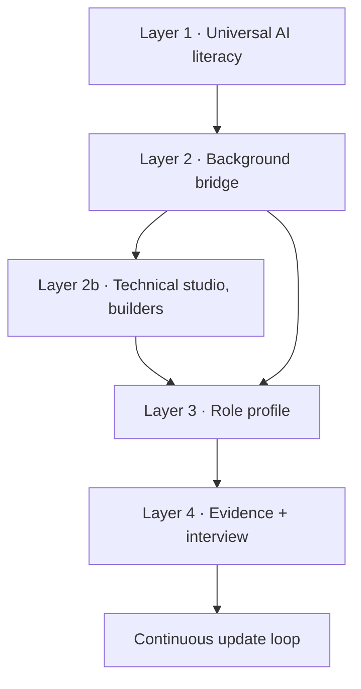

# Learning Path Builder

A complete path has four layers, plus a builder-only studio layer. Skip content only when the [[AI Career Diagnostic]] shows that you can **recall, explain, and apply** it.

## Layer 1 — universal foundations

Everyone should understand these, although depth varies by role:

1. [[01 AI Systems and Vocabulary]]
2. [[04 Data Foundations]]
3. [[05 Machine Learning]]
4. [[08 Generative AI Systems]]
5. [[09 Prompt Context and Tool Use]]
6. [[12 Evaluation Testing and Observability]]
7. [[13 Deployment MLOps and Economics]]
8. [[14 Security Privacy Safety and Responsible AI]]
9. [[15 Product UX Business and Change]]

## Layer 2 — choose a bridge

| Bridge | Add these modules | Typical destinations |
|---|---|---|
| Builder | [[02 Math and Statistics for AI]], [[03 Python SQL Git and Software Foundations]], [[06 Deep Learning]], [[07 Transformers and Foundation Models]], [[10 RAG and Knowledge Systems]], [[11 Agents and Automation]], then [[Builder 4-Week Syllabus]] | engineering, research, data, platform, evaluation, security |
| Decision-maker | [[AI Product Discovery and Delivery]], [[AI Economics and FinOps]], [[AI Adoption and Change]], [[Communicating AI Decisions]] | product, program, consulting, transformation, business analysis, executive AI leadership |
| Human experience | [[AI Interaction and UX]], [[Conversation and Content Design]], [[AI Accessibility]], [[Creative AI Provenance and Rights]] | UX, research, conversation, content, creative roles |
| Trust | [[US AI Law and Policy Orientation]], [[AI Risk and Control Design]], [[AI Assurance Evidence]], [[AI Threat Modeling]] | governance, policy, compliance, risk, audit, trust and safety, security |
| Knowledge and operations | [[Data Quality and Annotation]], [[Knowledge Architecture]], [[Workflow Analysis and Automation]], [[Human Feedback Operations]] | data operations, rating, ontology, knowledge, automation |
| Customer-facing | [[AI Solution Discovery]], [[AI Demonstration and Enablement]], [[Communicating AI Decisions]], [[AI Adoption and Change]] | solutions architecture, sales engineering, account leadership, product marketing, partnerships, success, support, DevRel, training |

## Layer 3 — role track

Open one role from [[AI Career Atlas]]. Follow its sequence in order:

1. mission and boundaries;
2. level ladder and prerequisites;
3. competency map;
4. study sequence;
5. matching [[Technical Studio]] cases, if any;
6. tool categories;
7. quiz and flashcards;
8. interview preparation plus [[Technical Interview Drills]] for technical roles;
9. suggested projects.

## Layer 4 — evidence and interview

- Select one small and one substantial idea from [[Project Selection Guide]] plus the role profile.
- Document decisions with [[Project Brief Template]], [[Evaluation Report Template]], and—where relevant—[[AI System Card Template]].
- Practice with [[AI Interview Playbook]], [[Behavioral Interview Bank]], and the family-specific interview guide.
- Use [[Role Readiness Check]] to identify gaps.

## Suggested pacing

| Pace | Weekly time | Pattern |
|---|---:|---|
| Sustainable | 4–6 hours | 2 study sessions + 1 recall/interview session |
| Career-switch sprint | 10–15 hours | foundations and project work in parallel |
| Immersive | 25–35 hours | treat as structured training; protect review and recovery time |

Time is not mastery. Use retrieval and explanation quality, quiz performance, and the ability to make defensible project decisions.

## A reusable weekly cycle

| Day | Focus |
|---|---|
| 1 | Read one concept section; make your own example |
| 2 | Read the next section; connect it to the target role |
| 3 | Closed-note flashcards and quiz questions |
| 4 | Improve a suggested project artifact |
| 5 | Explain one design choice and one failure mode aloud |
| 6 | Re-test misses; scan official updates relevant to the role |
| 7 | Rest or light review |

> [!checkpoint] Progress rule
> Advance when you score at least 80%, can explain each missed alternative, and can connect the concept to a real role decision. Memorizing an answer key is not progression.
