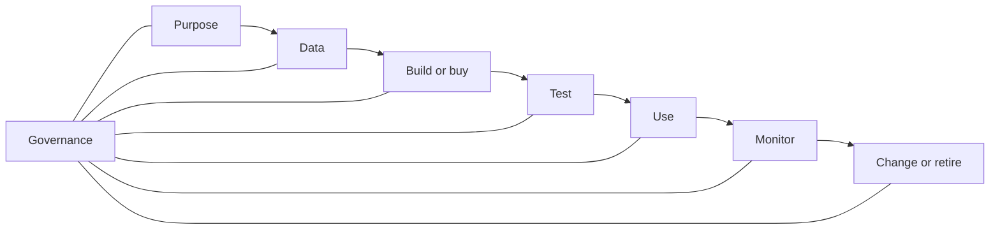

# 01 · AI Systems and Vocabulary

## Outcome

You can distinguish a model from a complete system, name the major AI approaches, trace a lifecycle, and ask questions that expose hidden assumptions.

## The essential distinctions

**Artificial intelligence (AI)** is an umbrella term for machine-based systems that produce outputs—such as predictions, recommendations, content, or decisions—for human-defined objectives. U.S. legal and policy documents may use the definition in [15 U.S.C. § 9401(3)](https://uscode.house.gov/view.xhtml?req=granuleid:USC-prelim-title15-section9401&num=0&edition=prelim); always check the governing context.

**Machine learning (ML)** is an AI approach in which behavior is learned from data or experience rather than specified only through explicit rules.

**Deep learning** uses multilayer neural networks to learn representations. It powers much of modern perception and generative AI.

**Generative AI** produces new content or structured output based on patterns learned from data. A generated answer is not automatically a retrieved fact.

**A model** is a learned computational component. **An AI system** includes the model plus instructions, data pipelines, retrieval, tools, interfaces, policies, people, infrastructure, monitoring, and fallback procedures.

> [!important] Evaluate the system you deploy
> A base model's benchmark result does not establish the quality of your application. Prompts, retrieval, tools, permissions, user behavior, and changing data can dominate outcomes.

## Common system purposes

| Purpose | Example output | Central risk question |
|---|---|---|
| Classification | fraud/not fraud | Are errors distributed and costly in acceptable ways? |
| Regression/forecasting | demand estimate | How uncertain is the estimate under change? |
| Ranking/recommendation | ordered candidates | What objective is optimized, and what feedback loop follows? |
| Generation | text, code, image, audio | Is content grounded, authorized, safe, and fit for use? |
| Perception | objects, speech, signals | Under which environments and populations does it fail? |
| Optimization/control | schedule or action | What constraints and human overrides exist? |
| Agentic action | multi-step tool use | What can it access, spend, change, or disclose? |

## Training and inference

- **Training** adjusts model parameters to reduce an objective over examples or experience.
- **Inference** uses a trained model to produce an output for an input.
- **Fine-tuning** continues training for a narrower behavior or domain.
- **Retrieval-augmented generation (RAG)** supplies information at inference time; it does not change the base model's parameters.
- **Prompting/context design** changes instructions and supplied context; it is not training.

## Probabilistic behavior

Many AI systems produce scores or probability-like distributions. Generative systems may sample from possible next elements, so repeated runs can differ. A confident tone is not a calibrated probability. Reliability comes from constraints, grounding, validation, and monitoring—not from asking the model to “be certain.”

## The lifecycle

At every stage ask: who owns the decision, who may be affected, what evidence is sufficient, what can fail, and how will humans detect and respond?

## A six-question challenge pattern

1. **Purpose:** What decision or user outcome is this system meant to improve?
2. **Evidence:** What data and evaluation represent real use?
3. **Boundary:** Where must it refuse, defer, or request review?
4. **Tradeoff:** Which errors matter most, and to whom?
5. **Operation:** How will drift, incidents, cost, latency, and misuse be observed?
6. **Accountability:** Which named human or team owns action and risk acceptance?

## Frequent misconceptions

- “AI” is not synonymous with a chatbot.
- Natural language fluency does not prove reasoning, truth, or domain authority.
- Open weights do not necessarily mean open training data, open source, or unrestricted licensing.
- Automation does not eliminate human work; it redistributes review, exception handling, and accountability.
- A statistically strong model can still be a poor product or an unacceptable system.

## Quiz

1. What is the difference between a model and an AI system?
2. Does RAG update model parameters? Explain.
3. Why can two runs of the same generative request differ?
4. Name three non-model components that can change application behavior.
5. A classifier is 95% accurate. What essential questions remain unanswered?
6. Who owns the output of a deployed AI system?

> [!success]- Answer key
> 1. A model is a learned component; the system includes the model and its data, instructions, tools, interface, infrastructure, people, controls, and operations. 2. No. RAG normally retrieves and supplies context at inference time. 3. Generation can sample from a distribution and system context may vary. 4. Any three of prompts, retrieval corpus, tool permissions, interface, preprocessing, policy layer, decoding settings, or human workflow. 5. Class balance, error types and costs, subgroup/environment performance, calibration, temporal validity, leakage, and whether the metric matches the use case. 6. Named people and organizations remain accountable according to their roles; the model cannot own responsibility.

## Flashcards

Artificial intelligence:: The umbrella class of machine-based systems producing predictions, recommendations, content, decisions, or other outputs for human-defined objectives.

Machine learning:: AI methods that learn behavior from data or experience rather than relying only on hand-written rules.

Model vs system:: A model is a computational component; a system includes data, prompts, tools, interfaces, infrastructure, controls, people, and operations.

Training:: Adjusting model parameters using examples or experience to reduce an objective.

Inference:: Producing outputs from a trained model for new inputs.

Fine-tuning:: Continuing parameter training to adapt model behavior or capability.

RAG:: Retrieving information and supplying it to a generator at inference time without normally changing base-model parameters.

Probabilistic output:: An output selected or scored from possible outcomes; fluent wording is not proof of certainty.

Human-in-the-loop:: A system design in which a human performs a defined review, decision, or intervention—not merely a person who could theoretically intervene.

Lifecycle ownership:: Named accountability for purpose, data, technical operation, risk, incidents, and retirement across an AI system's life.

## Sources and next step

- [NIST AI Risk Management Framework](https://www.nist.gov/itl/ai-risk-management-framework), including lifecycle and trustworthiness concepts; verified 2026-08-12.
- [NIST AI RMF Core](https://airc.nist.gov/airmf-resources/airmf/5-sec-core/); verified 2026-08-12.
- [U.S. Code definition of AI, 15 U.S.C. § 9401](https://uscode.house.gov/view.xhtml?req=granuleid:USC-prelim-title15-section9401&num=0&edition=prelim); verified 2026-08-12.

Next: [[02 Math and Statistics for AI]] or, for conceptual learners, [[04 Data Foundations]].
