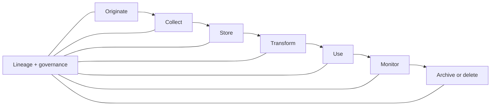

# 04 · Data Foundations

## Outcome

You can trace data from origin to use, assess fitness for purpose, recognize leakage and shift, and specify the documentation needed for accountable AI work.

## Data is evidence, not raw truth

Data is produced by a process: people, instruments, software, policy, incentives, sampling, and missingness. Before modeling, ask:

- What real-world concept is each field intended to represent?
- Who or what is absent, overrepresented, or measured differently?
- Which labels are observed, inferred, delayed, subjective, or proxies?
- When was it collected relative to the prediction or decision?
- What permissions, notices, licenses, retention rules, and contractual limits apply?

## The data lifecycle

**Lineage** records where data came from and how it changed. **Provenance** supports claims about origin and custody. **Data contracts** define expected schema, semantics, quality, and change behavior between producers and consumers.

## Quality is use-dependent

| Dimension | Question |
|---|---|
| Validity | Does it conform to allowed types and rules? |
| Accuracy | Does it correspond to the intended real-world value? |
| Completeness | Are necessary observations present? |
| Consistency | Do representations agree across sources and time? |
| Timeliness | Is it fresh enough for the decision? |
| Uniqueness | Are entities or events duplicated? |
| Coverage/representativeness | Does it reflect the conditions and populations of use? |
| Label quality | Are targets defined and applied reliably? |

A dataset can be “clean” yet unfit because it represents the wrong population or outcome.

## Splits and leakage

- **Training set:** fits parameters.
- **Validation set:** selects models, thresholds, or settings.
- **Test set:** estimates performance after choices are fixed.

**Leakage** occurs when information unavailable at legitimate prediction time, or information from the evaluation target, contaminates model development or assessment. Common causes include random splits across the same person, future timestamps, preprocessing before splitting, duplicate documents, and repeated benchmark tuning.

Use time-based, group-based, geographic, or source-based splits when those better simulate deployment.

## Shift and drift

- **Covariate shift:** input distribution changes.
- **Label/prior shift:** outcome prevalence changes.
- **Concept drift:** the relationship between inputs and outcomes changes.
- **Policy or behavior feedback:** deployment changes what is measured next.

Detecting distribution change does not by itself prove performance decline; outcome-based checks and investigation are needed.

## Labels and human judgment

Write annotation guidelines, include boundary cases, train annotators, measure agreement appropriately, adjudicate disputes, and record uncertainty. Disagreement can reveal genuine ambiguity rather than poor work. Never turn a subjective social judgment into a supposedly objective label without acknowledging the construct and consequences.

## Generative-AI data concerns

- rights and licenses for training, tuning, retrieval, and generated output;
- secrets and personal information in prompts, logs, or corpora;
- poisoned or malicious documents;
- outdated, contradictory, or low-authority knowledge;
- benchmark contamination;
- provenance and traceability of generated media;
- feedback data that rewards superficial preference rather than real correctness.

## Documentation set

A useful dataset record includes purpose, owners, sources, collection dates, population, fields, transformations, exclusions, label process, known gaps, sensitive data, rights, splits, quality checks, versions, access, retention, and prohibited uses. Link it to model/system evaluations rather than treating it as static paperwork.

## Quiz

1. Why is data not equivalent to ground truth?
2. Give two examples of temporal leakage.
3. When is a random train/test split inappropriate?
4. Does input drift prove the model is failing? Explain.
5. What can low annotator agreement mean besides poor annotator quality?
6. Why can a clean and complete dataset still be unfit?

> [!success]- Answer key
> 1. Data is generated through measurement, sampling, policy, incentives, and representation choices, all of which introduce limits. 2. Using post-decision information as a feature or randomly mixing future events into training are examples. 3. When groups, time, geography, source duplication, or future conditions must be held out to represent deployment. 4. No. It is a warning signal; performance may or may not decline, so connect drift to labels, user outcomes, and investigation. 5. Genuine task ambiguity, underspecified rules, multiple valid interpretations, or differing domain knowledge. 6. It may measure the wrong construct, omit the deployment population, violate rights, or encode an unacceptable proxy.

## Flashcards

Data lineage:: A record of data origin, movement, and transformations.

Data provenance:: Evidence about data origin, custody, and history.

Data contract:: An agreement about schema, meaning, quality, ownership, and change behavior.

Data leakage:: Illegitimate information contamination that makes development or evaluation unrealistically favorable.

Training set:: Data used to fit model parameters.

Validation set:: Data used for model, hyperparameter, or threshold choices.

Test set:: Held-out data used after choices are fixed to estimate performance.

Concept drift:: A change in the relationship between inputs and the target outcome.

Label ambiguity:: Legitimate uncertainty or multiple interpretations in the target definition.

Fitness for purpose:: Whether data's origin, meaning, coverage, quality, rights, and timing support the intended use.

## Sources and next step

- [NIST AI RMF](https://www.nist.gov/itl/ai-risk-management-framework) and [NIST Generative AI Profile](https://nvlpubs.nist.gov/nistpubs/ai/NIST.AI.600-1.pdf), verified 2026-08-12.
- [Datasheets for Datasets](https://doi.org/10.1145/3458723), documentation framework.

Next: [[05 Machine Learning]].
