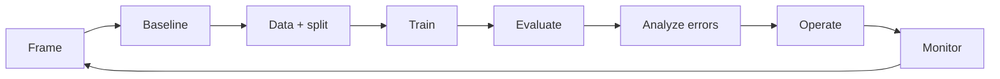

# 05 · Machine Learning

## Outcome

You can frame an ML problem, explain how learning and generalization differ, select an evaluation design from consequences, and recognize when ML is unnecessary.

## Start with the decision

Define the user, decision, action, outcome, time horizon, constraints, and baseline. Then ask whether a rule, search system, process change, or ordinary software would solve the problem more reliably.

## Learning settings

| Setting | Signal | Examples |
|---|---|---|
| Supervised learning | labeled input–target examples | classification, regression |
| Unsupervised learning | structure without target labels | clustering, dimensionality reduction |
| Self-supervised learning | targets derived from the data itself | masked or next-token prediction |
| Reinforcement learning | rewards from actions and environment | control, sequential policies |
| Semi-/weak supervision | limited or noisy labels plus other signals | large-scale labeling scenarios |

## The development loop

Build a simple baseline first. It detects pipeline errors, quantifies the value of complexity, and creates a fallback.

## Generalization

**Generalization** is performance on relevant unseen cases. **Overfitting** means learning training-specific patterns that do not transfer. **Underfitting** means the model or training process cannot capture useful structure.

- **Bias** can mean systematic model error; in social contexts it can also mean harmful or unfair patterns. State which meaning you intend.
- **Variance** describes sensitivity to the training sample.
- **Regularization** discourages overly flexible solutions through penalties, constraints, data augmentation, early stopping, or architecture choices.

Cross-validation estimates variation across splits, but only if the split structure represents deployment and the test set remains untouched.

## Features, targets, and proxies

A **feature** is an input used by a model. The **target/label** is the modeled outcome. Proxy variables can be operationally useful yet harmful or misleading. A target that is easy to measure may not represent the real objective; optimizing it can distort behavior.

## Metric selection

Map each error to a consequence and owner. Use confusion matrices, precision/recall, calibration, ranking metrics, regression error, subgroup and slice results, robustness checks, and operational metrics as appropriate. Aggregate scores can hide catastrophic rare failures.

Set thresholds from costs and capacity. Thresholds are policy choices expressed through model scores, not properties dictated by the model.

## Interpretation

Feature importance, saliency, or explanation methods describe a model under assumptions; they do not automatically explain causal reality or justify a decision. Test explanation stability and usefulness with the people who need it.

## Production reality

Performance depends on preprocessing, feature availability, training-serving consistency, latency, data freshness, fallback behavior, human workflow, and monitoring. A model artifact without these is not a production system.

## Quiz

1. Why build a non-ML or simple-model baseline?
2. Distinguish overfitting from underfitting.
3. Why is a decision threshold a policy choice?
4. What makes cross-validation misleading?
5. Why can optimizing a proxy harm the real objective?
6. Does feature importance establish causation?

> [!success]- Answer key
> 1. It tests the pipeline, establishes incremental value, exposes unnecessary complexity, and may serve as fallback. 2. Overfitting captures sample-specific noise; underfitting fails to capture useful structure. 3. It converts scores into action and trades different error costs, capacity, and stakeholder impact. 4. Leakage, nonrepresentative split structure, repeated tuning, dependence across examples, or changing time conditions. 5. The proxy is an incomplete measurement and agents/processes may adapt to what is measured. 6. No. It describes model dependence or attribution under a method, not a causal intervention in the world.

## Flashcards

Supervised learning:: Learning from input–target examples.

Self-supervised learning:: Creating learning targets from the structure of unlabeled data itself.

Generalization:: Performance on relevant unseen cases or conditions.

Overfitting:: Learning patterns that fit development data but do not transfer adequately.

Underfitting:: Failing to capture enough useful structure even on development data.

Regularization:: Techniques that constrain learning to improve generalization.

Baseline:: A simple reference method used to quantify improvement and validate the pipeline.

Decision threshold:: The score cutoff that translates predictions into actions and encodes tradeoffs.

Proxy target:: A measurable stand-in for the real outcome that may only partially represent it.

Model explanation:: Evidence about model behavior under a method and assumptions—not automatic causal truth.

## Sources and next step

- [Scikit-learn user guide](https://scikit-learn.org/stable/user_guide.html), free reference.
- [Google Machine Learning Crash Course](https://developers.google.com/machine-learning/crash-course), free course.
- [NIST AI RMF](https://www.nist.gov/itl/ai-risk-management-framework), verified 2026-08-12.

Next: [[06 Deep Learning]].
