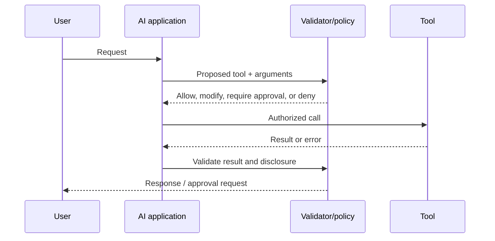

# 09 · Prompt, Context, and Tool Use

## Outcome

You can turn an ambiguous request into explicit instructions and context, request machine-checkable output, and treat model/tool boundaries as untrusted interfaces.

## Prompting vs context engineering

**Prompting** designs instructions and examples for a model interaction. **Context engineering** manages the complete information state available at inference: system policy, user request, conversation, retrieved evidence, tool descriptions/results, memory, metadata, budgets, and output constraints.

In production, prompt wording is only one variable.

## A reusable instruction structure

1. **Goal:** the outcome and audience.
2. **Inputs:** clearly delimited authorized material.
3. **Constraints:** scope, prohibited behavior, evidence rules, privacy, tone, and resources.
4. **Process requirements:** checks or tool use that matter; avoid demanding hidden reasoning transcripts.
5. **Output contract:** schema, fields, units, length, citations, and failure response.
6. **Examples:** representative positives and important boundary cases.
7. **Uncertainty policy:** when to state limits, ask, refuse, or escalate.

Use external validators for properties a model cannot guarantee through wording alone.

## Context priority and conflict

Applications often define instruction authority—platform/system rules, developer/application policy, user requests, then untrusted data. Exact mechanics vary by platform. Label untrusted content as data, isolate it where possible, and explicitly prohibit treating retrieved text or web content as authority.

## Structured output

A schema makes output easier to validate and connect to software. Still check:

- required and unexpected fields;
- types, ranges, formats, and enum values;
- semantic consistency across fields;
- source support and authorization;
- whether a valid structure contains an unsafe action.

Syntactic validity is not semantic correctness.

## Tool use

Tools should have narrow permissions, typed descriptions, timeouts, spending/action limits, audit records, and idempotency where state changes. A model may select a tool; policy code determines whether it is allowed.

## Prompt injection

**Direct injection** arrives in a user's instruction. **Indirect injection** is embedded in content the system reads, such as a webpage, document, email, image, or tool result. Treat all external content as potentially adversarial. Prompt instructions alone are not a complete defense.

Controls include least privilege, separation of data and instructions, content/source allowlists, output encoding, tool policy checks, human approval for consequential action, sandboxing, data-loss prevention, and adversarial testing.

## Improve systematically

1. Define an evaluation set before polishing wording.
2. Establish a simple baseline.
3. Change one variable at a time where practical.
4. Record model/version, prompt, context strategy, decoding, tools, and results.
5. Analyze failures by category.
6. Prefer clearer architecture or validation over endlessly lengthening prompts.

## When prompting is not the fix

- missing facts → retrieval or authoritative tool;
- complex deterministic rule → ordinary code/rules engine;
- persistent domain behavior → consider fine-tuning after evidence;
- unsafe permission model → redesign access control;
- poor user problem → product discovery;
- subjective success criteria → stakeholder alignment and a better rubric.

## Quiz

1. What information belongs to context beyond the prompt text?
2. Why is a JSON schema not proof of correctness?
3. Distinguish direct and indirect prompt injection.
4. Who should make the final permission decision for a tool call?
5. Why define an evaluation set before prompt iteration?
6. Give two cases where a longer prompt is the wrong solution.

> [!success]- Answer key
> 1. System policy, conversation, retrieved evidence, tool definitions/results, memory, metadata, and budgets. 2. It proves only structural conformance unless semantic, evidence, permission, and safety checks also pass. 3. Direct injection is in an explicit user request; indirect injection is hidden in content the system processes. 4. Deterministic policy/authorization controls, with human approval where required—not the model alone. 5. It reduces cherry-picking and makes changes measurable and reproducible. 6. Missing knowledge needs retrieval; unsafe access needs permission redesign; deterministic rules need code; unclear value needs discovery.

## Flashcards

Prompt engineering:: Designing instructions and examples to influence model behavior.

Context engineering:: Managing the full inference-time information state, including policy, data, memory, tools, and budgets.

Output contract:: A defined structure and semantic expectation for model output.

Direct prompt injection:: An adversarial instruction supplied directly by a user.

Indirect prompt injection:: An adversarial instruction embedded in external content processed as data.

Least privilege:: Granting only the permissions required for a task and duration.

Tool schema:: A typed description of a tool's purpose, arguments, and often returned structure.

Semantic validation:: Checking whether structured output is meaningful, supported, authorized, and internally coherent.

## Sources and next step

- [NIST Generative AI Profile](https://nvlpubs.nist.gov/nistpubs/ai/NIST.AI.600-1.pdf), especially information integrity and security risks; verified 2026-08-12.
- [OWASP Top 10 for LLM Applications](https://owasp.org/www-project-top-10-for-large-language-model-applications/), current project page; verified 2026-08-12.

Next: [[10 RAG and Knowledge Systems]].
