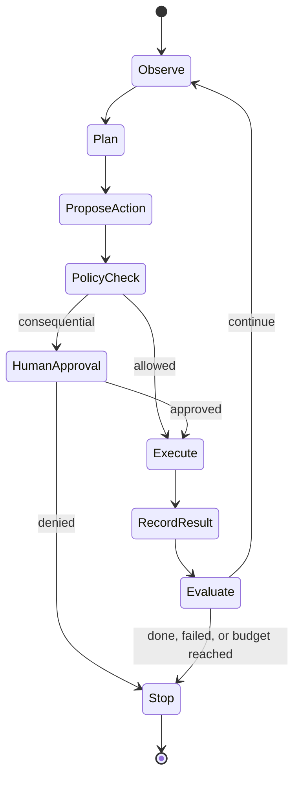

# 11 · Agents and Automation

## Outcome

You can distinguish deterministic automation from agentic behavior, define autonomy and permissions, and design an observable loop with safe interruption and recovery.

## What is an agent?

In practice, an AI agent is a system in which a model helps select and sequence actions toward a goal using tools and state. Definitions vary. “Agent” should not be used as a quality claim or a synonym for any chatbot.

| Pattern | Behavior | Use when |
|---|---|---|
| Deterministic workflow | fixed steps and rules | process is known and exceptions are bounded |
| Model-assisted workflow | model handles one or more uncertain steps | classification, extraction, drafting, or routing needs judgment |
| Agentic loop | system selects next action based on state/results | path cannot be fully specified and value justifies added risk |
| Multi-agent system | multiple specialized actors coordinate | decomposition measurably improves results enough to justify coordination cost |

Prefer the least autonomy that solves the problem.

## Agent loop

## State and memory

- **Working state:** current goal, plan, evidence, tool results, and remaining budget.
- **Session memory:** information scoped to a task or conversation.
- **Long-term memory:** persisted facts or summaries requiring provenance, correction, expiration, access control, and user visibility.
- **External system of record:** authoritative data that should be queried rather than vaguely remembered.

More memory can add stale assumptions, privacy exposure, and injection persistence.

## Tool and action design

Give tools narrow, typed interfaces. Separate read from write capabilities. Use least-privilege credentials, allowlists, sandboxing, rate/spend/time budgets, reversible actions, idempotency keys, destination confirmation, and human approval for high-impact steps. Record intent, arguments, policy outcome, execution result, and side effects.

## Failure modes

- goal ambiguity and reward hacking;
- looping or premature completion;
- compounding small errors across steps;
- fabricated state or tool results;
- prompt injection from email, files, webpages, or tool responses;
- unauthorized data movement or action;
- duplicated state changes after retries;
- lost context, stale memory, and cross-user leakage;
- coordinator overhead and cascading errors in multi-agent designs;
- evaluation that scores the final answer but ignores dangerous intermediate actions.

## Evaluation

Measure task completion, step correctness, policy compliance, side effects, tool efficiency, recovery, interruption, uncertainty handling, time/cost, and transcript evidence. Test adversarial content, partial tool failure, ambiguous goals, revoked permissions, stale state, duplicate events, and budget exhaustion.

> [!source] Emerging standards
> NIST launched an **AI Agent Standards Initiative** in February 2026 focused on secure, interoperable adoption. Deliverables were still developing at this vault's cutoff; do not describe an announced initiative as a finished standard. See the [official announcement](https://www.nist.gov/news-events/news/2026/02/announcing-ai-agent-standards-initiative-interoperable-and-secure), verified 2026-08-12.

## Quiz

1. Why prefer a deterministic workflow when it suffices?
2. What makes a workflow agentic?
3. Why can long-term memory increase risk?
4. What should be recorded around every consequential tool call?
5. Why is final-answer accuracy insufficient agent evaluation?
6. Give two safe-stop conditions.

> [!success]- Answer key
> 1. It is easier to test, predict, secure, audit, and recover. 2. A model participates in choosing and sequencing actions based on changing state/results. 3. It can preserve stale, wrong, private, or injected content and cross boundaries. 4. Intent, arguments, identity/permissions, policy decision, approval, result, and side effects. 5. Intermediate actions can leak data, violate policy, waste resources, or cause irreversible effects despite a good final message. 6. Goal reached, human denial, permission failure, budget/time limit, repeated loop, low confidence, unsafe state, or unrecoverable tool failure.

## Flashcards

AI agent:: A system in which a model helps choose and sequence actions toward a goal using tools and state.

Deterministic workflow:: Automation whose steps and branching rules are explicitly specified.

Agentic loop:: Repeated observation, action selection, execution, and evaluation based on evolving state.

Working state:: Current goal, plan, evidence, results, and budgets used during a task.

Long-term memory:: Persisted agent information requiring provenance, permissions, correction, and expiration.

Reversible action:: An operation designed so its effect can be safely undone or staged before commitment.

Action budget:: A limit on time, steps, tokens, money, or side effects that bounds autonomy.

## Next step

Continue to [[12 Evaluation Testing and Observability]] and [[AI Threat Modeling]].
