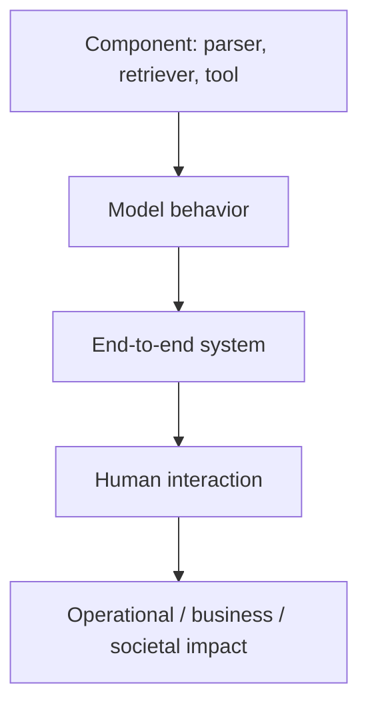

# 12 · Evaluation, Testing, and Observability

## Outcome

You can turn a vague quality claim into a measurement plan, choose evidence at multiple system levels, and communicate uncertainty and limitations.

## Evaluation starts with a decision

State:

1. what decision the evaluation informs;
2. the system/version/configuration under test;
3. intended users, tasks, environments, and exclusions;
4. constructs and measurable indicators;
5. acceptable error tradeoffs and stop conditions;
6. sample design and uncertainty analysis;
7. who reviews, approves, and monitors the conclusion.

## Evaluation levels

Success at a lower level does not prove success above it. Conversely, an end-to-end failure needs decomposition to identify the component to fix.

## Build an evaluation set

Include representative routine cases, important slices, difficult edges, no-answer cases, adversarial cases, historical incidents, permission boundaries, and changing conditions. Record case source, rationale, expected behavior, ambiguity, annotators, version, and permitted use. Prevent contamination by keeping some cases private and rotating sets.

## Metrics and rubrics

- use deterministic metrics for exact properties when available;
- use multidimensional rubrics for qualities such as support, relevance, completeness, tone, and safety;
- define scale anchors with examples;
- report category and slice results, not only averages;
- pair quality with latency, cost, reliability, and policy compliance;
- define severity-weighted failure counts for rare consequential errors.

## Human and model-based judging

Human evaluation needs trained reviewers, clear rubrics, blinding/randomization where relevant, agreement analysis, adjudication, and workload/worker safeguards. Model-based judges can scale evaluation but may share model biases, prefer style over correctness, be prompt-sensitive, or be contaminated. Validate a judge against high-quality human labels and monitor disagreement.

## Statistical validity

State what population you want to generalize to, how items were sampled, how repeated trials are handled, and what uncertainty interval means. NIST AI 800-3 (2026) emphasizes that benchmark averages can conflate different measurement targets and that explicit statistical models and assumptions improve interpretation.

## Red teaming vs evaluation

Evaluation estimates behavior under defined conditions. Red teaming actively searches for failures, often adversarially. Red-team findings are not prevalence estimates unless sampling supports that claim; they are valuable evidence of possibility and exploitability.

## Online observation

Track model/configuration, feature and data signals, quality proxies, labeled outcomes where available, refusals/escalations, tool actions, policy blocks, latency, errors, cost, user feedback, incidents, and drift. Protect privacy: do not log full prompts or outputs by default merely because they are useful.

Monitoring requires thresholds, owners, response playbooks, and the ability to roll back, disable, or degrade gracefully.

## Quiz

1. Why must an evaluation name the decision it informs?
2. What is wrong with reporting only an average score?
3. How should a model-based judge be validated?
4. Distinguish a red-team finding from a prevalence estimate.
5. Why can logging every prompt create risk?
6. What makes a monitoring metric operationally useful?

> [!success]- Answer key
> 1. Evidence sufficiency, population, metrics, thresholds, and tradeoffs depend on the decision. 2. Averages hide slices, severity, rare failures, uncertainty, and distribution shifts. 3. Compare against expert/human labels across representative and adversarial cases; examine bias, reliability, prompt sensitivity, and drift. 4. A red-team finding proves a failure can occur under the found conditions; prevalence requires a defensible sampling design. 5. Prompts can contain personal, confidential, copyrighted, credential, or security-sensitive content and expand retention/access obligations. 6. It has a defined meaning, threshold, owner, response, and connection to user/system outcomes.

## Flashcards

Evaluation construct:: The underlying quality or behavior an assessment intends to measure.

Evaluation set:: A versioned set of cases with rationale, expected behavior, and metadata used to assess a system.

Slice analysis:: Reporting performance for meaningful subsets rather than only an aggregate.

Model-based judge:: A model used to score other outputs under a rubric; it requires independent validation.

Red teaming:: Authorized adversarial exploration intended to discover failures or abuse paths.

Observability:: Evidence from logs, metrics, traces, and events that supports understanding system state and behavior.

Drift alert:: A signal of change requiring investigation; it is not itself proof of degraded outcome.

Measurement uncertainty:: Quantified limits on an estimate due to sampling, variation, labeling, or model assumptions.

## Sources and next step

- [NIST AI 800-3 evaluation statistics](https://www.nist.gov/news-events/news/2026/02/new-report-expanding-ai-evaluation-toolbox-statistical-models), released 2026-02-19.
- [NIST ARIA pilot evaluation report](https://www.nist.gov/publications/assessing-risks-and-impacts-ai-aria-pilot-evaluation-report), published 2025-11-13.
- [NIST automated benchmark evaluation draft](https://www.nist.gov/news-events/news/2026/01/towards-best-practices-automated-benchmark-evaluations), explicitly a draft at the 2026-08-12 cutoff.

Next: [[13 Deployment MLOps and Economics]].
