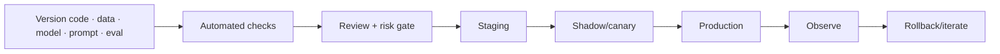

# 13 · Deployment, MLOps, and Economics

## Outcome

You can describe a controlled path to production, define reliability and rollback, and model total cost and value rather than comparing only model prices.

## Production path

AI delivery adds probabilistic evaluation, data/model lineage, and behavior change to ordinary software practices. It does not remove code review, testing, security, or incident management.

## Version the behavior

Record code, data snapshots, model/checkpoint or provider model identifier, prompts, retrieval corpus/index, tool schemas, configuration, dependencies, evaluation set, results, approvals, and deployment. Without the combination, a behavior may be impossible to reproduce.

## Release strategies

- **Shadow:** new system observes duplicated traffic without controlling the user result.
- **Canary:** limited users/traffic receive the new system with monitored stop criteria.
- **A/B test:** compares outcomes under randomized or otherwise defensible assignment.
- **Blue/green:** maintain old and new environments for controlled switching.
- **Feature flag/routing:** enable by user, task, risk, geography, or capability.

Rollback must be tested. For state-changing agents, compensating actions and audit records may be needed; deploying old code cannot undo actions already taken.

## Reliability vocabulary

- **SLI:** measured indicator such as availability, latency, grounded-answer rate, or successful tool completion.
- **SLO:** target for an SLI over a period.
- **SLA:** external commitment with contractual/business consequences.
- **Error budget:** tolerated unreliability used to balance delivery and stability.

Include graceful degradation: smaller model, retrieval-only result, cached answer, human queue, or safe unavailability depending on risk.

## Latency and throughput

End-to-end latency can include queueing, retrieval, reranking, prompt construction, time to first token, generation, tool calls, validation, and network delay. Optimize the bottleneck supported by traces. Techniques include caching, batching, routing, smaller models, speculative/optimized decoding, quantization, context reduction, concurrency control, and hardware tuning.

## Total cost

Model/API or compute cost is one line:

$$\text{TCO}=\text{build} + \text{data} + \text{training/adaptation} + \text{inference} + \text{evaluation} + \text{platform} + \text{security/governance} + \text{human operations} + \text{incident/change cost}$$

Compare **cost per successful, acceptable outcome**, not cost per token alone. Include failed/retried calls, long contexts, review time, support, lock-in, data egress, and migration.

## Value case

Define baseline volume, time, quality, revenue/risk outcome, adoption, displacement of other cost, and unintended work. Separate demonstrated value from forecast assumptions. Productivity gained in one task may be consumed by review or downstream correction.

## Buy, use open models, or build

Evaluate capability evidence, privacy/data terms, security, rights, customization, portability, latency, geography, availability, support, transparency, hardware/talent, and exit strategy. “Open weights” still requires license, provenance, security, and operations review.

## Quiz

1. Why must prompts and retrieval corpora be versioned with code?
2. Distinguish shadow and canary deployment.
3. What is the difference between SLI and SLO?
4. Why is price per token an incomplete comparison?
5. Why can rollback be insufficient for an agent?
6. Name two graceful-degradation strategies.

> [!success]- Answer key
> 1. They materially change system behavior and are needed for reproduction, review, comparison, and rollback. 2. Shadow traffic does not control user results; canary traffic does for a limited cohort. 3. SLI is the measured quantity; SLO is its target over a period. 4. It omits retries, context size, other components, human review, engineering, evaluation, incidents, platform, and quality-adjusted outcomes. 5. External actions or state changes may already have occurred and require compensation. 6. Human review, retrieval-only, smaller model, cache, read-only mode, safe refusal, or temporary disablement.

## Flashcards

Behavioral version:: The combination of model, code, data, prompt, retrieval, tools, configuration, and environment that determines system behavior.

Shadow deployment:: Testing on duplicated real traffic without using the new system's result for the user.

Canary deployment:: Exposing a limited cohort to a new version with monitored stop criteria.

SLI:: A measured service-level indicator.

SLO:: A target value or range for an SLI over time.

Graceful degradation:: A controlled reduction in capability that preserves safety and essential service during failure.

Total cost of ownership:: Lifecycle cost including technology, people, controls, operations, incidents, and change.

Cost per acceptable outcome:: Total cost divided by outcomes that meet task, quality, safety, and policy criteria.

## Next step

Continue to [[14 Security Privacy Safety and Responsible AI]] and compare tools in [[MLOps and Platforms]].
