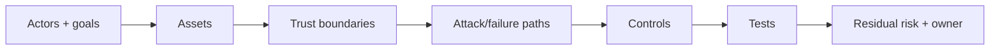

# 14 · Security, Privacy, Safety, and Responsible AI

## Outcome

You can distinguish risk domains, threat-model an AI system, apply a lifecycle frame, and recognize when to involve security, privacy, legal, safety, accessibility, civil-rights, or domain experts.

## Different questions, connected controls

| Domain | Central question |
|---|---|
| Security | Can an actor compromise confidentiality, integrity, availability, or authorized control? |
| Privacy | Is personal data handled lawfully, fairly, proportionately, and with appropriate individual/organizational controls? |
| Safety | Can intended or unintended behavior cause unacceptable harm? |
| Fairness/civil rights | Are impacts, access, errors, or treatment unjustifiably different or discriminatory? |
| Transparency/accountability | Can relevant people understand purpose, limits, evidence, ownership, and recourse? |
| Reliability | Does behavior remain valid and robust under expected and stressed conditions? |
| Accessibility | Can people with disabilities use the system and obtain accommodations/equivalent paths? |

One control can serve several domains, but none should be collapsed into a generic “ethics score.”

## Threat model the whole system

Identify users, insiders, vendors, attackers, affected non-users, and automated actors. Assets include personal/confidential data, prompts, weights, training data, retrieval sources, credentials, tools, decisions, reputation, and safety-critical state.

## AI-specific and amplified risks

- prompt injection and unsafe tool use;
- training/retrieval data poisoning;
- adversarial examples and evasion;
- model extraction, theft, inversion, and membership inference;
- memorization or sensitive-data disclosure;
- supply-chain compromise of models, datasets, packages, plugins, and endpoints;
- excessive agency, insecure output handling, and cross-tenant leakage;
- fabricated content, impersonation, digital replicas, and scalable persuasion;
- harmful bias, exclusion, accessibility barriers, and automation bias;
- overreliance on evaluations that miss context or rare severe failure.

## Privacy-by-design questions

What personal data is necessary? What is the lawful/authorized purpose? Can it be minimized, de-identified, processed locally, or deleted sooner? Who can access prompts, embeddings, logs, feedback, and vendor data? Can users understand and exercise applicable rights? What happens when data is copied into a model, cache, index, backup, or evaluation set?

De-identification reduces risk but does not guarantee anonymity; linkage and model behavior can re-expose information.

## NIST AI RMF

The voluntary NIST AI RMF uses four functions:

- **Govern:** policies, accountability, culture, inventory, and oversight.
- **Map:** context, purpose, actors, impacts, and risk tolerances.
- **Measure:** analyze and test trustworthiness characteristics and impacts.
- **Manage:** prioritize, respond, monitor, communicate, and improve.

Govern is cross-cutting. AI RMF 1.0 was under revision at the August 2026 cutoff; always consult the current [NIST page](https://www.nist.gov/itl/ai-risk-management-framework).

## U.S. employment and creative cautions

The EEOC states that federal employment discrimination laws apply when employers use AI and automated systems. Accessibility and reasonable-accommodation processes matter; a vendor does not remove employer obligations. Consult [EEOC AI publications](https://www.eeoc.gov/eeoc-publications), verified 2026-08-12.

The Copyright Office's multipart AI report addresses digital replicas, copyrightability, and generative-AI training. See [copyright.gov/ai](https://www.copyright.gov/ai/) and [[Creative AI Provenance and Rights]].

State law changes quickly. Use the [NCSL AI legislation database](https://www.ncsl.org/financial-services/artificial-intelligence-legislation-database) as a discovery index, then verify enacted text and effective dates with the relevant state source.

## Control hierarchy

1. eliminate an unnecessary high-risk use;
2. reduce scope, data, capability, autonomy, or affected population;
3. design technical and process controls;
4. independently test and monitor;
5. provide notice, choice, accessibility, review, appeal, and remedy where appropriate;
6. accept residual risk only through an authorized, documented owner;
7. stop or retire when risk cannot be justified.

Human review is a control only when reviewers have information, time, authority, competence, independence, and an alternative to approval.

## Quiz

1. Distinguish security, privacy, and safety using one sentence each.
2. Why must retrieval indexes and embeddings be included in a privacy review?
3. What makes human review a real control?
4. Name the four NIST AI RMF functions.
5. Does buying an employment AI tool transfer the employer's legal obligations to the vendor?
6. Why is de-identification not a guarantee of anonymity?

> [!success]- Answer key
> 1. Security protects authorized confidentiality/integrity/availability/control; privacy governs appropriate handling and impact of personal data; safety concerns unacceptable harm from behavior or failure. 2. They may encode, reveal, retrieve, or retain personal/confidential data and cross permission boundaries. 3. Defined trigger, relevant evidence, trained reviewer, adequate time, authority to disagree, documented action, and an effective alternative/appeal. 4. Govern, Map, Measure, Manage. 5. No; applicable obligations remain with the employer and other responsible actors. 6. Other data and model behavior can re-link records or infer identities/attributes.

## Flashcards

Threat model:: A structured account of actors, assets, trust boundaries, attack/failure paths, controls, tests, and residual risk.

Prompt injection:: Instructions designed to manipulate a model-powered system, including instructions hidden in processed content.

Data poisoning:: Manipulating training, tuning, feedback, or retrieval data to change system behavior.

Model extraction:: Attempts to reproduce or steal model capability or parameters through access or compromise.

Privacy minimization:: Limiting personal data collection, use, access, retention, and sharing to what is necessary.

Residual risk:: Risk remaining after controls, requiring explicit ownership and response.

NIST AI RMF functions:: Govern, Map, Measure, and Manage.

Meaningful human review:: Review with information, competence, time, authority, documentation, and a viable ability to change the outcome.

## Sources and next step

- [NIST AI RMF and resources](https://www.nist.gov/itl/ai-risk-management-framework), verified 2026-08-12.
- [NIST Generative AI Profile](https://nvlpubs.nist.gov/nistpubs/ai/NIST.AI.600-1.pdf).
- [NIST Adversarial Machine Learning taxonomy](https://csrc.nist.gov/pubs/ai/100/2/e2023/final).
- [EEOC artificial-intelligence publications](https://www.eeoc.gov/eeoc-publications), verified 2026-08-12.

Next: [[15 Product UX Business and Change]].
