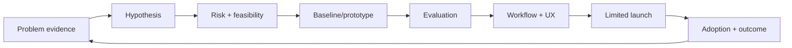
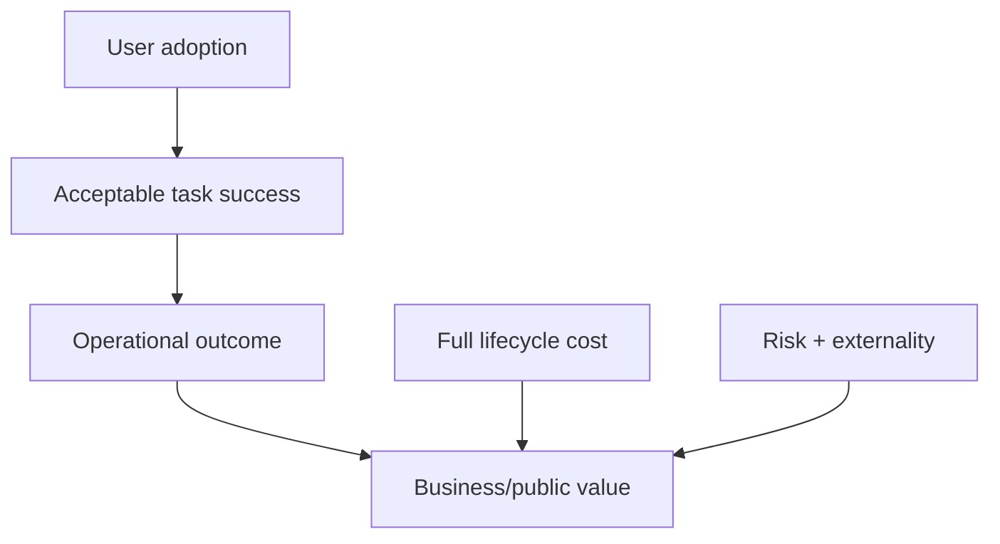

# 15 · Product, UX, Business, and Change

## Outcome

You can frame an AI opportunity around a real user decision, evaluate whether probabilistic behavior is acceptable, design human control, and connect adoption to measurable value.

## Start with the job, not the model

Write a problem statement:

> For **[user]** in **[context]**, the current **[task/decision]** causes **[measured problem]**. We believe **[change in workflow]** can improve **[outcome]** while respecting **[constraints]**. We will compare it with **[baseline]** using **[measures]**.

Then ask whether AI adds enough value to justify variability, data exposure, evaluation, and operational complexity.

## AI suitability

Good candidates often have high volume, useful patterns/data, tolerant or reviewable errors, measurable outcomes, and a workflow that can absorb exceptions. Poor candidates include unclear objectives, unavailable authority, unacceptable error consequences without reliable safeguards, rare data, unresolved rights, or a deterministic rule that ordinary software handles better.

## Discovery and delivery loop

Prototypes test assumptions; they are not production readiness evidence.

## Human–AI interaction principles

- make capability and limits visible at the moment they matter;
- show sources, uncertainty, and status without pretending precision;
- let users inspect, edit, reject, and recover;
- confirm consequential or irreversible actions;
- design for accessibility and reasonable alternatives;
- avoid anthropomorphic cues that overstate agency or understanding;
- distinguish draft, recommendation, and executed action;
- preserve user context without hidden or indefinite memory;
- collect feedback that identifies the case and failure, not just thumbs up/down.

## Workflow design

Map trigger, inputs, decisions, handoffs, exceptions, systems of record, approvals, output destinations, and incident paths. AI may remove one step while creating review, escalation, data preparation, or correction work elsewhere. Measure the complete workflow.

## Business case

Track a value tree:

Metrics may include completion time, quality, conversion, resolution, error severity, customer effort, employee burden, capacity, revenue, cost, or avoided loss. State assumptions and counterfactual baseline. Vanity usage without outcome and quality can hide failure.

## Buy/build/partner

Compare evidence for task quality, integration, data rights and retention, privacy/security, model/provider change, configurability, accessibility, support, portability, cost, monitoring, exit, and contract protections. Pilot with representative workflows and pre-defined stop criteria.

## Adoption and change

People need a reason, safe access, role clarity, training, support, examples, manager reinforcement, feedback channels, and visible response to failures. Identify who gains work, loses discretion, carries review burden, or may be affected. Adoption resistance can be rational evidence about workflow or trust—not merely a communications problem.

## Quiz

1. Why start with a user problem and baseline rather than a model capability?
2. Name two signs that ordinary software may be better than AI.
3. What is wrong with measuring only tool usage?
4. Why must a prototype be separated from production readiness?
5. Give three characteristics of meaningful user control.
6. Why can adoption resistance be useful evidence?

> [!success]- Answer key
> 1. It defines value, alternatives, evaluation, constraints, and whether AI is justified. 2. Fully deterministic rules, unacceptable probabilistic error, no usable data, unclear objective, or unresolved rights. 3. Usage does not establish correct, safe, efficient task completion or business/public value. 4. Production adds representative evaluation, reliability, security, privacy, governance, support, monitoring, and incident obligations. 5. Visibility, ability to inspect/edit/reject, confirmation, recovery, appeal, accessibility, and real alternatives. 6. It may reveal added work, poor fit, unclear accountability, safety concerns, or loss of expertise/discretion.

## Flashcards

Problem statement:: A defined user, context, task, evidence, intended outcome, constraints, baseline, and measure.

AI suitability:: Whether AI's probabilistic capability creates enough value under available data, risk, workflow, and measurement constraints.

Prototype:: A learning artifact that tests assumptions; not proof of production readiness.

Meaningful user control:: Timely information and real ability to inspect, alter, reject, recover, or appeal.

Value tree:: A causal hypothesis connecting adoption, acceptable task success, operational outcomes, cost/risk, and final value.

Counterfactual baseline:: The outcome expected without the proposed system or under the best alternative.

Workflow externality:: Work or impact shifted to another person, team, or affected group.

Change enablement:: Role clarity, access, learning, support, feedback, reinforcement, and response needed for responsible adoption.

## Sources and next step

- [NIST AI RMF](https://www.nist.gov/itl/ai-risk-management-framework), context and risk framing; verified 2026-08-12.
- [U.S. Digital Services Playbook](https://playbook.cio.gov/), user-centered service and iterative delivery principles.
- [EEOC AI resources](https://www.eeoc.gov/eeoc-publications), employment use and accessibility cautions; verified 2026-08-12.

Next: select a bridge in [[Core Skills Hub]] and a role in [[AI Career Atlas]].
