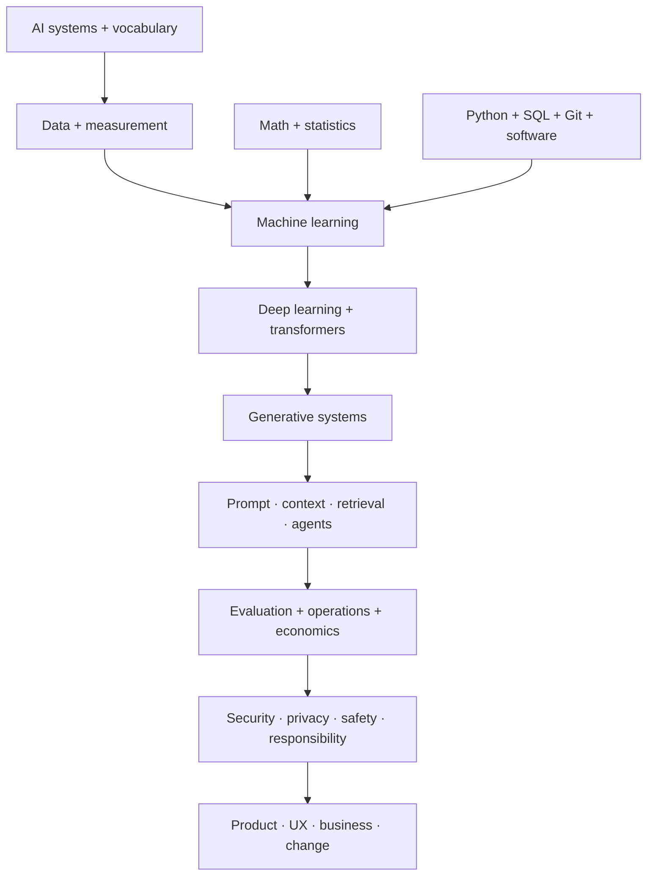

# Foundations Hub

The goal is not equal depth for every learner. It is a shared language that lets technical and nontechnical specialists make sound decisions together.

## Modules

| # | Module | Central question |
|---:|---|---|
| 1 | [[01 AI Systems and Vocabulary]] | What is the system actually doing? |
| 2 | [[02 Math and Statistics for AI]] | How do we represent uncertainty and learning? |
| 3 | [[03 Python SQL Git and Software Foundations]] | How do technical teams express, connect, and control work? |
| 4 | [[04 Data Foundations]] | Is the evidence fit for the purpose? |
| 5 | [[05 Machine Learning]] | How does a model learn and generalize? |
| 6 | [[06 Deep Learning]] | How do neural networks learn representations? |
| 7 | [[07 Transformers and Foundation Models]] | Why do modern foundation models behave as they do? |
| 8 | [[08 Generative AI Systems]] | How are text, images, audio, video, and code generated? |
| 9 | [[09 Prompt Context and Tool Use]] | How do instructions, information, and tools shape behavior? |
| 10 | [[10 RAG and Knowledge Systems]] | How do systems retrieve and ground organizational knowledge? |
| 11 | [[11 Agents and Automation]] | How can a model plan and act safely across steps? |
| 12 | [[12 Evaluation Testing and Observability]] | How do we know it works, for whom, and under what conditions? |
| 13 | [[13 Deployment MLOps and Economics]] | How do we operate it reliably and affordably? |
| 14 | [[14 Security Privacy Safety and Responsible AI]] | How do we control harms and preserve trust? |
| 15 | [[15 Product UX Business and Change]] | How does capability become a useful, adopted outcome? |

## Depth by pathway

| Pathway | Required depth |
|---|---|
| Research and engineering | Deep in 2–14; working fluency in 15 |
| Product, program, strategy | Deep in 1, 4, 8–15; conceptual + challenge questions for 2, 3, 5–7 |
| UX and creative | Deep in 1, 8, 9, 12, 14, 15; role-appropriate fluency elsewhere |
| Governance, policy, assurance | Deep in 1, 4, 12–15; enough technical depth to trace evidence and challenge claims |
| Human data and knowledge operations | Deep in 1, 4, 8–12, 14; tool-appropriate fluency in 3 |
| Customer-facing and education | Broad fluency across all; deeper in the products, architecture, and domain served |

## Assessment

Each module contains a closed-note quiz, answer explanations, and flashcards. Start with [[Foundations Pretest]], then use [[Foundations Final Check]] after the required modules for your pathway. Builders should then walk [[Technical Skills Hub]] and two cases in [[Technical Studio]] before a role track.

> [!tip] Explain at two altitudes
> For every concept, practice a precise practitioner explanation and a plain-language stakeholder explanation. AI work frequently fails at the boundary between those audiences.
