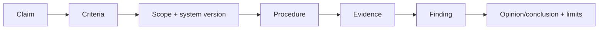

# AI Assurance Evidence

Assurance asks whether evidence supports a claim against stated criteria with appropriate independence and scope.

## Evidence chain

Claims such as “fair,” “secure,” “accurate,” or “responsible” are too broad until constructs, population, period, thresholds, controls, and criteria are named.

## Evidence quality

Seek sufficiency and appropriateness: relevance, reliability, completeness, provenance, reproducibility, timing, and independence. Strong evidence can include direct observation, reperformance, controlled test, immutable operational records, sampled records with defensible selection, and corroborated third-party evidence. A self-attestation may be useful but is weaker for independent assurance.

## AI complications

Version combinations are complex; behavior is probabilistic; evaluation sets can be contaminated; provider evidence may be limited; systems drift; human workflow affects outcome; and a narrow benchmark can be mistaken for a broad claim. Preserve exact scope and exceptions.

## Quiz

1. Why is “the model is safe” unauditable? 2. What are sufficiency and appropriateness? 3. Why reperform a control? 4. What must identify the system under review?

> [!success]- Answers
> 1. No defined hazard, context, population, period, criteria, or threshold. 2. Amount/coverage and quality/relevance/reliability of evidence. 3. To independently test whether evidence and result can be reproduced. 4. Model, data, prompt, retrieval, tools, code, configuration, environment, and time period as applicable.

## Flashcards

Assurance claim:: A specific assertion evaluated against explicit criteria.

Reperformance:: Independently executing a procedure to verify result and evidence.

Scope limitation:: A boundary or missing evidence that restricts the conclusion.

Source: [GAO AI Accountability Framework](https://www.gao.gov/products/gao-21-519sp), verified 2026-08-12.
