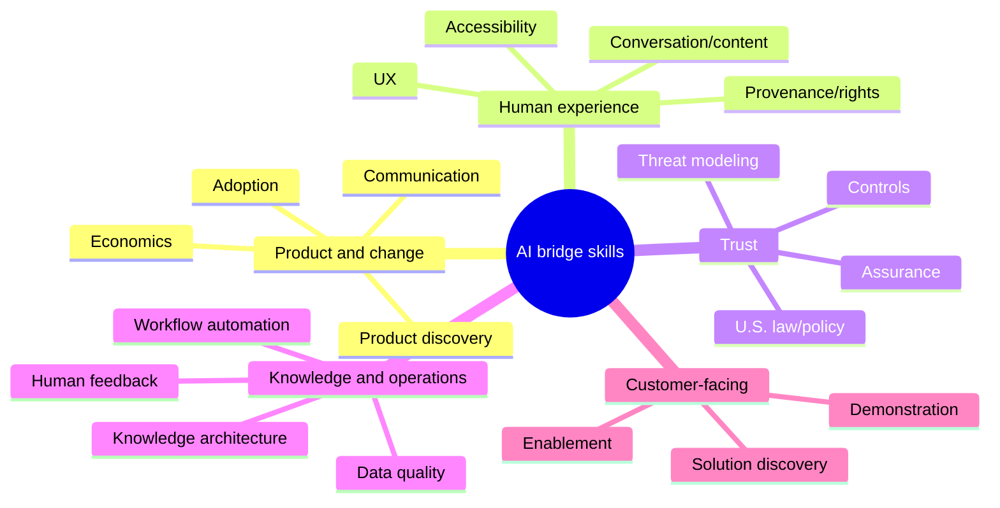

# Core Skills Hub

Bridge skills connect universal foundations to daily role work. Complete the bridge recommended in [[Learning Path Builder]], then add only what your target postings demand.

## Product, decision, and change

- [[AI Product Discovery and Delivery]]
- [[AI Economics and FinOps]]
- [[AI Adoption and Change]]
- [[Communicating AI Decisions]]

## Human experience and creative operations

- [[AI Interaction and UX]]
- [[Conversation and Content Design]]
- [[AI Accessibility]]
- [[Creative AI Provenance and Rights]]

## Trust, policy, and assurance

- [[US AI Law and Policy Orientation]]
- [[AI Risk and Control Design]]
- [[AI Assurance Evidence]]
- [[AI Threat Modeling]]

## Data, knowledge, and human operations

- [[Data Quality and Annotation]]
- [[Knowledge Architecture]]
- [[Workflow Analysis and Automation]]
- [[Human Feedback Operations]]

## Customer-facing delivery

- [[AI Solution Discovery]]
- [[AI Demonstration and Enablement]]

> [!tip] T-shaped depth
> Build broad enough understanding to collaborate across the lifecycle and deep enough skill to own one outcome. Collecting shallow familiarity with every tool is not a substitute for role depth. Technical builders should add [[Technical Studio]] after the builder foundation modules; those cases practice the judgment these bridge notes describe.
