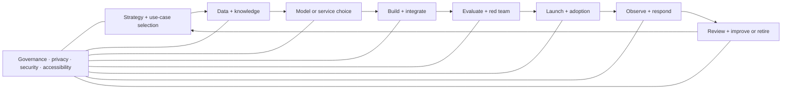

# AI System Lifecycle Map

AI work is cross-functional. The arrows are feedback loops, not a one-way assembly line.

| Lifecycle work | Roles that often lead | Roles that must contribute |
|---|---|---|
| strategy and problem framing | [[Chief AI Officer and Head of AI]], [[AI Product Manager]], [[AI Strategy Consultant]], [[AI Business Analyst]] | domain experts, UX, governance, engineering |
| data and knowledge | [[ML Data Engineer]], [[RAG and Knowledge Engineer]], [[AI Data Operations Manager]] | privacy, ontology, domain experts, evaluation |
| model/service research and selection | [[Applied Scientist]], [[AI ML Research Scientist]], [[AI Engineer]] | product, security, finance, governance |
| application and workflow delivery | [[AI Engineer]], [[ML Engineer]], [[AI Automation Specialist]] | UX, platform, evaluation, product |
| evaluation and adversarial testing | [[AI Evaluation Engineer]], [[AI Red Teamer]] | domain experts, UX research, responsible AI, security |
| deployment and reliability | [[MLOps Engineer]], [[AI Platform Engineer]], [[Inference and Performance Engineer]] | application engineering, security, FinOps |
| adoption and customer outcomes | [[AI Transformation Lead]], [[AI Customer Success Manager]], [[AI Trainer and Educator]] | product, UX, support, governance |
| market, revenue, and partner execution | [[AI Product Marketing Manager]], [[AI Enterprise Account Executive]], [[AI Strategic Partnerships Manager]] | product, sales engineering, solutions, legal, finance, customer success |
| monitoring, incidents, abuse, and change | platform/operations + product owner | [[AI Technical Support and User Operations Specialist]], [[AI Trust and Safety Operations Specialist]], evaluation, security, legal/privacy, domain owner |
| governance and assurance | [[AI Governance Specialist]], [[Model Risk Manager]], [[AI Auditor and Assurance Specialist]] | every accountable system owner |
| retirement and records | product/system owner + governance | data, platform, security, legal, knowledge management |

> [!important] Ownership rule
> “The model did it” is not an ownership model. Every deployed system needs named human owners for purpose, data, technical operation, risk acceptance, incident response, and retirement.

## NIST frame

The NIST AI Risk Management Framework organizes risk work through **Govern, Map, Measure, and Manage**, designed to operate across the lifecycle. The framework is voluntary and AI RMF 1.0 was under revision as of August 12, 2026. Use the current [NIST AI RMF page](https://www.nist.gov/itl/ai-risk-management-framework) and [AI Resource Center](https://airc.nist.gov/), verified 2026-08-12.
