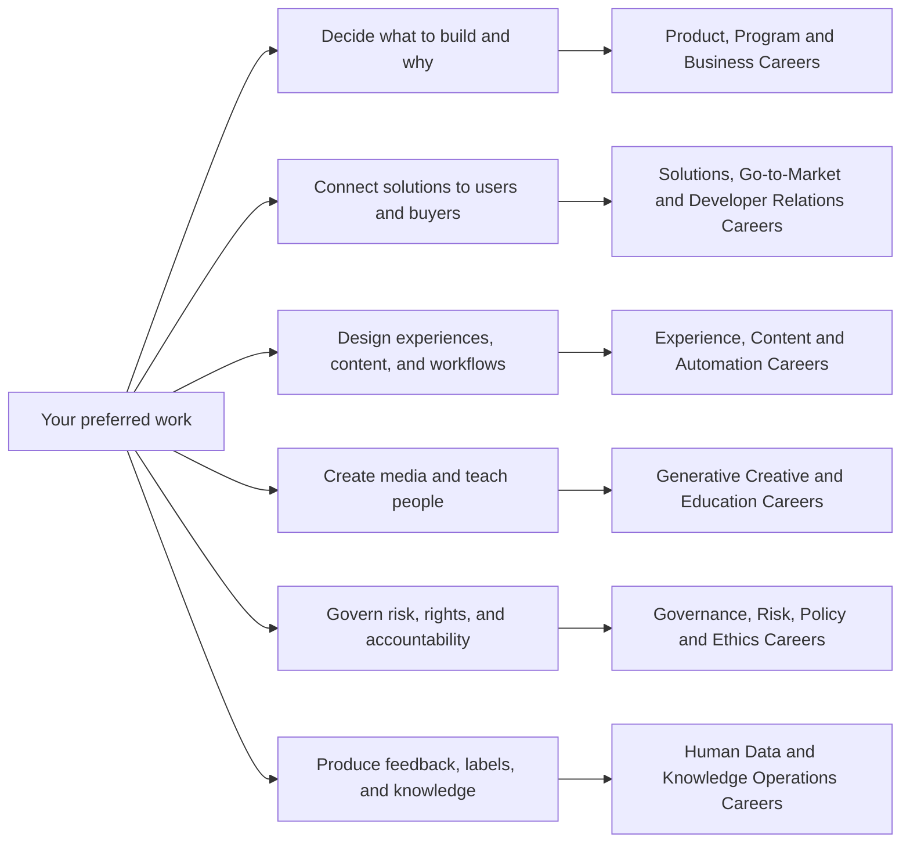

# Nontechnical and Hybrid AI Career Map

> [!abstract] What this map covers
> These careers make AI useful, usable, governable, sellable, teachable, creative, or trainable. “Nontechnical” does **not** mean “no technical literacy”: every role must understand model limits, evaluation, data handling, human oversight, and the business or social context of use.

## Choose by the work you want to own

## Family guide

| Family | Central question | Representative roles | Typical proof of skill |
|---|---|---|---|
| [[Product, Program and Business Careers]] | What outcome should AI produce, for whom, and how will we deliver it? | Product, program, analysis, strategy, transformation, AI executive leadership | Product brief, evaluation plan, roadmap, operating model, portfolio decision |
| [[Solutions, Go-to-Market and Developer Relations Careers]] | How can a market, customer, partner, or developer succeed with the technology? | Product marketing, enterprise sales, partnerships, architecture, sales engineering, success, support, DevRel | Positioning, account plan, partner model, demo, reference design, adoption/support plan, tutorial |
| [[Experience, Content and Automation Careers]] | How should humans interact with the system and its output? | UX, research, conversation, content, context, automation | Prototype, research report, dialogue spec, tested workflow |
| [[Generative Creative and Education Careers]] | How do we create responsibly and help others learn? | Creative direction, image, video, audio, training | Campaign system, provenance log, edited media, curriculum |
| [[Governance, Risk, Policy and Ethics Careers]] | What may the system do, under which controls, with what evidence—and how is live abuse handled? | Governance, responsible AI, trust and safety operations, policy, privacy, risk, audit, ethics | Inventory, impact assessment, case/incident record, control matrix, audit workpapers |
| [[Human Data and Knowledge Operations Careers]] | What human judgment and organized knowledge make the system reliable? | Recruiting, annotation, human feedback, data ops, taxonomy, KM | Rubric, gold set, QA report, taxonomy, governed knowledge base |

## Technical-depth legend

- **Low-code:** understands AI behavior and evidence; usually no production coding.
- **Hybrid:** can inspect APIs, data structures, evaluations, or automation logic and collaborate with engineers.
- **Technical-hybrid:** regularly prototypes, debugs integrations, or reads code, but is not primarily an ML model builder.

> [!warning] Titles are not a controlled vocabulary
> Employers combine and rename these jobs. Search by outcomes and artifacts as well as titles. For example, “Responsible AI,” “AI governance,” “model risk,” and “AI assurance” overlap but answer different accountability questions. The role notes state their boundaries explicitly.

## Universal readiness test

Before claiming job readiness in any family, be able to:

1. Explain the use case, affected people, expected benefit, and credible failure modes.
2. Separate a persuasive demo from evidence that a system works under realistic conditions.
3. Create a small evaluation set with acceptance thresholds and a human escalation path.
4. Trace what data enters a tool, where it may go, and what may not be shared.
5. Document limitations, decisions, versions, and ownership.
6. Present one portfolio artifact and defend the tradeoffs behind it.

## U.S. research baseline

- NIST describes the AI RMF as voluntary, use-case-agnostic guidance organized around **Govern, Map, Measure, and Manage**. NIST states that AI RMF 1.0 is being revised; therefore, practitioners should verify the current version before formal adoption.
- NIST’s Generative AI Profile adds GenAI-specific risk actions, while the NIST AI Resource Center provides implementation and evaluation resources.
- U.S. obligations are sectoral and state/local as well as federal. A responsible practitioner maintains a jurisdiction-and-effective-date register instead of asserting that one framework equals compliance.
- O*NET occupations are useful career analogs, not proof that every AI-prefixed title is a standardized occupation.

## Sources

All sources were checked **2026-08-12**.

- [NIST — AI Risk Management Framework](https://www.nist.gov/itl/ai-risk-management-framework) — current-status page; notes the 2026 revision work.
- [NIST — Generative AI Profile, NIST AI 600-1](https://doi.org/10.6028/NIST.AI.600-1) — GenAI risk-management profile.
- [NIST — AI Resource Center](https://airc.nist.gov/) — implementation and evaluation resources.
- [O*NET OnLine](https://www.onetonline.org/) — U.S. Department of Labor occupational descriptions and transferable-skill analogs.
- [White House — America’s AI Action Plan](https://www.whitehouse.gov/releases/2025/07/white-house-unveils-americas-ai-action-plan/) — current federal policy context; do not treat as a private-sector compliance checklist.
