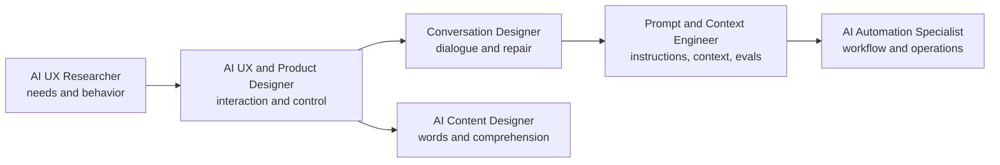

# Experience, Content and Automation Careers

These roles shape how people understand, control, and recover from probabilistic systems—and how work moves through them.

| Role | Optimizes | Typical evidence |
|---|---|---|
| [[AI UX and Product Designer]] | Whole human-AI interaction | Prototype with uncertainty, override, feedback, and recovery states |
| [[AI UX Researcher]] | Understanding of people and context | Research plan, moderated study, findings linked to decisions |
| [[Conversation Designer]] | Turns, voice, clarification, repair, escalation | Dialogue map and adversarial test transcript |
| [[AI Content Designer]] | Clarity, guidance, labels, error and consent language | Content system and comprehension test |
| [[Prompt and Context Engineer]] | Reproducible model behavior | Versioned prompt/context package and evaluation set |
| [[AI Automation Specialist]] | Reliable movement of work across systems | Diagram, workflow, test matrix, logs, runbook |

## Non-negotiables

- Design the human’s authority: review, edit, override, retry, escalate, and exit.
- Test with representative users and realistic failures—not only happy paths.
- Meet accessibility needs; WCAG 2.2 remains the practical baseline for web content and interaction.
- Treat prompts, retrieved context, tools, and output handling as one system.

## Sources

Checked **2026-08-12**.

- [NIST — Human Centered Design](https://www.nist.gov/itl/iad/human-centered-technologies/human-factors-human-centered-design).
- [W3C — WCAG 2.2 Overview](https://www.w3.org/WAI/standards-guidelines/wcag/).
- [NIST — AI RMF FAQs](https://www.nist.gov/itl/ai-risk-management-framework/ai-risk-management-framework-faqs) — trustworthiness across design, deployment, use, and evaluation.
