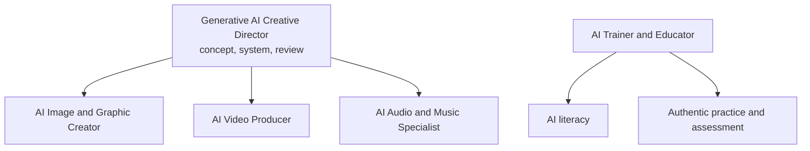

# Generative Creative and Education Careers

This family combines human direction, iterative generation, editing, provenance, rights management, and audience judgment.

> [!warning] Generation is not the finished craft
> Employers buy outcomes: a coherent visual system, edited sequence, intelligible mix, accurate lesson, licensed assets, provenance, and delivery to specification. Tool fluency without art direction, editing, or audience judgment is fragile.

| Role | Primary judgment | Signature proof |
|---|---|---|
| [[Generative AI Creative Director]] | Concept, brand, campaign system, review standard | Multi-channel campaign plus provenance/risk brief |
| [[AI Image and Graphic Creator]] | Composition, typography, retouching, consistency | Human-edited series with process log |
| [[AI Video Producer]] | Story, continuity, direction, edit, sound, delivery | Finished short with shot list and rights/disclosure log |
| [[AI Audio and Music Specialist]] | Performance, arrangement, sound, consent, mix | Edited audio package with stems and consent/licensing record |
| [[AI Trainer and Educator]] | Learning objectives, practice, feedback, transfer | Curriculum, quiz, facilitator guide, evaluation results |

## U.S. rights and disclosure baseline

- The U.S. Copyright Office says human-authored expressive elements may be protected, but merely providing prompts is not enough; document human selection, arrangement, and modification.
- Get permission for a person’s voice, face, or likeness and check applicable contract, publicity, platform, and state rules.
- YouTube requires disclosure for meaningfully altered or synthetic realistic content in specified circumstances.
- Content Credentials/C2PA-style provenance can add creation/edit context but does not itself prove truth, permission, or copyright ownership.

## Sources

Checked **2026-08-12**.

- [U.S. Copyright Office — Copyright and Artificial Intelligence](https://www.copyright.gov/ai/).
- [YouTube Help — altered or synthetic content](https://support.google.com/youtube/answer/14328491).
- [Adobe — Content Credentials in Firefly](https://helpx.adobe.com/firefly/web/get-started/learn-the-basics/content-credentials-overview.html).
