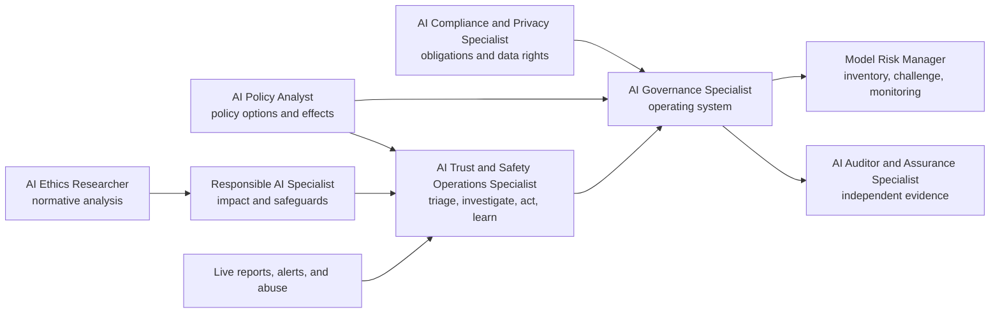

# Governance, Risk, Policy and Ethics Careers

These roles convert principles, laws, standards, risk appetite, and evidence into decisions and accountability.

## Boundary test

| Role | Question it answers |
|---|---|
| [[AI Governance Specialist]] | Who decides, through what process, with what evidence and escalation? |
| [[Responsible AI Specialist]] | Who may be helped or harmed, and what design/operational safeguards reduce that risk? |
| [[AI Policy Analyst]] | What policy option should an institution or government adopt, and with what effects? |
| [[AI Compliance and Privacy Specialist]] | What obligations apply to this data, use, entity, and jurisdiction—and what control demonstrates compliance? |
| [[Model Risk Manager]] | Is model risk identified, challenged, validated, monitored, and accepted by the right authority? |
| [[AI Auditor and Assurance Specialist]] | Does independent, sufficient evidence support the stated criteria? |
| [[AI Ethics Researcher]] | What values, rights, duties, and distributive consequences are in tension? |
| [[AI Trust and Safety Operations Specialist]] | What live abuse or safety risk is occurring, what authorized action is proportionate, and what must the system learn? |

> [!danger] Framework is not law; control is not evidence
> NIST AI RMF is voluntary. A policy document is not proof of operation. “Compliant with AI law” is not a meaningful claim until the practitioner identifies the jurisdiction, effective date, system/use, responsible entity, and actual requirement. These notes are education, not legal advice.

## U.S. watchlist at the cutoff

- **Federal:** sector-specific statutes and regulators remain central; EEOC employment-discrimination law and FTC consumer protection/privacy authority can apply to AI-enabled conduct.
- **State/local:** California’s 2025 CCPA regulations took effect January 1, 2026, with some cybersecurity-audit, risk-assessment submission, and ADMT compliance dates phased into 2027–2030; Illinois employment-AI provisions took effect January 1, 2026; NYC Local Law 144 regulates covered automated employment decision tools.
- **Colorado:** the Attorney General reports that the 2026 reenacted automated-decision law and chatbot provisions take effect January 1, 2027; treat them as upcoming, not current at this cutoff.
- **Banking:** the 2026 interagency model-risk guidance superseded SR 11-7 for covered banking organizations and explicitly says generative and agentic AI are outside its scope, while noting that governance practices should address out-of-scope tools.

## Sources

Checked **2026-08-12**.

- [NIST — AI RMF](https://www.nist.gov/itl/ai-risk-management-framework).
- [U.S. GAO — AI Accountability Framework](https://www.gao.gov/products/gao-21-519sp).
- [Federal Reserve — SR 26-2 Revised Guidance on Model Risk Management](https://www.federalreserve.gov/supervisionreg/srletters/SR2602.htm).
- [EEOC — Artificial Intelligence and the ADA](https://www.eeoc.gov/eeoc-disability-related-resources/artificial-intelligence-and-ada).
- [FTC — Privacy and Security](https://www.ftc.gov/business-guidance/privacy-security).
- [California Privacy Protection Agency — 2025 regulations](https://cppa.ca.gov/regulations/ccpa_updates.html).
- [Illinois General Assembly — Illinois Human Rights Act](https://www.ilga.gov/legislation/ILCS/details?ActID=2266&ActName=Illinois+Human+Rights+Act.&ChapAct=775%20ILCS%205/).
- [NYC DCWP — Automated Employment Decision Tools](https://www.nyc.gov/site/dca/about/automated-employment-decision-tools.page).
- [Colorado Attorney General — ADMT and chatbot rulemaking](https://coag.gov/ai/).
- [OpenAI — Analytics & Automation Lead, User Safety & Risk Operations](https://openai.com/careers/analytics-and-automation-lead-user-safety-and-risk-operations-san-francisco/) — current U.S. operational role evidence at the cutoff.
