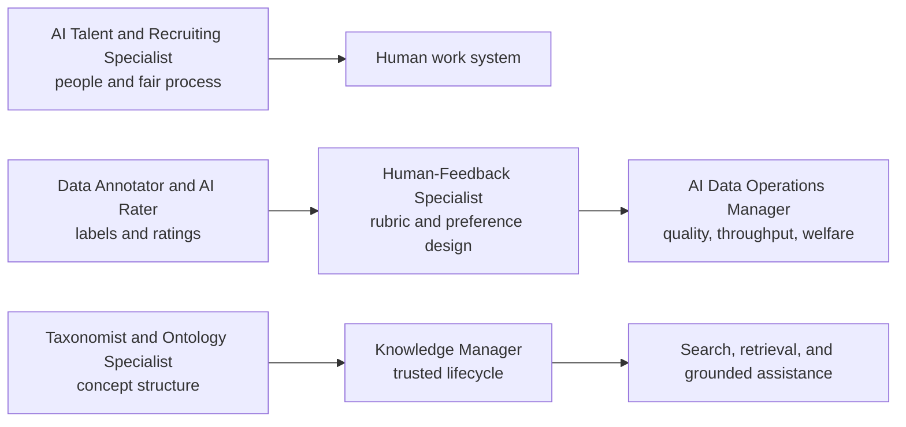

# Human Data and Knowledge Operations Careers

This family supplies the structured human judgment and organized information that make AI systems trainable, evaluable, retrievable, and maintainable.

| Role | Unit of responsibility | Signature artifact |
|---|---|---|
| [[AI Talent and Recruiting Specialist]] | Candidate/employee process and capability | Skills-based role profile, structured interview, tool-risk review |
| [[Data Annotator and AI Rater]] | One label/rating with rationale | Calibrated sample set and error analysis |
| [[Human-Feedback Specialist]] | Rubric, task, calibration, ambiguity | Annotation guide, gold set, agreement/quality report |
| [[AI Data Operations Manager]] | Production system and workforce | Capacity/quality dashboard, lineage, escalation and worker-welfare plan |
| [[Taxonomist and Ontology Specialist]] | Concepts, labels, relations, constraints | Governed taxonomy or ontology with validation report |
| [[Knowledge Manager]] | Trusted knowledge lifecycle | Source inventory, metadata model, permissions, freshness and retrieval test |

> [!warning] Human data is not “cheap ground truth”
> Labels are judgments under instructions. Quality depends on clear constructs, representative tasks, calibration, disagreement handling, privacy/security, domain expertise, and humane working conditions. Measure agreement where appropriate, but do not erase legitimate ambiguity.

## Sources

Checked **2026-08-12**.

- [W3C — SKOS Reference](https://www.w3.org/TR/skos-reference/) — concepts, labels, schemes, and semantic relations.
- [NIST — AI RMF](https://www.nist.gov/itl/ai-risk-management-framework) — data, human oversight, evaluation, and lifecycle risk.
- [EEOC — Artificial Intelligence and the ADA](https://www.eeoc.gov/eeoc-disability-related-resources/artificial-intelligence-and-ada).
- [U.S. Department of Labor — AI & Inclusive Hiring Framework announcement](https://www.dol.gov/newsroom/releases/odep/odep20240924).
- [NYC DCWP — Automated Employment Decision Tools](https://www.nyc.gov/site/dca/about/automated-employment-decision-tools.page).
