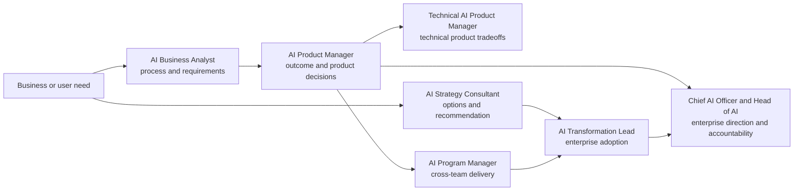

# Product, Program and Business Careers

This family translates needs into outcomes, portfolios, operating changes, and evidence. The roles share business judgment but differ in what they own.

| Role | Owns | Does not primarily own |
|---|---|---|
| [[AI Product Manager]] | User outcome, product direction, prioritization, success evidence | Project administration or model implementation |
| [[Technical AI Product Manager]] | Product outcome plus API/data/evaluation tradeoffs | Core model research |
| [[AI Program Manager]] | Dependencies, risks, governance gates, delivery across workstreams | Product-market decision rights |
| [[AI Business Analyst]] | Current state, requirements, process measures, acceptance criteria | Enterprise strategy or technical architecture |
| [[AI Strategy Consultant]] | Fact-based recommendation and value/risk case | Long-term internal adoption ownership |
| [[AI Transformation Lead]] | Operating model, adoption portfolio, capability and change | A single feature backlog |
| [[Chief AI Officer and Head of AI]] | Enterprise direction, portfolio, authority, capability, investment, and accountability | Every product/system decision or independent assurance |

## Entry routes

- Operations or domain expert → [[AI Business Analyst]] → product/program/transformation.
- Product manager → [[AI Product Manager]] → [[Technical AI Product Manager]].
- Project/program leader → [[AI Program Manager]] → [[AI Transformation Lead]].
- Analyst/consultant → [[AI Strategy Consultant]] → transformation leadership.
- Product, program, transformation, governance/risk, technology/data, or domain executive leadership → [[Chief AI Officer and Head of AI]]. This is not an entry-level destination.

## Shared evidence

Build a use-case brief, stakeholder map, baseline, evaluation plan, risk register, decision log, and adoption measurement plan. The strongest portfolio shows a rejected option and why it was rejected—not just a polished demo.

## Sources

Checked **2026-08-12**.

- [O*NET — Management Analysts](https://www.onetonline.org/link/summary/13-1111.00) — U.S. occupational analog for analysis and consulting; updated 2026.
- [NIST — AI RMF 1.0](https://doi.org/10.6028/NIST.AI.100-1) — lifecycle risk and accountability vocabulary.
- [NIST — Human-Centered AI](https://www.nist.gov/programs-projects/human-centered-ai) — context-of-use and human-centered evaluation.
- [OMB — M-25-21](https://www.whitehouse.gov/wp-content/uploads/2025/02/M-25-21-Accelerating-Federal-Use-of-AI-through-Innovation-Governance-and-Public-Trust.pdf) — formal U.S. federal CAIO authority and duties; private-sector titles vary.
