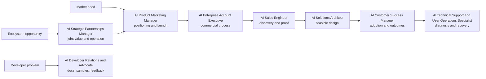

# Solutions, Go-to-Market and Developer Relations Careers

This family makes technical capability understandable, adoptable, and valuable to customers or developers.

| Role | Primary audience | Signature artifact |
|---|---|---|
| [[AI Solutions Architect]] | Customer engineering and architecture | Reference architecture and evaluation/security plan |
| [[AI Sales Engineer]] | Buyer, evaluator, procurement team | Discovery-backed demo and proof-of-value plan |
| [[AI Customer Success Manager]] | Deployed customer and executives | Adoption/outcome plan with risk escalation |
| [[AI Developer Relations and Advocate]] | Developers and product teams | Runnable sample, tutorial, talk, feedback synthesis |
| [[AI Product Marketing Manager]] | Defined market segments, field, and partners | Positioning brief, claims matrix, launch and enablement system |
| [[AI Enterprise Account Executive]] | Enterprise buying group and executives | Account plan, mutual action plan, commercial decision and handoff |
| [[AI Strategic Partnerships Manager]] | Ecosystem counterpart and internal partner teams | Partner thesis, joint operating model, scorecard, renewal/exit decision |
| [[AI Technical Support and User Operations Specialist]] | Users, developers, deployed customers, and responders | Reproduction, case/escalation record, knowledge and incident improvement |

> [!tip] Portfolio rule
> A generic chatbot is weak evidence. Show one audience, one real workflow, explicit success criteria, failure handling, data boundaries, and a clear handoff.

## Sources

Checked **2026-08-12**.

- [O*NET — Sales Engineers](https://www.onetonline.org/link/summary/41-9031.00) — transferable U.S. occupation analog.
- [NIST — AI Resource Center](https://airc.nist.gov/) — AI evaluation and risk resources.
- [OpenAI — API documentation](https://developers.openai.com/api/docs/) — an example of the official documentation surface these roles must learn to navigate; vendor-specific features change quickly.
- [O*NET — Computer User Support Specialists](https://www.onetonline.org/link/summary/15-1232.00) — U.S. occupational support analog, updated 2026.
- [FTC — Advertising and Marketing](https://www.ftc.gov/business-guidance/advertising-marketing) — official U.S. truth-in-advertising and claim-evidence baseline.
- [NIST — AI RMF Core](https://airc.nist.gov/airmf-resources/airmf/5-sec-core/) — lifecycle, third-party, monitoring, response, and accountability vocabulary.
