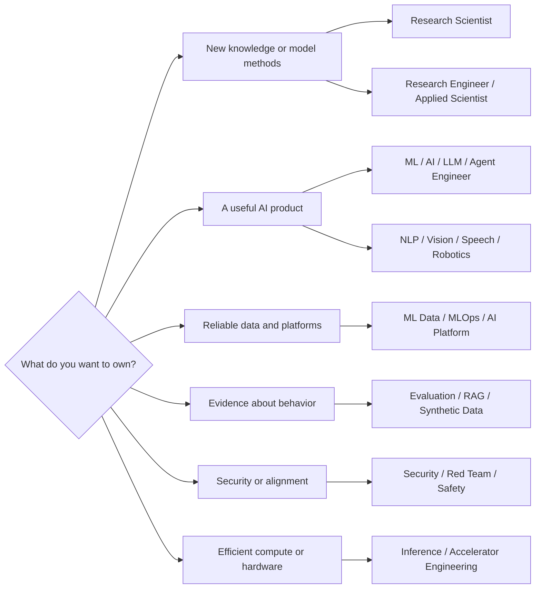
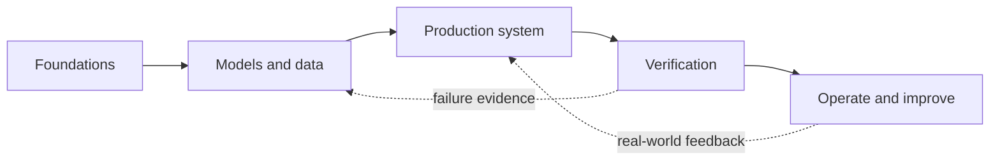

# Technical AI careers

> [!abstract] Outcome
> Use this map to choose a U.S. technical AI role by the work you want to own, then open the linked track for a study sequence, assessment, interview preparation, and portfolio projects. Titles are not standardized; verify the responsibilities in every job posting.

## Choose by the artifact you want to own

## Role atlas

### Research and applied science

| Track | Primary output | Strongest signal |
|---|---|---|
| [[AI ML Research Scientist]] | Novel methods and defensible empirical findings | Research record and experimental rigor |
| [[Research Engineer]] | Research ideas converted into fast, reliable experiments | Excellent ML implementation and systems judgment |
| [[Applied Scientist]] | Scientifically justified models that improve a real metric | Modeling depth plus product experimentation |

### Model and product engineering

| Track | Primary output | Strongest signal |
|---|---|---|
| [[ML Engineer]] | Trained models and production prediction systems | End-to-end ML lifecycle delivery |
| [[AI Engineer]] | AI-enabled product behavior, often using foundation models | Software engineering plus evaluation discipline |
| [[LLM Engineer]] | LLM applications, adaptation, serving, and quality loops | Retrieval, prompting, fine-tuning, evals, and reliability |
| [[Agentic AI Engineer]] | Tool-using systems that complete multi-step work safely | Orchestration, state, permissions, tracing, and agent evals |

### Modality specialists

| Track | Primary output | Strongest signal |
|---|---|---|
| [[NLP Engineer]] | Language understanding or generation systems | Linguistic/data insight plus modern transformer practice |
| [[Computer Vision Engineer]] | Image and video perception systems | Dataset, geometry, model, and deployment competence |
| [[Speech AI Engineer]] | ASR, TTS, speaker, or audio-language systems | Signal processing plus sequence modeling and streaming |
| [[Robotics and Embodied AI Engineer]] | Perception-to-action behavior in physical systems | Robotics integration, controls, simulation, and safety |

### Data, operations, and platform

| Track | Primary output | Strongest signal |
|---|---|---|
| [[Data Scientist - AI ML]] | Decision insight and validated predictive analysis | Statistics, causal/experimental reasoning, communication |
| [[ML Data Engineer]] | Reproducible, governed, model-ready data | Distributed data systems and data quality |
| [[MLOps Engineer]] | Repeatable training, release, monitoring, and rollback | CI/CD, model lifecycle, observability, reliability |
| [[AI Platform Engineer]] | Paved roads for many AI teams | Multi-tenant infrastructure, APIs, security, developer experience |

### Quality, knowledge, and data generation

| Track | Primary output | Strongest signal |
|---|---|---|
| [[AI Evaluation Engineer]] | Reproducible evidence about capability, quality, and risk | Measurement design, graders, statistics, and test systems |
| [[RAG and Knowledge Engineer]] | Traceable answers grounded in governed knowledge | Information retrieval, ingestion, ranking, citations, evals |
| [[Synthetic Data Engineer]] | Fit-for-purpose generated datasets with measured utility and risk | Data generation, filtering, provenance, privacy, evaluation |

### Security, safety, and assurance

| Track | Primary output | Strongest signal |
|---|---|---|
| [[AI Security Engineer]] | Preventive and detective controls across the AI lifecycle | AppSec/cloud security plus AI-specific threat modeling |
| [[AI Red Teamer]] | Authorized adversarial findings with reproducible evidence | Creative testing, safe handling, and actionable reporting |
| [[AI Safety and Alignment Researcher]] | Evidence and interventions for intended, safe model behavior | Research rigor across alignment, oversight, and evaluations |

### Performance and hardware

| Track | Primary output | Strongest signal |
|---|---|---|
| [[Inference and Performance Engineer]] | Lower latency/cost and higher throughput without unacceptable quality loss | Profiling, compilers, kernels, serving, benchmarking |
| [[AI Hardware and Accelerator Engineer]] | Architecture, RTL, kernels, or co-design that improves AI compute | Computer architecture, digital design, and workload analysis |

## A shared technical spine

> [!tip] Study the work, not just the syllabus
> Open [[Technical Role Deep Dive Framework]] before a role note. Every technical track now includes a work anatomy: the operating loop, owned artifacts, decision tradeoffs, metrics, interfaces, failure modes, and research anchors. Use it to turn a title into a testable understanding of the job. Learn the shared jargon in [[Technical Skills Hub]], then rehearse decisions in [[Technical Studio]] before you treat the track as interview-ready.

> [!info] Current Microsoft delivery path
> For platform, MLOps, agent, and evaluation roles, pair the role profile with [[Microsoft Azure DevOps and Foundry]] and [[Case - Azure DevOps Foundry Release Gate]]. The case turns the role anatomy into a release decision: WIF, identities, evaluation gates, environments, Toolboxes, traces, and rollback.

Every track benefits from the following sequence, with depth adjusted by role:

1. **Programming and systems:** Python, Git, Linux, testing, APIs, SQL; add C++ for robotics, performance, hardware, or low-level roles.
2. **Mathematical reasoning:** probability, statistics, linear algebra, optimization, experimental design.
3. **ML fundamentals:** supervised/unsupervised learning, deep learning, data splits, leakage, calibration, error analysis.
4. **Production discipline:** data/version lineage, reproducibility, observability, privacy, threat modeling, rollback.
5. **Modern AI systems:** transformers, embeddings, retrieval, tool use, post-training, evaluation, cost and latency.
6. **Evidence:** a portfolio artifact with a written problem definition, baseline, methodology, limitations, and reproducible results.

> [!warning] A notebook is not an end-to-end portfolio
> Hiring evidence becomes stronger when another person can reproduce it, inspect the data and model lineage, run tests, understand tradeoffs, and see how failure is detected and handled.

## How levels usually differ

| Level | Expected scope | Typical evidence |
|---|---|---|
| Explorer / intern | Bounded tasks with guidance | Correct small projects and clear learning notes |
| Entry / associate | Own a component and its tests | Reproducible project with sound baseline and analysis |
| Mid-level | Own an end-to-end subsystem | Production-minded design, metrics, incidents, tradeoffs |
| Senior | Define ambiguous problems and lead cross-team delivery | Architecture and measurable impact across a system |
| Staff / principal | Set technical direction across systems or research programs | Durable platforms, methods, standards, or research influence |

The ladder is a learning model, not a universal employer leveling scheme. Frontier research titles may require graduate-level research evidence; engineering employers may substitute demonstrated impact for a particular degree.

## Four portfolio rules

- Report **baselines**, not only the final score.
- Separate **development data** from truly held-out tests; document contamination risks.
- Measure operational constraints such as latency, throughput, cost proxy, security boundaries, or recovery behavior when relevant.
- Publish a short **model/system card** describing intended use, exclusions, limitations, provenance, and evaluation conditions.

## U.S. occupational context

Most specialized AI titles do not have their own Standard Occupational Classification. Depending on duties, postings often map approximately to computer and information research scientists, software developers, data scientists, information security analysts, computer hardware engineers, or robotics engineers. That mapping is imperfect; use duties and required evidence—not a title—to compare roles.

> [!info] Education is role-dependent
> The U.S. Bureau of Labor Statistics describes a master's degree as typical for computer and information research scientists and a bachelor's degree as typical for data scientists. Individual AI employers vary widely. Publications or equivalent research evidence matter most for scientist roles; deployable systems and engineering depth can matter more for engineering roles.

## Source and update policy

This family was verified **2026-08-12**. Fast-moving employer-title and tooling claims should be checked quarterly. Foundational material should be reviewed annually. Job postings are snapshots, not promises about every employer.

- [BLS — Computer and Information Research Scientists](https://www.bls.gov/ooh/computer-and-information-technology/computer-and-information-research-scientists.htm) — duties and U.S. education context; page modified 2025-04-18, accessed 2026-08-12.
- [BLS — Data Scientists](https://www.bls.gov/ooh/math/data-scientists.htm) — duties and U.S. education context; accessed 2026-08-12.
- [O*NET — Robotics Engineers, 17-2199.08](https://www.onetonline.org/link/details/17-2199.08) — updated 2026; accessed 2026-08-12.
- [NIST AI Risk Management Framework 1.0](https://nvlpubs.nist.gov/nistpubs/ai/NIST.AI.100-1.pdf) — lifecycle risk vocabulary; published 2023-01, accessed 2026-08-12.
- [NIST AI RMF Generative AI Profile, NIST AI 600-1](https://doi.org/10.6028/NIST.AI.600-1) — generative-AI risks and actions; published 2024-07-26, page updated 2026-04-08, accessed 2026-08-12.
- [OpenAI careers search](https://openai.com/careers/search/) and [Anthropic jobs](https://www.anthropic.com/careers/jobs) — live evidence of overlapping U.S. research, evaluation, security, systems, and performance titles; accessed 2026-08-12.
