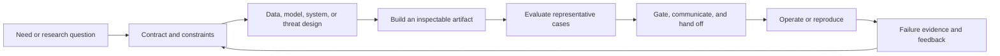

# Technical role deep-dive framework

> [!abstract] The goal
> A job title is a label. A role is a system of ownership: a recurring problem, a boundary, inputs, decisions, artifacts, metrics, and handoffs. Use this framework with any note in [[Technical AI Careers]] to understand what the person actually does and what evidence would prove competence.

## Read every role as an operating system

For each technical role, answer these eight questions in your own words:

1. **What outcome does the role own?** State the user, system, or research outcome—not a tool name.
2. **Where is the boundary?** Identify what enters the role, what leaves it, and what remains owned by adjacent teams.
3. **What repeats every week?** Describe the loop from request or signal to artifact, review, deployment, and feedback.
4. **What decisions require judgment?** Name the tradeoffs that cannot be solved by following a tutorial.
5. **What artifacts survive the work?** Examples include a model, dataset, benchmark, runbook, architecture decision record, threat model, or paper.
6. **How is quality measured?** Include task quality and operational constraints such as latency, cost, reliability, safety, privacy, or reproducibility.
7. **Who receives the handoff?** A role is understood when you can explain its interfaces with product, research, data, platform, security, domain, and operations partners.
8. **What would disprove success?** List failure modes, not only happy-path metrics.

## The technical role loop

The loop changes shape by role. A research scientist may spend more time in hypothesis and experiment; an inference engineer may spend more time in profiling and capacity tests; a security engineer may spend more time in threat modeling, controls, and incident response. The common thread is an explicit contract, inspectable evidence, and a feedback loop.

## Build an evidence map

Use the table below when studying a note or evaluating a portfolio project.

| Dimension | Weak evidence | Strong evidence |
|---|---|---|
| Problem framing | “I built a chatbot/model.” | A bounded user or system problem with exclusions, assumptions, and a success contract. |
| Technical work | A notebook or copied tutorial | Versioned code, tests, data/model lineage, reproducible commands, and a design explanation. |
| Measurement | One impressive score or demo | Baseline, held-out cases, slices, uncertainty or variance, and an error taxonomy. |
| Operations | “It runs locally.” | Deployment shape, observability, capacity/cost proxy, rollback or recovery behavior. |
| Safety and security | A generic disclaimer | Threat model, permissions, data handling, misuse cases, and tested mitigations. |
| Communication | Tool list | A short decision memo that explains tradeoffs, limitations, and what should happen next. |

## Metrics are part of the role

Do not treat metrics as a final reporting step. A useful role study separates:

- **Outcome metrics:** Did the user, model, research program, or physical system achieve the intended result?
- **Quality metrics:** How correct, relevant, calibrated, robust, or useful was the result?
- **Operational metrics:** What were latency, throughput, availability, cost, energy, or recovery characteristics?
- **Risk metrics:** What unsafe, insecure, biased, privacy-sensitive, or policy-sensitive behaviors occurred?
- **Process metrics:** Could another person reproduce the result, inspect the evidence, and understand the decision?

When a role note lists a metric, ask what distribution it summarizes, what slice it hides, and what action follows when it moves. A metric without a decision rule is decoration.

## How to study one role in practice

1. Read the mission, title reality, and work anatomy without opening the tool list.
2. Draw the role boundary: upstream inputs on the left, owned artifacts in the center, downstream consumers on the right.
3. Explain the operating loop aloud using one concrete domain example.
4. Work through the study sequence and keep a discrepancy ledger: assumption, evidence, result, limitation, next test.
5. Build the beginner project, but write the artifact as if another team must review or operate it.
6. Use the quiz and flashcards only after you can explain the tradeoffs and failure modes.
7. Compare the role with its boundary notes. If the distinction is still fuzzy, read two adjacent roles and rewrite the boundary in your own words.
8. Finish with a portfolio review: baseline, evidence, operational constraints, safety/security, and a decision memo.

## Research triangulation used in this vault

The role notes combine four kinds of evidence:

1. **U.S. occupational anchors:** BLS and O*NET describe durable duties, work activities, skills, and education for neighboring occupations. They are useful context, not a one-to-one dictionary for fast-moving AI titles.
2. **Current employer postings:** official postings show how organizations currently bundle research, engineering, evaluation, security, product, and operational ownership. A posting is a dated snapshot, not a universal rule.
3. **Primary technical documentation:** project and vendor documentation defines the artifacts, interfaces, and constraints practitioners actually work with.
4. **Risk and measurement guidance:** NIST, CISA, OWASP, and related sources provide shared language for evaluation, secure development, privacy, safety, and operational risk.

> [!warning] Do not over-read a title
> “AI engineer,” “research engineer,” “ML engineer,” and “applied scientist” can overlap heavily. Compare the responsibility verbs, owned artifacts, decision rights, and evaluation expectations in the posting. The notes intentionally preserve overlap and make the boundary explicit.

## A role-understanding rubric

You understand a technical role at a useful level when you can:

- explain its owned outcome without naming a vendor;
- sketch its system or research boundary;
- name three recurring artifacts and who consumes them;
- choose two quality metrics and two operational or risk metrics;
- describe three failure modes and the control or experiment that detects each;
- explain one tradeoff with a concrete example;
- distinguish the role from two adjacent roles;
- show a reproducible artifact and defend its limitations.

## Primary sources

- [BLS — Software Developers, Quality Assurance Analysts, and Testers](https://www.bls.gov/ooh/computer-and-information-technology/software-developers.htm) — software-system duties and U.S. occupational context; accessed 2026-08-12.
- [BLS — Computer and Information Research Scientists](https://www.bls.gov/ooh/computer-and-information-technology/computer-and-information-research-scientists.htm) — experiment, analysis, collaboration, and research-output context; accessed 2026-08-12.
- [BLS — Data Scientists](https://www.bls.gov/ooh/math/data-scientists.htm) — modeling, analysis, communication, and U.S. occupational context; accessed 2026-08-12.
- [O*NET — Robotics Engineers, 17-2199.08](https://www.onetonline.org/link/details/17-2199.08) — current robotics tasks, titles, and software-skill signals; updated 2026, accessed 2026-08-12.
- [NIST AI Risk Management Framework](https://nvlpubs.nist.gov/nistpubs/ai/NIST.AI.100-1.pdf) — Govern, Map, Measure, and Manage vocabulary; accessed 2026-08-12.
- [NIST AI RMF Generative AI Profile](https://doi.org/10.6028/NIST.AI.600-1) — generative-AI risk and lifecycle actions; page updated 2026-04-08, accessed 2026-08-12.
- [NIST AI TEVV](https://www.nist.gov/ai-test-evaluation-validation-and-verification-tevv) — evaluation, testing, validation, and verification context; accessed 2026-08-12.
- [NIST SP 800-218A](https://doi.org/10.6028/NIST.SP.800-218A) — secure software practices for generative AI and dual-use foundation models; accessed 2026-08-12.
- [OpenAI — Research Engineer, Frontier Evals and Environments](https://openai.com/careers/research-engineer-frontier-evals-and-environments-san-francisco/) — current evidence of environments, graders, measurement reliability, continuous evaluation, and cross-functional research engineering; accessed 2026-08-12.
