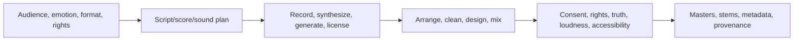

# AI Audio and Music Specialist

> [!abstract] Mission
> Create, edit, and deliver intentional audio or music with strong listening craft, consent and rights discipline, transparent synthetic-voice practice, and production-quality sound.

## Responsibilities

- Interpret narrative/emotional/brand brief and technical distribution specifications.
- Script, compose/arrange, record, direct performers, generate or transform sound, and design sonic identity.
- Edit timing/pitch/noise, arrange, layer, synthesize, mix, master, and create alternate/stem/caption/transcript deliverables.
- Obtain explicit voice/performance/music/sample licenses and consent; track source/model/version/transformation and usage scope.
- Prevent impersonation, deceptive attribution, unauthorized endorsement, and unsafe emotional manipulation.
- QC intelligibility, artifacts, phase, dynamics, frequency balance, loudness/peaks, sync, metadata, and playback contexts.

## Boundaries

- Music specialist may compose/produce; audio specialist may emphasize voice, podcast, dialogue cleanup, sound design, or accessibility. Portfolios should state the craft.
- Generation is one source layer; professional work includes recording, editing, arrangement, mixing, rights, and delivery.
- [[AI Video Producer]] integrates audio in picture; this role owns sound/music quality and rights depth.

## Levels

| Level | Scope | Evidence |
|---|---|---|
| Beginner | Short edited cue/voice piece | Clean edit, appropriate level, rights/source record |
| Specialist | Multi-layer deliverable and variants | Intentional arrangement/mix, consent/license, on-spec masters |
| Senior | Complex narrative/brand/interactive or synthetic voice | Direction, consistency, clearance, QA across platforms |
| Lead | Sonic system, roster/pipeline, governance | Distinctive craft and scalable ethical production |

## Prerequisites and competencies

- Critical listening, acoustics/signal basics, microphone/recording, DAW editing, timing/rhythm/harmony as relevant, synthesis/sound design, EQ/compression/dynamics, mixing/mastering, loudness and delivery formats.
- Generative literacy: text-to-speech/music/sound, voice conversion/cloning, stem separation, noise repair, artifacts, controllability, model/plan rights and provenance.
- Consent must be specific and informed; possession of recordings does not authorize cloning or new performances.
- Verify copyright, contract, publicity/personality, union, platform, advertising, and state requirements with qualified counsel for real work.

## Study sequence

1. Record and edit human voice/music/sound to learn signal flow and craft before relying on generation.
2. Create a source/rights/consent matrix and a synthetic-voice approval checklist.
3. Compare generated and recorded elements in context; identify artifacts and emotional mismatch.
4. Arrange, edit, mix, master, and export stems/alternates to specifications.
5. Run blinded listening, intelligibility, playback, disclosure/attribution, and impersonation review.
6. Archive project, prompts/settings, sources, releases/licenses, masters, stems, metadata, and case study.

## Tools

- **Free-first:** Audacity, GarageBand where available, Reaper evaluation/low-cost option, Ardour, LMMS, MuseScore, ffmpeg, local/open audio models where lawful and practical.
- **Paid:** Pro Tools/Logic/Ableton/Adobe Audition, iZotope, commercial speech/music/sound services, stock music/SFX, remote review/DAM.
- A commercial plan does not grant permission to clone a voice or imitate a living artist; verify separately.

## Knowledge check

1. Why is voice cloning consent different from recording consent?
2. What are stems?
3. Name four synthetic-audio artifacts or risks.
4. What does mastering prepare?
5. Why disclose synthetic music on YouTube under its current examples?

> [!success]- Answers
> 1. Cloning enables new speech, contexts, scale, duration, and future reuse beyond the recorded performance; scope must be explicit. 2. Separate grouped audio elements such as dialogue, music, drums, vocals, or effects for edit/mix/localization. 3. Pronunciation/prosody, breath/timing, phase/noise, identity drift, impersonation, rights, misleading attribution, emotional manipulation—any four. 4. Final tonal/dynamic/level/format compatibility for distribution, not a substitute for a good recording/mix. 5. The platform lists synthetically generating music among content requiring disclosure; always check the current policy and context.

## Flashcards

Voice clone:: A model-generated or converted voice intended to reproduce recognizable vocal identity.
Informed voice consent:: Specific permission covering data, intended outputs, contexts, duration, storage/reuse, compensation, disclosure, and withdrawal/takedown as applicable.
Stem:: A separated group of audio tracks delivered for alternate mixes or later production.
Loudness normalization:: Playback adjustment based on measured perceived loudness; platform targets vary.
Room tone:: Ambient sound of a recording location used to make edits natural.
Audio provenance:: Traceable origin, permissions, model/tool, transformations, performers, and versions of sound assets.

## Interview preparation

- Repair a flawed synthetic voice clip and state when rerecording is the better choice.
- Walk through permissions for cloning an employee, actor, deceased person, or celebrity—do not assume one answer.
- Explain a mix decision in terms of story and playback context.
- Bring brief, consent/license records, session organization, before/after, stems, masters, QC and provenance.

## Suggested projects

- **Beginner:** 60-second sound story using self-recorded and clearly licensed/generated elements, with transcript and source log.
- **Intermediate:** synthetic-voice localization prototype using your own explicitly consented voice or licensed service; include pronunciation guide, human review, alternates, disclosure, and takedown plan.
- **Advanced:** sonic brand or narrative package with original composition/sound design, governed voice workflow, stems, accessibility assets, multi-platform masters, rights/provenance archive, and listening study.

## Sources

Checked **2026-08-12**.

- [U.S. Copyright Office — Part 1 Digital Replicas](https://copyright.gov/ai/Copyright-and-Artificial-Intelligence-Part-1-Digital-Replicas-Report.pdf).
- [U.S. Copyright Office — AI initiative](https://www.copyright.gov/ai/).
- [YouTube Help — altered or synthetic content](https://support.google.com/youtube/answer/14328491).
- [YouTube — Impersonation policy](https://support.google.com/youtube/answer/2801947).
