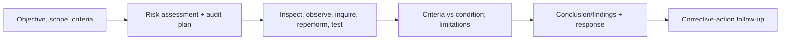

# AI Auditor and Assurance Specialist

> [!abstract] Mission
> Provide objective, appropriately independent conclusions about whether defined AI-related criteria are met, based on sufficient, appropriate, reproducible evidence.

## Responsibilities

- Establish engagement objective, subject matter, boundaries, criteria, users, assurance/audit type, materiality/significance, competence and independence.
- Assess inherent/control/detection risk and select representative evidence and sampling.
- Test governance, inventory, data, development/acquisition, evaluation, access/change, human oversight, monitoring, incidents, vendor controls, records and claims.
- Inspect documents/logs/data, observe processes, interview, reperform evaluations, sample cases, confirm externally where appropriate, and preserve workpapers.
- Distinguish control design, implementation, operating effectiveness and outcome effectiveness.
- Report evidence, findings, causes, effects/risk, recommendations, management response, limitations, and follow-up without overstating assurance.

## Boundaries

- [[AI Governance Specialist]] owns controls; auditors should not design/operate what they later independently assure without safeguards.
- Technical model evaluation is evidence, not the whole audit; criteria, process, people, controls, use and outcomes matter.
- “Bias audit” is a legally defined requirement in some contexts (for example NYC covered AEDTs); do not market a generic fairness report as statutory compliance.

## Levels

| Level | Scope | Evidence |
|---|---|---|
| Associate | Workpapers and tests under supervision | Traceable sample, procedure, evidence and conclusion |
| Auditor/specialist | Bounded engagement | Risk-based plan and defensible findings |
| Senior/manager | Complex/high-stakes/multi-domain engagement | Independence, evidence sufficiency, technical specialist integration |
| Director/assurance lead | Methodology, quality, stakeholder/regulator interface | Consistent engagement quality and transparent limitations |

## Prerequisites and competencies

- Audit/assurance/internal-control fundamentals, evidence, sampling, documentation, interviewing, independence/ethics, report writing, quality management.
- AI/data/evaluation/security/privacy and domain/legal literacy sufficient to scope specialists and interpret evidence.
- Know which standards govern the engagement. GAO’s 2024 Yellow Book is effective for specified audits/periods beginning on or after December 15, 2025; it does not automatically govern every private AI review.
- Never accept screenshots, policies, attestations or one test run as sufficient proof of sustained operation without risk-based corroboration.

## Study sequence

1. Learn assurance vs consulting, independence threats, criteria, evidence sufficiency/appropriateness and workpaper logic.
2. Turn NIST/organizational requirements into auditable criteria without converting voluntary guidance into law.
3. Risk-assess a system and design procedures across governance, data, performance and monitoring.
4. Reperform a sample evaluation and inspect logs/changes/incidents; reconcile inconsistencies.
5. Draft finding and conclusion with scope/limitations; conduct management-response meeting.
6. Run quality review and corrective-action follow-up; document unresolved risk.

## Tools

- **Free-first:** GAO Yellow Book and AI Accountability Framework, NIST AI RMF/AIRC, Obsidian, spreadsheets/Python/SQL, Git/hash tools, sampling scripts, Mermaid.
- **Paid:** audit/GRC platforms, secure workpaper/document review, data/model observability, legal databases, specialist testing, external assurance/certification.

## Knowledge check

1. Distinguish sufficient from appropriate evidence.
2. What are the four states of a control assessment?
3. Why define criteria before testing?
4. What is reperformance?
5. When does the 2024 Yellow Book become effective for performance audits?

> [!success]- Answers
> 1. Sufficiency is quantity; appropriateness is relevance and reliability. 2. Design adequacy, implementation/existence, operating effectiveness over time, and whether it produces/helps produce intended outcome. 3. Otherwise conclusions become subjective, shifting or cherry-picked. 4. Auditor independently executes a procedure/control/calculation/test to compare results. 5. For performance audits beginning on or after December 15, 2025, per GAO; applicability still depends on engagement.

## Flashcards

Audit criterion:: The benchmark against which subject matter is evaluated.
Sufficient appropriate evidence:: Enough relevant and reliable evidence to support the conclusion at the engagement’s risk level.
Independence:: Freedom in fact and appearance from impairments that compromise objective work and reporting.
Reperformance:: Auditor’s independent execution of a control, calculation, or evaluation procedure.
Finding:: Supported comparison of condition to criteria, often including cause, effect/risk and recommendation.
Assurance limitation:: Explicit boundary or uncertainty preventing a broader or stronger conclusion.

## Interview preparation

- Scope an audit of an AI assistant whose inventory and logs are incomplete.
- Explain why “aligned to NIST” is not auditable until converted to precise organizational criteria.
- Handle management pressure to remove a well-supported finding.
- Bring engagement memo, risk/control matrix, sampling plan, workpapers, reperformance, finding, report and follow-up.

## Suggested projects

- **Beginner:** audit one control in a fictional AI workflow; produce objective, criteria, procedure, sample, evidence and conclusion.
- **Intermediate:** performance audit of governance/data/performance/monitoring using GAO’s AI framework, with evidence matrix and mock management responses.
- **Advanced:** assurance engagement design for a vendor AI service: criteria, independence/competence, multi-tenant evidence constraints, technical/human testing, subcontractors, legal claims, findings, limitations, quality review and public-facing conclusion.

## Sources

Checked **2026-08-12**.

- [U.S. GAO — AI Accountability Framework](https://www.gao.gov/products/gao-21-519sp) — includes questions/procedures for auditors and assessors.
- [U.S. GAO — 2024 Government Auditing Standards](https://www.gao.gov/products/gao-24-106786).
- [U.S. GAO — Yellow Book current page](https://www.gao.gov/yellowbook) — effective-date and quality-management details.
- [NYC DCWP — Automated Employment Decision Tools](https://www.nyc.gov/site/dca/about/automated-employment-decision-tools.page).
