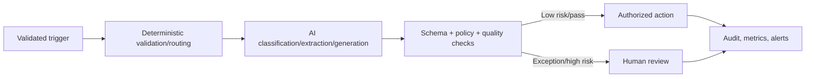

# AI Automation Specialist

> [!abstract] Mission
> Redesign and automate workflows using deterministic logic and AI only where each is appropriate, with reliable controls, human authority, and measurable operational value.

## Responsibilities

- Discover and baseline workflows; remove unnecessary work before automating.
- Design triggers, data transformations, rules, AI tasks, approvals, actions, exception queues, retries, and recovery.
- Integrate APIs, webhooks, databases, SaaS tools, model calls, identity/secrets, and notifications.
- Validate schemas and business rules; implement least privilege, idempotency, rate limits, timeouts, deduplication, logging, alerts, and manual fallback.
- Test normal, edge, adversarial, dependency-failure, and volume cases; monitor quality, labor, cost, and incidents.
- Document data flow, ownership, runbooks, vendor dependencies, and change history; train operators.

## Boundaries

- [[AI Business Analyst]] defines process/requirements; automation specialist often builds and operates the workflow.
- RPA may automate user-interface actions; this role increasingly emphasizes APIs/events plus probabilistic AI components.
- [[AI Solutions Architect]] designs broader solution architecture; the specialist may implement a bounded automation.
- “Agent builder” can conceal fragile unconstrained action. Prefer explicit workflows unless autonomy adds tested value.

## Levels

| Level | Scope | Evidence |
|---|---|---|
| Beginner builder | Personal/low-risk, few-step workflow | Reliable test cases, logs, manual fallback |
| Specialist | Business workflow with APIs and review | Monitored quality, exceptions, time/cost outcome |
| Senior | Multi-system, sensitive or high-volume automation | Security, scaling, incident recovery, lifecycle ownership |
| Lead / consultant | Automation portfolio, platform standards | Reuse, governance, value realization, reduced shadow automation |

## Prerequisites and competencies

- Process analysis, spreadsheets/data types, JSON, APIs/webhooks, authentication/OAuth, expressions/regex, SQL basics, error handling, testing, and documentation.
- AI literacy: classification/extraction/generation, retrieval, structured output, evals, prompt injection, privacy, bias, model change and costs.
- Understand concurrency, queues, retries/backoff, idempotency, rate limits, secrets, environment separation, observability, backup/export, and vendor exit.
- Never automate a consequential action without validating authority, failure severity, recourse, and human escalation.

## Study sequence

1. Map and simplify a workflow; quantify volume, touch/wait time, errors, and exceptions.
2. Build deterministic automation first with validation, logging, and retry.
3. Add one AI step with structured output and a 50-case evaluation.
4. Add risk-based human review, exception queue, feedback labels, and safe fallback.
5. Threat-model data/secrets/injection; load-test and simulate dependency failures.
6. Deploy with dev/test/prod separation, runbook, alerts, cost/quality dashboard, and rollback.

## Tools

- **Free-first:** n8n community/self-hostable options, Node-RED, Activepieces community options, Python, GitHub Actions, Postman, Docker, Ollama, PostgreSQL, Mermaid.
- **Paid:** Zapier, Make, n8n Cloud, Microsoft Power Automate, UiPath, Workato, model APIs, managed databases/queues/observability.
- Licensing and free-tier limits change; verify current official terms. Self-hosting provides control but creates security, patching, backup, and availability responsibility.

## Knowledge check

1. Why simplify before automating?
2. What problem does idempotency solve?
3. When should AI not replace a deterministic rule?
4. What belongs in an exception queue?
5. Why separate development and production credentials?

> [!success]- Answers
> 1. Automation otherwise accelerates waste and embeds bad controls. 2. Retries or duplicate events do not create duplicate consequential effects. 3. When the rule is known, stable, auditable, and deterministic or the error cost is unacceptable. 4. Original input, system output, validation/failure reason, risk/priority, context/evidence, reviewer actions, and audit trail. 5. To limit blast radius, prevent test actions on real systems/data, and enforce least privilege.

## Flashcards

Webhook:: An event-driven HTTP notification that triggers another system.
Idempotent action:: An action safe to retry without producing duplicate effects.
Dead-letter queue:: A holding area for failed items that need diagnosis or reprocessing.
Human-on-the-loop:: A person monitors and can intervene; appropriateness depends on detection, time, authority, and reversibility.
Compensating action:: A designed operation that mitigates or reverses a completed step when full transaction rollback is impossible.
Automation observability:: Logs, metrics, traces, alerts, and business/quality signals that make workflow state diagnosable.

## Interview preparation

- Diagram an invoice/email/support automation and identify what remains deterministic or human.
- Debug duplicate customer actions after retries; discuss idempotency key and audit repair.
- Explain when you refused an agentic design in favor of explicit approval or workflow.
- Bring before/after map, code/export, test set, threat model, logs/dashboard, runbook, and measured results.

## Suggested projects

- **Beginner:** inbox-to-task workflow with validation, deduplication, logs, failure notification, and no sensitive data.
- **Intermediate:** AI-assisted document triage with structured extraction, 50 cases, confidence/risk review routing, exception queue, cost and quality dashboard.
- **Advanced:** production-style multi-system automation with dev/test/prod, secrets, queue/retries/idempotency, least privilege, injection tests, approval, audit trail, incident tabletop, backup/export, and ROI based on total labor.

## Sources

Checked **2026-08-12**.

- [n8n Documentation](https://docs.n8n.io/) — official workflow automation and self-hosting documentation.
- [Zapier — Use of AI within Zapier](https://help.zapier.com/hc/en-us/articles/26583719914381-Use-of-AI-within-Zapier) — updated May 29, 2026.
- [Zapier — Build an agent](https://help.zapier.com/hc/en-us/articles/24393442652557-Build-an-agent-in-Zapier-Agents).
- [NIST — Generative AI Profile](https://doi.org/10.6028/NIST.AI.600-1).
