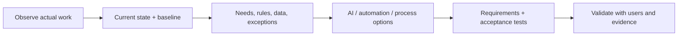

# AI Business Analyst

> [!info] October 13, 2026 update
> Use [[US Career and Governance Update — October 2026]] for current U.S. evidence and a role-family work-product exercise. Pair it with [[Model and Agent Lifecycle Management]] to explain how a technical change affects users, risk, cost, and communication. Older profile claims retain their original verification dates.

> [!abstract] Mission
> Turn messy business work into a measurable process, clear requirements, testable acceptance criteria, and an evidence-backed recommendation about where AI should—and should not—participate.

## Responsibilities

- Interview and observe stakeholders; model current and future workflows, decisions, handoffs, queues, exceptions, and controls.
- Quantify baseline volume, time, quality, rework, cost, service, and risk.
- Elicit functional, data, quality, accessibility, privacy, security, audit, human-review, and operational requirements.
- Define representative scenarios, acceptance criteria, traceability, and user acceptance testing.
- Analyze options and gaps; translate between domain staff, [[AI Product Manager]], design, engineering, governance, and vendors.
- Validate that changes improve work rather than merely move effort to reviewers or customers.

## Boundaries

- Unlike [[AI Product Manager]], the analyst usually recommends and clarifies rather than owns the roadmap and product decision.
- Unlike [[AI Automation Specialist]], the analyst may specify a workflow without building the production automation.
- Unlike [[AI Strategy Consultant]], the analyst works at process/requirement depth more often than enterprise market strategy.

## Levels

| Level | Scope | Evidence |
|---|---|---|
| Junior / domain transitioner | Interviews, process maps, scenario/test documentation | Accurate map validated by users and measurable acceptance criteria |
| Analyst | One end-to-end process and solution options | Traceable requirements, baseline, UAT, and recommendation |
| Senior | Cross-system/high-stakes process, conflict resolution | Exception/control design and evidence across affected groups |
| Lead | Analysis standards, portfolio discovery, capability coaching | Reusable intake, taxonomy, metrics, and quality review system |

## Prerequisites and competencies

- Facilitation, process modeling, requirements, data literacy, root-cause analysis, basic statistics, and clear writing.
- AI literacy: variability, context limits, retrieval, evaluation, data leakage, bias, automation bias, and human escalation.
- Master stakeholder mapping, SIPOC/BPMN-style flows, decision tables, data dictionaries, user stories/use cases, nonfunctional requirements, traceability, UAT, and benefit measurement.
- Learn to ask: Who is affected but absent? What exception is common? What happens when confidence is low? Who can reverse the action?

## Study sequence

1. Observe one real process; map actual rather than policy-only work.
2. Baseline volume, wait, touch time, rework, error severity, and user experience.
3. Build a decision/exception table and a data-source/permission map.
4. Compare non-AI, deterministic automation, predictive AI, generative AI, and hybrid options.
5. Write testable functional and nonfunctional requirements plus 30 acceptance scenarios.
6. Run a simulated UAT, log defects by severity, and recommend proceed/constrain/redesign/stop.

## Tools

- **Free-first:** Obsidian, spreadsheets, Mermaid, diagrams.net, BPMN.io, DBeaver, SQLite, Postman, Figma free tier, survey tools.
- **Paid:** Miro/Lucidchart, Jira/Confluence, Visio, Tableau/Power BI, process mining suites, enterprise requirements tools, model API sandboxes.

## Knowledge check

1. Why distinguish touch time from wait time?
2. Turn “the AI should be accurate” into a better requirement.
3. What is requirements traceability?
4. Why interview exception handlers?
5. What signals that apparent automation shifted labor rather than removed it?

> [!success]- Answers
> 1. They have different causes and interventions; automating a short touch step may not fix a long queue. 2. Name task, dataset/population, metric/rubric, threshold, slices, reviewer, and response when unmet. 3. Linking needs and obligations through requirements, design, tests, results, and decisions. 4. They know real failure modes, hidden rules, and recovery work. 5. Review time, correction/rework, escalations, customer effort, or downstream error rises while the automated step looks faster.

## Flashcards

Current state:: The observed workflow, decisions, data, exceptions, controls, measures, and pain before change.
Acceptance criterion:: A specific, testable condition that a solution must satisfy.
Nonfunctional requirement:: A quality or constraint such as latency, accessibility, reliability, privacy, or auditability.
Traceability:: A maintained link from originating need/obligation to implementation, test evidence, and decision.
Exception path:: Designed handling for cases outside the normal flow.
Process debt:: Hidden workaround, rework, ambiguity, or control weakness that automation can amplify.

## Interview preparation

- Practice live process discovery: ask actors, trigger, outcome, volume, data, rules, exceptions, controls, measures, and pain.
- Show how you resolved conflicting stakeholder requirements using a decision rule and evidence.
- Be ready to critique “automate 80%” by locating the denominator, severity, review burden, and outcome.
- Bring a process map, decision table, data dictionary, requirements traceability matrix, and UAT report.

## Suggested projects

- **Beginner:** map and baseline a personal or volunteer workflow; identify five exceptions and three non-AI improvements.
- **Intermediate:** requirements pack for an AI-assisted support triage flow with data map, 30 UAT cases, thresholds, human routing, and accessibility needs.
- **Advanced:** multi-stakeholder future-state analysis comparing three solution patterns with cost, risk, failure severity, controls, traceability, pilot results, and recommendation.

## Sources

Checked **2026-08-12**.

- [O*NET — Management Analysts](https://www.onetonline.org/link/summary/13-1111.00) — 2026-updated U.S. occupation analog including organizational evaluation and procedure design.
- [NIST — Human Centered Design](https://www.nist.gov/itl/iad/human-centered-technologies/human-factors-human-centered-design).
- [NIST — AI RMF Playbook](https://airc.nist.gov/airmf-resources/playbook/).
