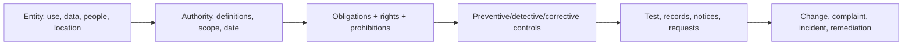

# AI Compliance and Privacy Specialist

> [!abstract] Mission
> Determine—with qualified legal partners where required—which obligations apply to an AI-enabled activity and translate them into data/process controls, evidence, rights handling, monitoring, and remediation.

## Responsibilities

- Fact-map entity/role, jurisdictions, users/affected people, sector/use, data categories/sources, decisions, vendors, transfers, retention and system flow.
- Maintain obligation register with authority, status/effective date, definitions, scope, requirements, exceptions, enforcement, owner and counsel interpretation.
- Conduct/privacy-support assessments, data inventories/records, minimization, purpose/use limitation, notice/consent where applicable, rights/requests, retention/deletion, access/security, vendor terms and incident response.
- Map requirements to controls and evidence; test operation and remediate gaps.
- Review employment, consumer, credit, health, education, biometrics, communications, children, marketing and state-specific contexts with appropriate counsel.
- Monitor legal, regulatory, platform and vendor changes; train business/product/engineering.

## Boundaries

- This is not automatically an attorney role; do not issue legal advice beyond qualifications/authorization.
- Privacy risk includes effects on people from data processing; cybersecurity focuses on confidentiality/integrity/availability threats, with overlap.
- [[AI Governance Specialist]] manages the enterprise system; compliance/privacy supplies obligation and domain-control expertise.

## Levels

| Level | Scope | Evidence |
|---|---|---|
| Analyst | Research, inventories, assessments, request/evidence support | Accurate primary-source status and traceability |
| Specialist | Own program/process for products/use cases | Controls operate and rights/records are timely |
| Senior / counsel-partner | Complex multi-state/sector/vendor/high-risk issues | Resolves scope with documented interpretation and remediation |
| Director / privacy officer | Enterprise risk posture, regulator/board interface | Sustainable program, defensible evidence and effective rights protection |

## Prerequisites and competencies

- U.S. privacy/consumer/employment/sector legal literacy, regulatory research, data governance, records, vendor management, controls/testing, incident and rights-request operations.
- Technical literacy: data flow, model training/inference, prompts/logs, embeddings, retrieval, de-identification/re-identification, access, retention, deletion and downstream propagation.
- Track definitions, effective dates, and phased compliance dates. At cutoff: California’s 2025 CCPA regulations were effective January 1, 2026, while ADMT requirements begin January 1, 2027 and cybersecurity-audit/risk-assessment submissions phase later; Illinois employment-AI provisions were effective January 1, 2026; NYC Local Law 144 remains active for covered AEDTs.
- NIST Privacy Framework is voluntary; its public page at cutoff prominently references Privacy Framework 1.1 **initial public draft**, so verify version before claiming adoption.

## Study sequence

1. Learn legal-source hierarchy and build obligation-register schema.
2. Draw end-to-end data map including prompts, uploads, outputs, logs, human review, embeddings, vendors, retention and deletion.
3. Analyze one use under federal/sector and applicable state/local sources with counsel flags.
4. Conduct privacy/risk assessment and map duties/rights to controls/evidence.
5. Test notice/comprehension, access/deletion/correction/opt-out flows, vendor deletion and incident tabletop.
6. Create monitoring calendar, change triggers, training and remediation dashboard.

## Tools

- **Free-first:** official statutes/regulators, NIST Privacy Framework, data-flow tools/Mermaid, Obsidian, spreadsheets/SQLite, Git, records/templates.
- **Paid:** privacy management/data discovery/catalog/consent/request platforms, legal research, GRC, vendor risk, DLP/security tooling, outside counsel and audit.
- Do not upload personal/confidential facts to an unapproved AI legal-research tool; independently verify citations and current status.

## Knowledge check

1. Why begin with facts rather than a compliance checklist?
2. What is purpose limitation?
3. Why is deleting a source record sometimes insufficient?
4. Distinguish de-identification from anonymity.
5. What fields belong in an obligation register?

> [!success]- Answers
> 1. Applicability depends on entity, role, data, use, people, jurisdiction, date and exceptions. 2. Collect/use data only for specified legitimate purposes and control incompatible reuse under applicable requirements. 3. Copies, logs, embeddings, derived data, backups, vendor systems or trained artifacts may persist; map actual propagation and legal/technical feasibility. 4. De-identification reduces linkage under defined controls; absolute anonymity is a stronger and often unsupported claim because re-identification risk remains contextual. 5. Authority/status/date/jurisdiction, definitions/scope, obligation/right/prohibition, exceptions, enforcement, interpretation, control/evidence, owner, review trigger.

## Flashcards

Data minimization:: Limiting personal data to what is necessary and proportionate for the specified purpose and obligations.
Purpose limitation:: Defining and controlling the purposes for which data is processed.
Privacy risk:: Potential problems individuals experience from data processing, with organizational consequences.
Obligation register:: Traceable record of applicable requirements, interpretations, controls, evidence, owners and change status.
Data lineage:: Traceable movement and transformation of data from source through systems and outputs.
Effective date:: Date a legal requirement begins to operate; it may differ from passage, signing or publication.

## Interview preparation

- Fact-map an employee AI assistant and identify questions before naming laws.
- Explain an end-to-end deletion challenge involving logs, retrieval index and vendor backups.
- Correct a claim that “NIST certified us compliant.”
- Bring primary-source research memo, data map, obligation/control/evidence matrix, assessment, rights workflow and tabletop.

## Suggested projects

- **Beginner:** data inventory/flow and privacy notice critique for a fictional AI assistant.
- **Intermediate:** U.S. obligation and control matrix for an AI hiring workflow using EEOC, DOL, NYC and Illinois primary sources; flag attorney decisions.
- **Advanced:** multi-state privacy/compliance program for a generative service: product/data mapping, CPPA 2025 regulation analysis, vendor/retention/deletion, rights, risk assessments, cybersecurity-audit interfaces, incidents, evidence testing and legal-update process.

## Sources

Checked **2026-08-12**.

- [NIST — Privacy Framework](https://www.nist.gov/privacy-framework) — verify version/status before use.
- [FTC — Privacy and Security](https://www.ftc.gov/business-guidance/privacy-security).
- [California Privacy Protection Agency — 2025 final regulations](https://cppa.ca.gov/regulations/ccpa_updates.html) — effective January 1, 2026.
- [EEOC — Artificial Intelligence and the ADA](https://www.eeoc.gov/eeoc-disability-related-resources/artificial-intelligence-and-ada).
- [NYC DCWP — Automated Employment Decision Tools](https://www.nyc.gov/site/dca/about/automated-employment-decision-tools.page).
- [Illinois General Assembly — Illinois Human Rights Act](https://www.ilga.gov/legislation/ILCS/details?ActID=2266&ActName=Illinois+Human+Rights+Act.&ChapAct=775%20ILCS%205/).
