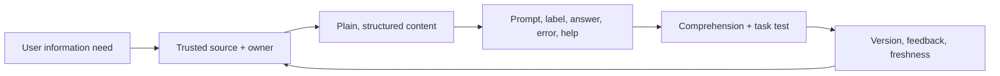

# AI Content Designer

> [!info] October 13, 2026 update
> Use [[US Career and Governance Update — October 2026]] for current U.S. evidence and a role-family work-product exercise. Pair it with [[Model and Agent Lifecycle Management]] to explain how a technical change affects users, risk, cost, and communication. Older profile claims retain their original verification dates.

> [!abstract] Mission
> Use language, structure, and content systems to help people understand what an AI system can do, make informed choices, complete tasks, and recover from uncertainty or failure.

## Responsibilities

- Define content principles, voice/tone, terminology, disclosure, consent, privacy, source/evidence, error, refusal, feedback, and escalation language.
- Design input guidance, examples, prompt starters, progressive help, output structure, citations, warnings, uncertainty, and next actions.
- Build reusable content patterns and schemas across interfaces with [[AI UX and Product Designer]] and [[Conversation Designer]].
- Improve source content for retrieval: chunks, headings, metadata, answerability, ownership, freshness, and conflict handling with [[Knowledge Manager]].
- Test comprehension, scanning, expectation, action, accessibility, and localization with representative people.
- Govern human-authored and generated content: review, version, provenance, quality, incident correction, and retirement.

## Boundaries

- UX writing is a subset focused on interface words; content design includes information needs, structure, evidence, lifecycle, and service.
- [[Prompt and Context Engineer]] configures system behavior; content designer configures human understanding and task language.
- Marketing content may persuade; product content must prioritize accurate expectations and successful use.

## Levels

| Level | Scope | Evidence |
|---|---|---|
| Junior | Component copy and patterns | Clear variants and comprehension test |
| Designer | End-to-end product/service content | Content model linked to task and measured outcomes |
| Senior | Complex/high-stakes/localized system | Resolves policy, evidence, source, and recovery complexity |
| Lead | Content strategy, governance, design system | Consistency, ownership, quality/freshness at scale |

## Prerequisites and competencies

- Plain language, UX writing, information architecture, content modeling, research/testing, accessibility, editorial systems, localization, and stakeholder negotiation.
- AI literacy around model limits, retrieval/citations, prompt/context, safety, privacy, provenance, evaluation, and hallucination.
- Can write specific, action-oriented, non-blaming errors and refusals; distinguish disclosure from informed understanding.
- Must not imply that AI output is verified, private, human, neutral, complete, or authoritative unless evidence supports it.

## Study sequence

1. Audit an AI interface for claims, terminology, source, uncertainty, data, error, and action.
2. Create a terminology and voice system with prohibited/conditional phrases.
3. Design content for before, during, after, and failure states across one workflow.
4. Restructure a source corpus for retrievability and assign owners/freshness.
5. Run comprehension/task testing and compare two variants.
6. Build a governed content pattern library with metrics and incident update flow.

## Tools

- **Free-first:** Obsidian, Hemingway/plain-language checks used critically, Figma/Penpot, spreadsheets, Vale, Markdown linters, Mermaid, accessibility readers/checkers.
- **Paid:** Figma/Zeroheight, Acrolinx, Contentful/Sanity, localization systems, research tools, model APIs, enterprise knowledge platforms.
- Automated readability scores cannot establish comprehension, accessibility, tone suitability, or legal adequacy.

## Knowledge check

1. Why can a disclosure fail despite being legally visible?
2. What makes an error message actionable?
3. How does content structure affect retrieval?
4. Distinguish voice from tone.
5. Why govern source content, not just generated output?

> [!success]- Answers
> 1. Users may not notice, understand, remember, or have a meaningful choice. 2. It states what happened in user terms, impact, safe next action/alternative, and escalation without blame or false certainty. 3. Clear headings, atomic answerable sections, metadata, stable terminology, and ownership improve selection and interpretation. 4. Voice is consistent character/principles; tone adapts to context and emotion. 5. Retrieval cannot reliably compensate for stale, conflicting, unowned, inaccessible, or poorly structured knowledge.

## Flashcards

Content model:: Structured definition of content types, fields, relationships, rules, and reuse.
Plain language:: Communication designed so the intended audience can find, understand, and use information.
Content provenance:: Traceable origin, authorship/system contribution, version, and transformations of content.
Retrieval-ready content:: Owned, current, structured, labeled, scoped content that can be selected and interpreted reliably.
Error recovery content:: Language that supports recognition, consequence understanding, corrective action, alternative, and escalation.
Expectation setting:: Helping users form an accurate model of capability, limits, data use, and responsibility before relying.

## Interview preparation

- Rewrite a misleading AI disclaimer into task-specific expectation and action guidance.
- Diagnose a wrong answer caused by conflicting source content, not the model alone.
- Explain how you measured comprehension rather than stakeholder preference.
- Bring audit, content model, pattern library, source redesign, test findings, and governance workflow.

## Suggested projects

- **Beginner:** audit and rewrite 20 AI interface strings across onboarding, input, output, feedback, and error.
- **Intermediate:** content system for a retrieval assistant: terminology, source format, citations, uncertainty, refusal, escalation, and comprehension test.
- **Advanced:** enterprise generative-content governance kit with schemas, authorship/provenance, review tiers, accessibility/localization, source ownership/freshness, incident corrections, and metrics.

## Sources

Checked **2026-08-12**.

- [W3C — WCAG 2 Overview](https://www.w3.org/WAI/standards-guidelines/wcag/).
- [NIST — Human Centered Design](https://www.nist.gov/itl/iad/human-centered-technologies/human-factors-human-centered-design).
- [NIST — Generative AI Profile](https://doi.org/10.6028/NIST.AI.600-1).
