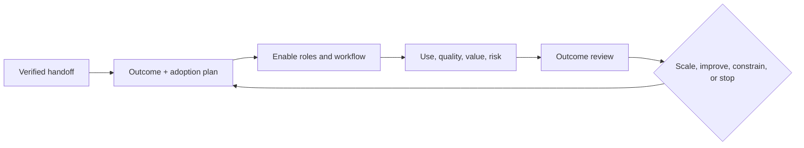

# AI Customer Success Manager

> [!abstract] Mission
> Help customers adopt AI appropriately, realize measurable outcomes, manage operational risk, and build durable capability after purchase.

## Responsibilities

- Validate pre-sale assumptions, stakeholders, intended uses, data/technical readiness, risks, and success measures.
- Create an outcome plan with baseline, target, milestones, owners, enablement, support, evaluation, and executive review.
- Segment users and workflows; deliver role-specific onboarding and communities of practice with [[AI Trainer and Educator]].
- Monitor appropriate usage, task success, quality, review burden, cost, incidents, satisfaction, and business outcomes.
- Coordinate support, product, architecture, security/legal, and account teams; escalate harmful, noncompliant, or technically unsuitable use.
- Drive renewal/expansion through evidence—not raw seat activation or prompt volume.

## Boundaries

- [[AI Sales Engineer]] proves pre-sale fit; CSM owns post-sale realization and relationship rhythm.
- Support resolves incidents/questions; CSM synthesizes patterns and coordinates outcomes.
- [[AI Transformation Lead]] owns enterprise-wide internal change; CSM advises a customer’s adoption within the vendor relationship.

## Levels

| Level | Scope | Evidence |
|---|---|---|
| Associate | Onboarding, education, usage analysis | Accurate customer plan and resolved blockers |
| CSM | Outcome and adoption for account set | Links product use to validated workflow results |
| Senior / strategic | Complex enterprise, multi-use-case governance | Executive alignment, expansion discipline, incident recovery |
| Leader | Segmentation, playbooks, health system, product feedback | Predictive health signals based on value/risk, not vanity use |

## Prerequisites and competencies

- Customer discovery, enablement, project/change coordination, analytics, executive communication, conflict and incident management.
- AI workflow and evaluation literacy; data/security/privacy boundaries; costs and model/vendor change awareness.
- Can design adoption by role and job, diagnose quality versus workflow versus trust versus skill problems, and quantify realized value.
- Recognizes that high use can be harmful and low use can be rational.

## Study sequence

1. Turn a sales handoff into a verified outcome hypothesis and baseline.
2. Map roles, jobs, readiness, data, risks, and sponsor/manager network.
3. Create onboarding plus authentic practice and evaluation for each role.
4. Define a customer health model mixing outcomes, quality, adoption, support, risk, relationship, and capability.
5. Run mock quality incident, executive review, and inappropriate-use escalation.
6. Produce a scale/constrain/stop recommendation with evidence.

## Tools

- **Free-first:** Obsidian, spreadsheets, survey/forms, Loom, analytics exports, office hours, Mermaid, shared checklists.
- **Paid:** Gainsight/Totango/ChurnZero-style CS platforms, CRM, product analytics, LMS, support systems, call intelligence, observability/evaluation dashboards.
- Customer health data should be minimal, permissioned, explainable, and never treated as infallible prediction.

## Knowledge check

1. Why is weekly active use not proof of value?
2. What belongs in an AI customer health score?
3. Name four causes of low adoption.
4. When should a CSM discourage expansion?
5. What should an executive review decide?

> [!success]- Answers
> 1. Use may be experimental, duplicative, low quality, risky, or disconnected from outcomes. 2. Outcomes, fit/adoption, quality/review burden, support/reliability, risk, capability, relationship—weighted transparently. 3. Poor workflow fit, insufficient quality, latency, data access, unclear policy, missing manager support, inaccessible UX, fear or added workload—any four. 4. When intended use is unsafe/noncompliant, prerequisites are missing, outcomes are absent, cost is unjustified, or the product is not fit. 5. Whether to scale, improve, constrain, pause, or stop—and who owns the next evidence.

## Flashcards

Value realization:: Demonstrating that the customer’s intended measurable outcome occurred and persists.
Adoption:: Appropriate, effective use in target work—not account activation alone.
Customer health:: A transparent, multi-signal view of likelihood to realize value and sustain the relationship.
Time to first value:: Time until a customer achieves an agreed, meaningful outcome—not merely completes setup.
Enablement:: Role- and workflow-specific capability building with practice, feedback, and support.
Expectation reset:: Evidence-based correction of assumptions or commitments before they compound harm.

## Interview preparation

- Diagnose a customer with high usage, low renewal intent, and increased review labor.
- Present a 30/60/90-day outcome/adoption plan for a regulated enterprise.
- Explain an escalation where the customer’s requested use exceeded product or policy boundaries.
- Bring a success plan, health model, enablement artifact, executive review, and outcome case.

## Suggested projects

- **Beginner:** onboarding and success plan for one AI workflow with baseline, target, roles, practice, and help path.
- **Intermediate:** transparent account-health workbook and executive review based on simulated usage, eval, incident, support, and outcome data.
- **Advanced:** enterprise adoption playbook with segmentation, governance alignment, champions/managers, use-case gates, quality monitoring, value model, incident communication, and expansion/stop criteria.

## Sources

Checked **2026-08-12**.

- [O*NET — Customer Service Representatives](https://www.onetonline.org/link/summary/43-4051.00) — partial service-work analog; strategic CSM scope is broader and not a standardized AI occupation.
- [NIST — AI RMF Playbook](https://airc.nist.gov/airmf-resources/playbook/) — monitoring and management actions.
- [NIST — Human-Centered AI](https://www.nist.gov/programs-projects/human-centered-ai).
