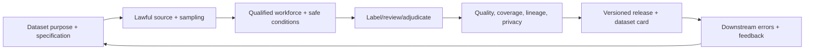

# AI Data Operations Manager

> [!info] October 13, 2026 update
> Use [[US Career and Governance Update — October 2026]] for current U.S. evidence and a role-family work-product exercise. Pair it with [[Model and Agent Lifecycle Management]] to explain how a technical change affects users, risk, cost, and communication. Older profile claims retain their original verification dates.

> [!abstract] Mission
> Operate a secure, humane, traceable human-data production system that delivers fit-for-purpose datasets at the required quality, coverage, throughput and cost.

## Responsibilities

- Convert model/research/product needs into dataset scope, sample/coverage, task specification, schedule, budget, capacity, service and acceptance criteria.
- Source/manage employees, contractors, vendors and domain experts; define qualification, onboarding, access, support, compensation/escalation and quality review with HR/legal/procurement.
- Operate queues, assignments, calibration, QA sampling, gold/adjudication, rework, incidents and change control.
- Maintain consent/rights, data classification, least privilege, secure environments, lineage, retention/deletion, dataset versions and vendor/subprocessor records.
- Monitor coverage, quality by slice, agreement, throughput/latency, rework, unit cost, attrition, wellbeing/safety and downstream usefulness.
- Investigate system causes—rubric, sampling, interface, incentives, fatigue, tooling, model shift—not only blame workers.

## Boundaries

- [[Human-Feedback Specialist]] designs constructs/rubrics/experiments; operations manager scales reliable delivery.
- Data engineer builds pipelines/infrastructure; data ops manager owns socio-technical production and service, often partnering closely.
- Procurement manages contracts; data ops owns operational acceptance and vendor performance evidence.

## Levels

| Level | Scope | Evidence |
|---|---|---|
| Coordinator | Queue, scheduling, access, issue tracking | Accurate operations and timely escalation |
| Manager | One program/vendor/domain | Quality/coverage/service with traceable lineage and safe workforce |
| Senior | Multi-vendor/global/specialist/high-risk portfolio | Forecasting, incident response, cross-program standards |
| Director | Data strategy, platform, make/buy, governance | Sustainable supply, workforce and quality system tied to downstream outcomes |

## Prerequisites and competencies

- Operations/capacity planning, vendor/procurement, workforce management, QA/statistics, project/program, data governance/security/privacy, process improvement, incident and executive communication.
- Understand annotation/feedback constructs, sampling, agreement, model/eval lifecycle, dataset shift and downstream error analysis.
- U.S. worker classification, wage/hour, workplace safety, accommodation and contract issues require HR/legal specialists; do not treat distributed piecework as compliance-free.
- Quality incentives should not reward forced guessing, hidden overtime, speed at safety’s expense or suppression of ambiguity.

## Study sequence

1. Create demand/specification including downstream purpose, population, slices, risks and acceptance.
2. Forecast volume, handle time, concurrency, learning curve, rework, shrinkage and expert bottlenecks.
3. Design access, qualification, calibration, queue/QA/adjudication, feedback and escalation.
4. Build dashboard and investigate simulated drift, ambiguity, throughput and harmful-content events.
5. Run vendor due diligence and incident/business-continuity tabletop.
6. Release versioned dataset with lineage, card, sign-offs, known limits and downstream feedback loop.

## Tools

- **Free-first:** Label Studio/CVAT/Doccano, Python/R/SQL, PostgreSQL, spreadsheets, Git/DVC, Obsidian, Mermaid, open dashboards and secure self-hosted options.
- **Paid:** enterprise annotation/workforce vendors, secure VDI, data catalog/lineage, project/queue, workforce management, GRC/DLP, cloud storage/warehouse, evaluation/monitoring.
- Open tools still require secure deployment, access, patching, backup and privacy review.

## Knowledge check

1. Why can throughput targets reduce quality?
2. What is shrinkage in capacity planning?
3. Distinguish QA sample from gold item.
4. Name four worker-welfare signals.
5. Why tie data quality to downstream use?

> [!success]- Answers
> 1. They can encourage guessing, skipping evidence/escalation, rushing harmful tasks or working off clock. 2. Paid/available time not producing labels due to training, calibration, meetings, breaks, leave, system downtime and support. 3. QA sample is selected work for review; gold item has adjudicated reference and may be embedded for calibration/checks. 4. Exposure severity, distress/escalation, break use, attrition, complaints, unpaid time, accommodation, schedule volatility—any four. 5. Agreement or guide compliance does not prove the dataset improves target behavior across important slices or avoids harm.

## Flashcards

Data operations:: The people, process, technology, controls and service that produce and maintain data for a defined use.
Lineage:: Traceable source, rights, transformations, labels/reviews, versions and downstream release.
Shrinkage:: Capacity unavailable for direct production because of necessary or unplanned non-production time.
Rework rate:: Portion of items requiring correction or repeated processing; interpret cause, not just volume.
Vendor concentration risk:: Dependence on one provider, geography, workforce or platform that threatens continuity, quality or control.
Dataset acceptance:: Authorized determination that defined quality, coverage, rights, security, documentation and use criteria are met.

## Interview preparation

- Recover a program with falling quality and rising throughput; investigate incentive/system causes.
- Capacity-plan a 1M-item project with expert review and uncertainty.
- Respond to a vendor data exposure or worker harmful-content complaint.
- Bring capacity model, SOP/flow, RACI, dashboard, vendor scorecard, incident plan, dataset card and retrospective.

## Suggested projects

- **Beginner:** production plan for 10,000 public items with roles, capacity, queue, QA, acceptance and dashboard.
- **Intermediate:** multi-tier generalist/expert workflow with qualification, calibration, sampling, gold governance, adjudication, privacy/access, wellbeing and downstream feedback.
- **Advanced:** make/buy/vendor operating model for sensitive data: due diligence/contracts, subprocessors, secure environment, continuity/exit, labor/welfare, lineage/deletion, incidents, performance dashboard and quarterly management review.

## Sources

Checked **2026-08-12**.

- [NIST — AI RMF 1.0](https://doi.org/10.6028/NIST.AI.100-1).
- [NIST — AI Resource Center](https://airc.nist.gov/).
- [U.S. Department of Labor — Wage and Hour Division](https://www.dol.gov/agencies/whd) — authoritative starting point for U.S. federal wage/hour information; seek case-specific advice.
