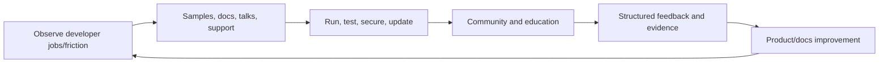

# AI Developer Relations and Advocate

> [!abstract] Mission
> Help developers succeed through accurate code, documentation, education, community, and a trustworthy feedback loop into product and engineering.

## Responsibilities

- Build minimal runnable samples, tutorials, quickstarts, workshops, demos, and talks around real developer jobs.
- Verify every claim and code path against current official docs, SDK versions, model behavior, limits, pricing surfaces, and security guidance.
- Teach evaluation, structured outputs, tool use, retrieval, security, cost, and production readiness—not only prompting.
- Support communities with inclusive moderation and clear escalation; synthesize reproducible feedback rather than forwarding anecdotes.
- Partner with product, engineering, docs, support, marketing, and [[AI Solutions Architect]].
- Instrument content outcomes and maintain/deprecate material as APIs and models change.

## Boundaries

- Developer relations serves developer success and product feedback; developer marketing primarily drives awareness/demand, though teams overlap.
- Developer advocate emphasizes teaching/community; developer experience engineer may own SDKs/tooling; technical writer owns documentation systems. Read the role.
- Advocacy does not mean defending the vendor regardless of evidence.

## Levels

| Level | Scope | Evidence |
|---|---|---|
| Associate | Samples, community support, workshop assistance | Reproducible artifact and accurate issue triage |
| Advocate | Own topic/audience and feedback loop | Developers complete a task and product/docs improve |
| Senior | Cross-platform architecture, major content/community | Anticipates migration/security/eval needs and influences roadmap |
| Principal / leader | DevRel strategy, measurement, editorial/technical quality | Scalable programs, trusted community, disciplined product signal |

## Prerequisites and competencies

- Comfortable coding in at least one common ecosystem, using Git, APIs, package managers, tests, auth/secrets, deployment basics, and debugging.
- Can explain AI models, context, structured output, retrieval, tools/agents, evals, privacy/security, latency/cost, and limitations.
- Strong teaching, technical writing, live presentation, empathy, community moderation, editorial judgment, and feedback synthesis.
- Treat code as a maintained product: dependency pinning, tests, setup validation, license, accessibility, and update owner.

## Study sequence

1. Choose one official platform and build a minimal API app from a clean environment.
2. Turn it into a tested quickstart with prerequisites, secrets handling, expected output, errors, and teardown.
3. Add an eval dataset and production-readiness chapter covering security, cost, observability, and failure.
4. Teach the content live; observe task completion and confusion rather than relying on applause.
5. Triage ten simulated issues into docs bug, product bug, user error, feature request, and unsupported use.
6. Publish a feedback synthesis with prevalence, severity, evidence, affected persona, workaround, and recommendation.

## Tools

- **Free-first:** GitHub, VS Code, Codespaces/free cloud sandboxes, local models, Jupyter/Colab, MkDocs/Docusaurus, OBS, community forums/Discord, accessibility checkers.
- **Paid:** model/cloud APIs, documentation analytics, event/webinar platforms, community suites, video editing, error/observability tools.
- Prefer official documentation as the source of truth and date/version every volatile tutorial.

## Knowledge check

1. What makes a code sample reproducible?
2. Why is page traffic a weak DevRel outcome alone?
3. What turns community anecdotes into product signal?
4. Why teach evaluation in a quickstart series?
5. What should happen when an API deprecates?

> [!success]- Answers
> 1. Declared environment/dependencies, setup, secrets, input/output, tests, error handling, and a clean-run check. 2. It does not show task success, production adoption, understanding, retention, or reduced friction. 3. Structured persona/use case, reproduction, frequency, severity, evidence, workaround, and decision context. 4. Developers need to know whether behavior meets their task, not merely obtain a response. 5. Notify, mark/version content, provide migration path, update tests/samples, archive misleading material, and track user impact.

## Flashcards

Developer experience:: The end-to-end effort, clarity, reliability, and confidence a developer encounters using a product.
Minimal reproducible example:: The smallest complete artifact that consistently demonstrates a behavior or issue.
Product signal:: Structured evidence that helps a product team prioritize or diagnose a developer problem.
Content debt:: Maintenance risk from outdated, duplicated, unowned, or untested developer material.
Time to first successful call:: Time from starting the quickstart to a verified valid API result.
Advocacy:: Representing developer needs to the company as well as explaining the product to developers.

## Interview preparation

- Deliver a five-minute technical explanation to beginners, then answer a senior engineer’s reliability/security questions.
- Debug a broken sample aloud without exposing secrets or guessing.
- Turn a noisy forum thread into a concise product-feedback artifact.
- Bring a tested repo, tutorial, recorded talk, issue triage, content metrics, and resulting improvement.

## Suggested projects

- **Beginner:** version-pinned quickstart repo with test, troubleshooting, cost note, and responsible-use caveat.
- **Intermediate:** 45-minute workshop that builds and evaluates a retrieval/tool app; include facilitator guide, accessibility, learner check, and feedback synthesis.
- **Advanced:** developer launch kit with samples in two languages, migration guide, eval/security guidance, documentation tests, community plan, issue taxonomy, and product feedback dashboard.

## Sources

Checked **2026-08-12**.

- [OpenAI — API documentation](https://developers.openai.com/api/docs/).
- [Anthropic — Tool use overview](https://platform.claude.com/docs/en/agents-and-tools/tool-use/overview).
- [Google Cloud — Prompt design strategies](https://cloud.google.com/vertex-ai/generative-ai/docs/learn/prompts/prompt-design-strategies).
- [W3C — WCAG 2 Overview](https://www.w3.org/WAI/standards-guidelines/wcag/) — accessible learning/docs baseline.
