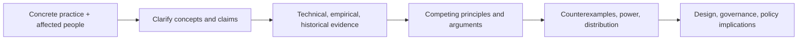

# AI Ethics Researcher

> [!abstract] Mission
> Produce rigorous normative and empirical analysis of the values, rights, duties, power, distribution, institutions, and human consequences shaped by AI—and make assumptions and disagreements explicit.

## Responsibilities

- Define normative question and concepts; locate who has power, agency, benefit, burden, voice and remedy.
- Research philosophy/ethics, law/policy, social science, history, STS, technical architecture/data and domain practice.
- Build arguments and counterarguments; test consistency, assumptions, examples, empirical premises and distributional consequences.
- Conduct empirical/participatory work ethically where appropriate and distinguish observed facts from normative judgment.
- Analyze autonomy, dignity, justice/fairness, rights, care, responsibility, legitimacy, labor, environment and democracy in context.
- Translate insight into design principles, institutional safeguards, research agendas or policy options without presenting values as technical inevitabilities.

## Boundaries

- [[Responsible AI Specialist]] operationalizes risk/safeguards; ethics research asks deeper normative and institutional questions and may challenge the use itself.
- [[AI Policy Analyst]] emphasizes authority/options/implementation; ethics research emphasizes justification and values, though strong work overlaps.
- Ethics is not a public-relations sign-off, abstract principle list, or substitute for legal, technical and empirical expertise.

## Levels

| Level | Scope | Evidence |
|---|---|---|
| Research assistant | Literature, case coding, source verification | Accurate synthesis and transparent notes |
| Researcher | Original bounded argument or empirical study | Defensible thesis, evidence, objections and implications |
| Senior | Interdisciplinary program and public/institutional influence | Conceptual rigor plus technical/social/domain credibility |
| Lead / professor / director | Agenda, team, partnerships, field contribution | Durable scholarship and accountable engagement with affected people |

## Prerequisites and competencies

- Normative ethics/political philosophy, logic/argumentation, research methods, research ethics, qualitative/quantitative literacy, law/policy and socio-technical/STS approaches.
- AI literacy sufficient to avoid treating “the algorithm” as one actor; inspect data, model, objective, interface, institution, incentives and deployment.
- Citation/source discipline, steelmanning, positionality/conflict disclosure, participatory safeguards and public communication.
- Avoid ethics washing: publish limits and conflicts, secure independence, connect consultation to decision pathways, and disclose when work is commissioned.

## Study sequence

1. Learn major normative lenses and practice reconstructing arguments charitably.
2. Select a concrete U.S. case and map actors, history, technology, institutions, incentives and affected people.
3. Separate empirical claims from value premises; verify both with appropriate evidence.
4. Write the strongest argument and objection for at least three positions.
5. Consult affected/domain/technical perspectives under ethical methods; revise claims.
6. Publish paper/policy/design implications, limitations, dissent and open questions.

## Tools

- **Free-first:** Obsidian, Zotero, PhilPapers/Google Scholar, SSRN/arXiv with quality judgment, legislation/agency/GAO/NIST sources, R/Python, qualitative coding tools.
- **Paid:** academic databases, transcription/qualitative platforms, survey/panel tools, conferences, expert/community partnerships, journal/books access.
- Generative literature summaries can omit or fabricate sources; always read and cite originals.

## Knowledge check

1. What is the is–ought gap?
2. Why is “fairness” not one technical property?
3. What is ethics washing?
4. Why study institutions and incentives?
5. Distinguish moral agent, patient and responsibility bearer.

> [!success]- Answers
> 1. Descriptive facts alone do not entail a normative conclusion without a value premise. 2. It names competing ideas about treatment, opportunity, outcome, process, need, desert and power; context and law matter. 3. Using ethics language/process to legitimize conduct without independent scrutiny, authority, resources or change. 4. They shape design/deployment and distribute responsibility/benefit/harm beyond model properties. 5. Agent can act morally; patient can be helped/harmed or owed duties; responsibility bearer is accountable under a moral/institutional arrangement—categories may overlap.

## Flashcards

Normative claim:: A claim about what ought to be done, valued, permitted, prohibited or owed.
Descriptive claim:: A claim about what is or is likely to occur, answerable with empirical/conceptual evidence.
Distributive justice:: How benefits, burdens, opportunities and resources are allocated.
Procedural justice:: Fairness and legitimacy of the process by which decisions are made.
Positionality:: How a researcher’s social/institutional position and interests may shape access, questions and interpretation.
Ethics washing:: Symbolic ethics activity used to create legitimacy without meaningful accountability or change.

## Interview preparation

- Analyze a hiring or companion chatbot through three ethical lenses and show real disagreement.
- Identify the hidden value judgments inside a proposed “neutral” metric.
- Explain how you would preserve independence on company-funded research.
- Bring annotated literature map, argument map, case/actor analysis, method/ethics plan, objections, paper and practical implications.

## Suggested projects

- **Beginner:** 2,000-word argument map on one AI practice separating empirical and normative premises and citing primary sources.
- **Intermediate:** interdisciplinary case study with technical/institutional map, affected-party perspectives, competing ethical analyses, objections and design/governance implications.
- **Advanced:** participatory research protocol and publishable paper on a U.S. AI policy/workplace practice, with positionality, conflict safeguards, dissent, distributional analysis and implementation implications.

## Sources

Checked **2026-08-12**.

- [NIST — AI RMF 1.0](https://doi.org/10.6028/NIST.AI.100-1) — explicitly treats AI systems as socio-technical and trustworthiness as contextual.
- [NIST — Identifying and Managing Bias in AI](https://doi.org/10.6028/NIST.SP.1270).
- [U.S. GAO — AI Accountability Framework](https://www.gao.gov/products/gao-21-519sp).
- [EEOC — Employment Discrimination and AI for Workers](https://www.eeoc.gov/sites/default/files/2024-04/20240429_Employment%20Discrimination%20and%20AI%20for%20Workers.pdf) — concrete U.S. rights/impact context.
