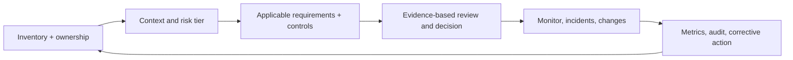

# AI Governance Specialist

> [!abstract] Mission
> Build and operate the decision rights, policies, inventory, evidence, controls, oversight, and learning system through which an organization develops, buys, uses, monitors, and retires AI accountably.

## Responsibilities

- Define AI scope/taxonomy, accountable owners, committees, three-lines interfaces, escalation, exception, and documentation requirements.
- Maintain inventory with purpose, affected people, owner, developer/deployer/vendor, data, model, integrations, decisions, risk tier, status, and review dates.
- Translate laws, contracts, standards, risk appetite, and internal policy into lifecycle controls and evidence with legal/compliance/security/privacy/model-risk partners.
- Operate intake, impact/risk assessment, vendor review, release/exception gates, monitoring, incidents, material-change review, and retirement.
- Build metrics, training, records, management review, audit support, and corrective action.
- Prevent governance theater: test whether controls operate and influence decisions.

## Boundaries

- [[Responsible AI Specialist]] focuses on people/impact and safeguards within products/use cases; governance owns the organizational operating system.
- [[AI Compliance and Privacy Specialist]] interprets applicable obligations and data/privacy controls; governance coordinates but does not give legal advice.
- [[AI Auditor and Assurance Specialist]] independently evaluates criteria/evidence; governance implements/operates controls and must preserve auditor independence.
- “AI ethics board” is not governance unless it has scope, authority, evidence, cadence, records, escalation, and follow-through.

## Levels

| Level | Scope | Evidence |
|---|---|---|
| Analyst | Inventory, control evidence, assessments, meeting/decision records | Accurate traceability and timely follow-up |
| Specialist/manager | Lifecycle process and business engagement | Risk-tiered reviews that change launches/use |
| Senior/director | Enterprise AI management system and regulatory alignment | Integrated ownership, monitoring, incidents, audit and improvement |
| Head / executive | Risk appetite, board reporting, governance accountability | Decisions and resources match actual exposure and strategy |

## Prerequisites and competencies

- GRC, enterprise risk, policy/process design, internal controls, records, vendor risk, facilitation, change and executive communication.
- AI lifecycle/architecture/evaluation literacy sufficient to question claims and evidence; U.S. federal/sector/state/local legal-research discipline.
- Master inventory, risk taxonomy/tiering, control design, evidence mapping, RACI/decision rights, exceptions, incident/corrective action, metrics, and management review.
- Frameworks are sources, not magic crosswalks: NIST AI RMF is voluntary and being revised at the cutoff; ISO/IEC 42001 is a paid international management-system standard; neither alone proves compliance.

## Study sequence

1. Map organizational context, AI actors, lifecycle, current decisions, obligations, and shadow use.
2. Define inventory schema, AI scope, risk factors/tiers, ownership, and material-change triggers.
3. Map NIST Govern/Map/Measure/Manage to concrete processes, controls, owners, and evidence.
4. Build intake, impact/risk/vendor assessment, gate, exception, monitoring, incident, and retirement workflows.
5. Test with three contrasting cases: low-risk productivity, customer-facing GenAI, consequential decision.
6. Conduct management review and mock audit; close gaps with owners/dates and revise the system.

## Tools

- **Free-first:** Obsidian, spreadsheets/SQLite, Mermaid, forms, Git, NIST AI RMF/AIRC, GAO framework, policy/control templates.
- **Paid:** GRC platforms, model/AI inventory and governance suites, data catalogs, vendor-risk tools, observability/evaluation, service/incident management, ISO standards/certification services.
- Buy after defining processes and evidence. A dashboard cannot discover every shadow system or assign accountability.

## Knowledge check

1. What minimum fields make an AI inventory decision-useful?
2. Distinguish risk tier from a final go/no-go decision.
3. What is a material change?
4. Why can a framework crosswalk mislead?
5. Name four governance effectiveness measures.

> [!success]- Answers
> 1. Purpose/use, affected people/context, owner, provider/deployer, model/data/integrations, risk tier, applicable requirements, decision/status, evidence/monitoring and review/change dates. 2. Tier determines proportional process/evidence; authorized people decide after reviewing case-specific evidence. 3. A change to model, data, purpose, population, autonomy, integration, scale, jurisdiction or other factor that could alter risk/performance and triggers review. 4. Similar labels can hide different scope, intent, evidence, or legal effect. 5. Inventory coverage, review timeliness, evidence quality, exceptions aging, incidents/near misses, corrective-action closure, monitoring coverage, repeated findings—any four.

## Flashcards

AI governance:: The system of authority, processes, evidence, controls, oversight, and accountability for AI decisions across the lifecycle.
AI inventory:: A governed record of AI systems/use cases and the context needed to assign ownership and oversight.
Risk tiering:: Proportional categorization that determines review, control, evidence, and approval depth.
Control owner:: Person accountable for design and/or operation of a control; roles must distinguish these where needed.
Exception:: Time-bound, authorized deviation with rationale, risk acceptance, compensating controls, owner, and expiry/review.
Governance theater:: Policies, boards, or checklists that create appearance without changing decisions or verifying operation.

## Interview preparation

- Design governance for a mid-size U.S. company with decentralized AI use; prioritize first 90 days.
- Explain how an inventory record becomes a monitoring and incident-routing control.
- Respond when a senior executive requests a permanent policy exception.
- Bring inventory schema, tiering logic, lifecycle map, control/evidence matrix, exception record, dashboard and mock review.

## Suggested projects

- **Beginner:** inventory ten fictional systems and create explainable risk tiers with uncertainty notes.
- **Intermediate:** lightweight AI management system for a U.S. small business: policy, roles, intake, assessments, vendor review, gates, exceptions, monitoring, incidents, and training.
- **Advanced:** enterprise governance operating model mapped to NIST AI RMF and selected obligations, with control/evidence catalog, committee charters, three-lines model, tooling requirements, management review, mock audit and corrective actions.

## Sources

Checked **2026-08-12**.

- [NIST — AI Risk Management Framework](https://www.nist.gov/itl/ai-risk-management-framework) — current page notes AI RMF 1.0 revision activity.
- [NIST — AI RMF 1.0](https://doi.org/10.6028/NIST.AI.100-1).
- [NIST — Generative AI Profile](https://doi.org/10.6028/NIST.AI.600-1).
- [U.S. GAO — AI Accountability Framework](https://www.gao.gov/products/gao-21-519sp).
- [ISO — ISO/IEC 42001:2023](https://www.iso.org/standard/42001) — management-system standard; full text may require purchase.
