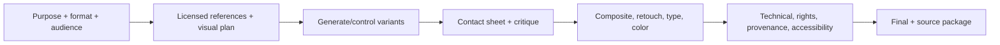

# AI Image and Graphic Creator

> [!info] October 13, 2026 update
> Use [[US Career and Governance Update — October 2026]] for current U.S. evidence and a role-family work-product exercise. Pair it with [[Model and Agent Lifecycle Management]] to explain how a technical change affects users, risk, cost, and communication. Older profile claims retain their original verification dates.

> [!abstract] Mission
> Create and finish purposeful visual work by combining art/design fundamentals, directed generation, selection, editing, typography, consistency, and responsible asset handling.

## Responsibilities

- Interpret brief, audience, composition, message hierarchy, brand, specifications, and accessibility needs.
- Research and license references; create moodboards, sketches/layouts, palettes, and visual direction.
- Generate systematically with prompts, seeds/references/masks/control methods as available; preserve reproducibility.
- Select critically; composite, retouch, correct anatomy/perspective/light, draw/paint, create typography/layout, color-manage, resize, and export.
- Maintain source/license/model/version/edit/provenance records and obtain likeness/property permissions.
- Check claims, stereotypes, logos/trademarks, text accuracy, deceptive realism, and channel disclosure.

## Boundaries

- A generator user stops at output; a professional creator owns composition, selection, edit, typography, delivery, rights, and audience outcome.
- [[Generative AI Creative Director]] sets concept/system and directs a team; this role executes and may art-direct a bounded assignment.
- “AI graphic designer” still requires design fundamentals; generation does not reliably solve layout or typographic hierarchy.

## Levels

| Level | Scope | Evidence |
|---|---|---|
| Beginner | Single edited asset from a brief | Contact sheet, strong selection, clean technical finish |
| Creator/designer | Consistent asset set and production specs | Human-edited series, layout/type, provenance and rationale |
| Senior | Complex composites, brand system, high-volume variants | Repeatable control, critique, clearance, cross-format quality |
| Lead | Visual direction, pipeline, review standards | Distinctive system and efficient responsible production |

## Prerequisites and competencies

- Composition, value/color, perspective, lighting, anatomy as relevant, visual hierarchy, typography, grids, brand, image editing, file formats/resolution/color profiles, print/digital delivery.
- Generative literacy: prompting, reference/control, masking/inpainting/outpainting, consistency, upscaling limits, artifacts, model bias, metadata/provenance.
- Rights literacy: licenses/terms, human authorship, likeness/property releases, trademarks, platform/client restrictions.
- Do not claim generated depictions are documentary evidence or use another artist’s name/style as a substitute for developing direction without considering ethical/contractual risk.

## Study sequence

1. Recreate ten compositions manually with basic shapes/type to learn hierarchy.
2. Produce contact sheets from one brief using controlled variable changes; write selection critiques.
3. Composite and retouch outputs to professional technical standards; add hand-created type/layout.
4. Build consistency across 8–12 assets and document repeatable reference/control workflow.
5. Audit representation, deceptive realism, IP/likeness, accessibility/alt text, provenance, and disclosure.
6. Package source files, finals, specs, licenses/releases, and case study.

## Tools

- **Free-first:** Krita, GIMP, Inkscape, Blender, Scribus, Figma/Canva free, local/open image models where hardware permits, ExifTool, Content Credentials Verify.
- **Paid:** Photoshop/Illustrator/Firefly, Canva Pro, commercial image generators, stock/asset libraries, upscaling/retouch tools, DAM.
- Check official commercial-use terms for the exact tool, model, plan, inputs, and date; terms are not universal legal clearance.

## Knowledge check

1. Why is a contact sheet valuable?
2. What does upscaling not fix?
3. What human work supports copyrightability?
4. Name four items in an asset provenance log.
5. Why create alt text after understanding context, not by generic automation alone?

> [!success]- Answers
> 1. It makes alternatives and selection criteria visible instead of anchoring on the first plausible output. 2. Concept, composition, anatomy, misleading detail, rights, or factual errors; it mainly increases/resynthesizes resolution. 3. Human-authored expressive selection, arrangement, modification, drawing, typography, compositing, and other control—not mere prompting. 4. Sources/licenses/releases, tool/model/version, prompt/reference/seed, generations, selected asset, edits, author, disclosure—any four. 5. Good alt text serves the asset’s purpose and surrounding content; automated descriptions can miss meaning or invent detail.

## Flashcards

Contact sheet:: A grid of candidates used to compare, critique, select, and record a visual exploration.
Inpainting:: Regenerating or editing a selected image region using surrounding context and instructions.
Color profile:: Metadata/standard describing how numeric color values should be interpreted by devices and workflows.
Destructive edit:: A change that permanently alters source pixels; preserve non-destructive layers where practical.
Release:: Permission from a person or property owner for specified uses; scope and jurisdiction matter.
Content Credential:: Tamper-evident provenance metadata; it adds context but does not itself prove truth or rights ownership.

## Interview preparation

- Edit a flawed generated asset live: prioritize concept, anatomy/perspective, lighting, type, color, and delivery.
- Defend why a visually impressive candidate failed the brief or rights review.
- Explain consistency across a series without overclaiming model control.
- Bring brief, references/licenses, sketches, contact sheets, prompts/settings, layers, provenance, finals, and critique.

## Suggested projects

- **Beginner:** one poster with 30-image contact sheet, human typography/layout, retouch, alt text, and provenance log.
- **Intermediate:** 10-asset campaign maintaining character/object/brand consistency across formats, with source and rights package.
- **Advanced:** publication or product visual system mixing generated, photographed, illustrated, and typographic work; include color/print/digital specs, accessibility, representation review, provenance, clearance, and reusable production guide.

## Sources

Checked **2026-08-12**.

- [U.S. Copyright Office — AI initiative and reports](https://www.copyright.gov/ai/).
- [Adobe — Content Credentials overview](https://helpx.adobe.com/firefly/web/get-started/learn-the-basics/content-credentials-overview.html).
- [W3C — WCAG 2 Overview](https://www.w3.org/WAI/standards-guidelines/wcag/).
