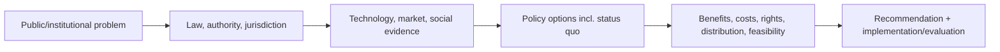

# AI Policy Analyst

> [!abstract] Mission
> Produce nonpartisan, source-traceable analysis of AI policy problems, authorities, options, tradeoffs, implementation, distributional effects, and uncertainty for a U.S. decision maker.

## Responsibilities

- Define decision maker, policy problem, population, jurisdiction, authority, baseline, stakeholders, market/technical context, and time horizon.
- Research statutes, regulations, cases, agency guidance, official data, standards, technical evidence, legislative history, and stakeholder positions.
- Distinguish enacted/effective law, final regulation, proposal, bill, executive policy, guidance, standard, contract, and voluntary practice.
- Develop options and evaluate effectiveness, enforceability, feasibility, cost, innovation/competition, rights, federalism, implementation capacity, and distributional effects.
- Draft briefs, testimony, comments, memos, legislative/regulatory analysis, implementation and evaluation plans.
- Update analyses as legal/technical facts change; disclose assumptions, conflicts, missing evidence, and uncertainty.

## Boundaries

- A policy analyst recommends or explains policy; [[AI Compliance and Privacy Specialist]] applies obligations inside an organization.
- An attorney gives legal advice/interpretation within professional authority; analysts must not misrepresent their role.
- [[AI Ethics Researcher]] examines normative justification more deeply; policy analysis integrates values with authority, feasibility, implementation and effects.

## Levels

| Level | Scope | Evidence |
|---|---|---|
| Research assistant / analyst | Source verification, summaries, data, stakeholder maps | Accurate status/effective dates and neutral synthesis |
| Policy analyst | Own bounded brief/options analysis | Decision-relevant alternatives and implementation details |
| Senior | Complex cross-jurisdiction/sector issue | Anticipates legal, technical, market and distributional interactions |
| Director / fellow | Agenda, team, testimony, institutional influence | Trusted analysis that survives scrutiny and updates |

## Prerequisites and competencies

- U.S. institutions, federalism, legislative/regulatory process, administrative and sector context, public economics, statistics, research methods, stakeholder analysis, concise writing.
- Technical AI literacy: models/data/compute, evaluation, security/safety, deployment actors, open/closed ecosystems, labor/competition/infrastructure issues.
- Source discipline: primary text first; capture version, publication/enactment/effective date, jurisdiction, status, definitions, scope, exceptions, enforcement.
- Never cite an introduced bill as law or infer nationwide rule from one city/state.

## Study sequence

1. Build a U.S. authority/status glossary and policy-tracking database.
2. Analyze one enacted local/state rule from primary text, implementing agency, and effective date.
3. Create stakeholder/power/impact map including small firms, workers, consumers and affected communities.
4. Develop at least three options plus status quo; define mechanism and theory of change.
5. Evaluate legal authority, enforceability, implementation, cost, distribution and unintended incentives.
6. Write two-page brief, 10-page appendix, implementation plan, evaluation measures and update triggers.

## Tools

- **Free-first:** Congress.gov, Federal Register, Regulations.gov, agency/state legislature sites, CourtListener where appropriate, BLS/Census/GAO, NIST, Obsidian, Zotero, spreadsheets/R/Python, Git.
- **Paid:** legal/regulatory databases, policy/news tracking, market research, survey/consultation platforms, mapping/quant tools.
- Generative tools may help query or compare, but every legal/status claim must be checked against primary current sources.

## Knowledge check

1. Distinguish enactment date from effective date.
2. What is a policy mechanism?
3. Why include status quo?
4. Name five policy-option criteria.
5. What must accompany a preemption claim?

> [!success]- Answers
> 1. Enactment is formal adoption/signing; effective date is when provisions begin operating, sometimes phased or conditioned. 2. The causal route by which an intervention is expected to change behavior/outcomes. 3. It is the baseline alternative and may outperform costly or harmful action. 4. Effectiveness, authority, enforceability, feasibility, cost, distribution, rights, competition/innovation, administrative burden, unintended effects—any five. 5. Exact legal authority/text, covered level/subject, scope, conditions, exceptions, status/effective date, and legal review—not a policy aspiration alone.

## Flashcards

Policy problem:: A defined undesirable public/institutional condition, not merely the existence of a technology.
Theory of change:: Causal explanation linking policy inputs and activities to outputs, outcomes and impacts.
Federalism:: Division and interaction of authority among U.S. federal, state, tribal and local governments.
Preemption:: Displacement of lower-level law by higher-level authority under specific constitutional/statutory conditions.
Regulatory impact:: Intended and unintended effects, costs, benefits and distribution produced by a rule and its implementation.
Policy status:: Whether an instrument is proposed, introduced, passed, enacted, effective, stayed, amended, repealed, superseded or guidance/voluntary.

## Interview preparation

- Brief a current U.S. AI policy in three minutes with status, scope, mechanism, evidence, tradeoffs and uncertainty.
- Compare federal versus state/local action without assuming one is inherently better.
- Correct a stakeholder who cites a bill or repealed order as current law.
- Bring source ledger, status tracker, options matrix, memo, comment/testimony sample and update log.

## Suggested projects

- **Beginner:** two-page neutral brief comparing NIST AI RMF, federal policy, and one enacted state/local measure by legal status and function.
- **Intermediate:** policy-options memo on automated employment tools using EEOC, DOL, NYC, Illinois and accessibility evidence, with implementation/evaluation.
- **Advanced:** U.S. cross-jurisdiction policy tracker and scenario analysis with primary-text extraction, definitions/crossover, enforcement, small-entity/workforce effects, uncertainty and quarterly update protocol.

## Sources

Checked **2026-08-12**.

- [White House — America’s AI Action Plan](https://www.whitehouse.gov/releases/2025/07/white-house-unveils-americas-ai-action-plan/) — federal executive policy context.
- [Congress.gov](https://www.congress.gov/) and [Federal Register](https://www.federalregister.gov/) — primary official legislative/regulatory status sources.
- [U.S. GAO — AI issue page](https://www.gao.gov/artificial-intelligence) — reports through 2026.
- [Colorado Attorney General — ADMT and chatbot rulemaking](https://coag.gov/ai/) — demonstrates 2026 amendments and January 1, 2027 effective date.
- [California Privacy Protection Agency — 2025 final regulations](https://cppa.ca.gov/regulations/ccpa_updates.html).
