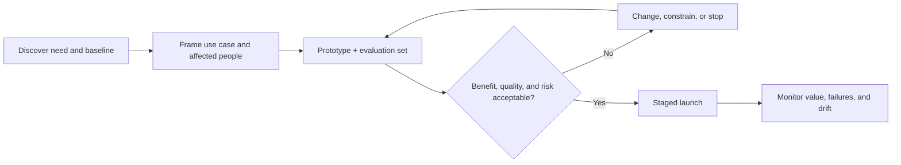

# AI Product Manager

> [!info] October 13, 2026 update
> Use [[US Career and Governance Update — October 2026]] for current U.S. evidence and a role-family work-product exercise. Pair it with [[Model and Agent Lifecycle Management]] to explain how a technical change affects users, risk, cost, and communication. Older profile claims retain their original verification dates.

> [!abstract] Mission
> Decide which user problem is worth solving with AI, shape a safe and viable product around it, and prove that it produces durable value under real conditions.

## What the work actually is

An AI product manager owns outcomes and tradeoffs, not “adding AI.” They discover needs, define the product and its boundaries, align design/engineering/legal/operations, prioritize learning, set evaluation and business measures, and decide when a system is ready—or should not ship.

### Core responsibilities

- Define target user, job-to-be-done, baseline, intended use, and excluded uses.
- Decide whether AI is necessary; compare rules, search, workflow redesign, and human service.
- Turn user needs into testable requirements, evaluation datasets, thresholds, and escalation paths.
- Manage discovery, roadmap, cost/latency/quality tradeoffs, launch gates, and post-launch learning.
- Partner with [[AI UX and Product Designer]], engineering, data, security, legal, [[Responsible AI Specialist]], sales, and operations.
- Communicate uncertainty honestly; keep decision, incident, and model/vendor-change records.

## Boundaries and aliases

- Compared with [[Technical AI Product Manager]], this role may be less hands-on with APIs, architecture, data pipelines, and model-selection experiments.
- Compared with [[AI Program Manager]], it owns product/user outcomes rather than the coordination system across workstreams.
- Compared with [[AI Business Analyst]], it has product decision rights and prioritizes investments, not only requirements.
- “ML PM” may imply predictive-model products; “GenAI PM” often emphasizes language, image, audio, video, or agents. Read the actual scope.

## Levels

| Level | Expected scope | Evidence of readiness |
|---|---|---|
| Associate / transitioner | Research, metrics, backlog slices, test cases under guidance | Clear use-case brief and small human-reviewed eval set |
| Product manager | Own one workflow or product area end to end | Launch memo with baseline, thresholds, risks, and measured outcome |
| Senior | Own ambiguous multi-user product, portfolio tradeoffs, cross-functional decisions | Evaluation strategy, economics model, incident learning, adoption evidence |
| Lead / head | Set product system, governance interfaces, investment thesis, talent standards | Portfolio decisions showing where the organization built, bought, constrained, or stopped |

## Prerequisites

- Product discovery, prioritization, metrics, experimentation, basic finance, and stakeholder communication.
- AI literacy: supervised versus generative systems, embeddings/retrieval, tool-using agents, probabilistic output, hallucination, bias, prompt injection, privacy, and evaluation limits.
- Ability to read JSON, API documentation, model/vendor terms, a basic architecture diagram, and an error analysis. Coding is helpful, not universally required.

## Competencies

| Competency | Can perform | Can explain |
|---|---|---|
| Problem framing | Baseline current workflow and affected people | Why a compelling demo may not solve the real job |
| Evaluation | Build representative cases, rubric, thresholds, and review process | Offline vs online measures; quality vs business outcome |
| Economics | Model volume, token/inference/vendor, review, and failure costs | Why automation rate alone can destroy value |
| Responsible delivery | Define exclusions, human authority, monitoring, incident path | Context-dependent risk and NIST Govern/Map/Measure/Manage |
| Product leadership | Prioritize evidence-generating increments and align functions | Buy/build/partner and model/vendor portability tradeoffs |

## Study sequence

1. **Product base:** interview five users; map the current workflow, pain, baseline, and constraints.
2. **AI behavior:** compare outputs across representative, edge, unsafe, and adversarial cases; maintain an error taxonomy.
3. **Evaluation:** create 30–50 cases, rubric, human-review guide, slices, thresholds, and regression routine.
4. **Experience and risk:** design disclosure, verification, editing, override, escalation, and excluded uses with [[AI UX and Product Designer]].
5. **Economics and launch:** estimate unit cost and failure cost; write staged rollout, observability, support, and rollback plans.
6. **Portfolio proof:** publish a decision packet, not confidential data: problem brief, alternatives, prototype, eval results, risks, and decision.

## Tools: free-first, then paid

- **Free/local:** Obsidian; spreadsheets; Python/Jupyter or Google Colab; GitHub; Figma free tier; Ollama or another locally runnable model; open evaluation libraries such as promptfoo or DeepEval; Mermaid.
- **Paid/managed:** ChatGPT, Claude, Gemini; OpenAI/Anthropic/Google APIs; Microsoft Foundry, Vertex AI, or Amazon Bedrock; Productboard/Jira/Linear; Amplitude/Mixpanel; LangSmith/Arize/Phoenix-style observability.
- Select by data policy, model capability, evaluation support, logging/retention, region, reliability, integration effort, unit economics, and exit cost. Never paste protected data into an unapproved consumer tool.

## Knowledge check

1. Why start with a workflow baseline rather than a model demo?
2. What is the difference between an offline evaluation metric and a product outcome?
3. Name four release-gate categories.
4. When should a PM reject AI for a use case?
5. Why must vendor/model changes trigger regression testing?

> [!success]- Answers
> 1. Without the baseline, the team cannot show improvement or understand existing human/process failure. 2. Offline metrics score behavior on test cases; outcomes measure real effects such as task success, time, quality, retention, revenue, or harm. 3. Quality, safety/rights, operations/reliability, economics, user experience, or compliance—any four. 4. When a simpler solution wins, evidence is insufficient, the risk cannot be acceptably controlled, data/rights are unavailable, or economics fail. 5. Behavior, cost, latency, safety, and tool-use patterns can change even when the interface looks stable.

## Flashcards

Intended use:: The documented users, purpose, conditions, and boundaries for which a system is designed and evaluated.
Product baseline:: A measured picture of the current user outcome and workflow before intervention.
Evaluation slice:: A meaningful subset of test cases used to reveal uneven performance hidden by an average.
Launch gate:: A predeclared condition that must be satisfied before a release stage proceeds.
Human oversight:: A designed allocation of authority, information, time, and ability to intervene—not the mere presence of a person.
AI PM’s core decision:: Whether, what, for whom, and under what evidence and controls to build and ship.

## Interview preparation

Prepare a 10-minute case walkthrough: context → baseline → options (including non-AI) → evaluation → risk → economics → decision → measured learning. Expect:

- “Design an AI assistant for a high-stakes workflow.” Ask about users, stakes, data, jurisdiction, reversibility, baseline, and human authority before proposing features.
- “Quality improved but adoption fell—what do you do?” Segment users, observe workflow fit, inspect latency/trust/control, and test explanations rather than assuming training is the answer.
- “The executive wants launch next week.” State evidence gaps, propose a bounded pilot with explicit exclusions and rollback, and document decision ownership.
- “How do you choose a model?” Tie choice to test-set performance, safety, latency, cost, privacy/security, availability, tooling, and portability.

## Suggested projects

- **Beginner — use-case decision brief:** compare AI, rules, search, and process-change options for one workflow; include baseline and “do not build” criteria.
- **Intermediate — evaluated prototype:** create a prototype, 40-case dataset with slices, rubric, results, error taxonomy, and product requirements for recovery.
- **Advanced — staged product launch packet:** add unit economics, architecture overview, vendor comparison, risk register, launch gates, monitoring, incident/rollback plan, and an executive memo defending a go/no-go decision.

## Sources

Checked **2026-08-12**.

- [NIST — AI RMF 1.0](https://doi.org/10.6028/NIST.AI.100-1) — lifecycle risk and trustworthiness framework.
- [NIST — Generative AI Profile](https://doi.org/10.6028/NIST.AI.600-1) — GenAI risks and actions.
- [NIST — Human-Centered AI](https://www.nist.gov/programs-projects/human-centered-ai) — context of use, human goals, and trust measurement.
- [O*NET — General and Operations Managers](https://www.onetonline.org/link/summary/11-1021.00) — transferable U.S. management-work analog; AI PM is not yet one standardized O*NET occupation.
- [OpenAI — Evaluation best practices](https://developers.openai.com/api/docs/guides/evaluation-best-practices) — vendor-specific but practical evaluation guidance.
