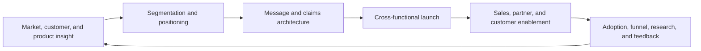

# AI Product Marketing Manager

> [!abstract] Mission
> Make an AI product understandable and credible to a defined market by grounding positioning, messaging, launches, sales enablement, and customer proof in real capabilities, evidence, and needs.

## Responsibilities

- Research audiences, jobs-to-be-done, alternatives, buying barriers, developer or user needs, industry context, and language using multiple evidence sources.
- Define segmentation, ideal customer profiles, positioning, differentiation, messaging hierarchy, use-case narratives, packaging inputs, and launch tiers.
- Translate model, platform, safety, privacy, and evaluation details into accurate audience language without erasing conditions or uncertainty.
- Orchestrate product, sales, solutions, customer success, research, safety, legal, communications, growth, creative, and partners around a launch plan.
- Produce sales and partner enablement, demos, webpages, briefs, competitive intelligence, proof libraries, objection handling, and customer stories.
- Measure message comprehension, qualified interest, activation/adoption, sales use, win/loss evidence, retention signals, and claim accuracy; update the narrative when the product changes.

## Adjacent-role boundaries

- [[AI Product Manager]] owns product outcomes, priorities, and roadmap; product marketing owns market insight, positioning, messaging, launch, and enablement.
- [[AI Content Designer]] writes content inside the product experience; PMM writes and governs the market-facing product story.
- [[Generative AI Creative Director]] owns the creative concept and system; PMM supplies audience, positioning, claims, and business objectives.
- Growth marketing runs acquisition and conversion channels; PMM supplies audience and message architecture and may share experimentation.
- Communications owns reputation, press, and corporate narrative; PMM owns the product/market narrative. Boundaries vary by employer.
- Sales executes account-specific commercial cycles; PMM creates reusable market evidence and enablement, then learns from field outcomes.

## Levels

| Level | Scope | Evidence of readiness |
|---|---|---|
| Associate / feeder marketer | Research, asset production, launch coordination | Clear audience insight, accurate copy, disciplined source and claim tracking |
| Product marketing manager | One product, audience, or use-case portfolio | Coherent positioning, launch, enablement, and measured learning loop |
| Senior / lead PMM | Platform, industry, or multi-product narrative | Resolves technical complexity, competitive ambiguity, and cross-functional tradeoffs |
| Director / head | Portfolio strategy, team, operating system, market category | Improves narrative coherence, launch quality, field effectiveness, and evidence standards |

## Prerequisites and competencies

- Customer and market research, segmentation, positioning, messaging, storytelling, writing/editing, launch management, enablement, analytics, facilitation, and commercial judgment.
- Working literacy in AI capabilities and failure modes, evaluation, data handling, safety, security, governance, and the target user’s workflow.
- Ability to distinguish a feature, capability, use case, benefit hypothesis, measured result, testimonial, and universal claim.
- Competence in research quality: segment evidence by audience and context; avoid presenting one enthusiastic customer or benchmark as universal proof.
- Change discipline: maintain claim sources, product/version context, reviewers, approvals, expiration dates, and withdrawal paths.

## Study sequence

1. Learn one AI product from official product, technical, safety, privacy, and limits documentation; reproduce its core workflows.
2. Interview or simulate research with a narrow audience; map their job, current alternative, trigger, barrier, risk, and buying/adoption language.
3. Write a positioning statement, category frame, differentiated value pillars, proof requirements, and explicit no-claim zones.
4. Create a message-and-claims matrix linking every objective statement to product evidence, scope, caveats, reviewer, and refresh date.
5. Build a tiered launch with audience, channel, enablement, readiness dependencies, feedback capture, and stop/revise criteria.
6. Run message tests and a launch retrospective; use comprehension, adoption, field use, objections, and win/loss evidence to revise the narrative.

## Tools

- **Free-first:** Obsidian, spreadsheets, survey/form free tiers, public filings and reviews, official documentation, Figma/Canva free tiers, Mermaid, Git, simple web analytics, and recording/transcription only with consent.
- **Paid:** product analytics, market intelligence, research panels, CRM and conversation intelligence, content management, enablement, competitive-intelligence, lifecycle marketing, design, and experimentation platforms.
- Generated copy is a draft. Protect research participant and customer data; require human technical, legal, safety, brand, and accessibility review where relevant.

## Knowledge check

1. What is the difference between positioning and messaging?
2. Why must AI claims include context and conditions?
3. What is a no-claim zone?
4. Which evidence can show that a launch worked?
5. Who owns the product roadmap?
6. How should a PMM use one strong customer result?

> [!success]- Answers
> 1. Positioning defines the market frame, audience, alternative, differentiated value, and reason to believe; messaging expresses that strategy for particular audiences and channels. 2. Model behavior and business outcomes vary by task, data, workflow, version, controls, and adoption; stripping conditions can make a claim misleading. 3. A topic or wording that must not be asserted until required evidence and authorization exist. 4. Readiness, comprehension, qualified demand, activation/adoption, field usage, win/loss reasons, retention signals, support load, and claim issues—chosen against the launch objective. 5. The product manager and authorized product leadership; PMM contributes market evidence. 6. Present it as a scoped case with conditions and source approval, not proof that every customer will get the same result.

## Flashcards

What is positioning?:: The strategic choice of audience, market frame, alternative, differentiated value, and credible reason to believe.
What is message architecture?:: A hierarchy connecting audience need, value pillars, supporting evidence, objections, and approved language.
What is claim substantiation?:: Evidence adequate for the express or implied objective claim in its actual context.
What is a launch tier?:: A classification that determines the depth of readiness, enablement, communication, measurement, and risk review.
What is a proof library?:: Governed customer, product, benchmark, and evaluation evidence with scope, permission, source, version, and expiration.
What is competitive intelligence?:: Ethical, sourced analysis of alternatives, buyer perception, strengths, gaps, and response strategy.
What is message-market fit?:: Evidence that the intended audience understands, believes, and acts on the product’s relevant value proposition.

## Interview preparation

- Present a positioning exercise for one narrow AI workflow; name the audience, alternative, insight, differentiated value, proof, and limitation.
- Turn a technical capability description into executive, practitioner, and developer messages without changing the underlying claim.
- Audit a fictional AI launch page: label unsupported, overly broad, outdated, or ambiguous claims and propose substantiation.
- Explain how you would launch when product readiness, safety review, enablement, or customer evidence is incomplete.
- Bring a research synthesis, positioning brief, claims matrix, launch plan, enablement asset, measurement plan, and retrospective.

## Suggested projects

- **Beginner:** Build a message house and claim ledger for one public AI feature using only official evidence; test comprehension with five consenting reviewers.
- **Intermediate:** Design a complete launch packet: segment research, positioning, tier, readiness checklist, webpage, sales brief, demo narrative, objections, and measurement dashboard.
- **Advanced:** Create a governed multi-industry PMM system with differentiated use cases, evidence expiration, competitive updates, partner enablement, win/loss synthesis, and quarterly narrative review.

## Sources

All sources were checked **2026-08-12**.

- [OpenAI — Industry Product Marketing Manager](https://openai.com/careers/industry-product-marketing-manager-san-francisco/) — current U.S. posting on positioning, messaging, field assets, customer proof, partner moments, launches, and claims accuracy.
- [OpenAI — Product Marketing Manager, Research & Safety](https://openai.com/careers/product-marketing-manager-research-and-safety-san-francisco/) — current U.S. posting on translating technical research and safety work into credible narratives and go-to-market programs.
- [OpenAI — Growth Product Marketing Manager](https://openai.com/careers/growth-product-marketing-manager-san-francisco/) — current U.S. posting on audience strategy, cross-channel messaging, funnel experiments, judgment, and trust.
- [O*NET — Market Research Analysts and Marketing Specialists](https://www.onetonline.org/link/summary/13-1161.00) — U.S. Department of Labor occupational analog, updated 2026.
- [O*NET — Marketing Managers](https://www.onetonline.org/link/summary/11-2021.00) — U.S. Department of Labor leadership analog.
- [FTC — Advertising and Marketing](https://www.ftc.gov/business-guidance/advertising-marketing) — official U.S. guidance that advertising claims must be truthful, nondeceptive/unfair, and evidence-based.
- [NIST — AI RMF Core](https://airc.nist.gov/airmf-resources/airmf/5-sec-core/) — context, documentation, transparency, evaluation, and accountability actions useful for claim governance.

Related: [[Solutions, Go-to-Market and Developer Relations Careers]] · [[AI Product Manager]] · [[Generative AI Creative Director]]
