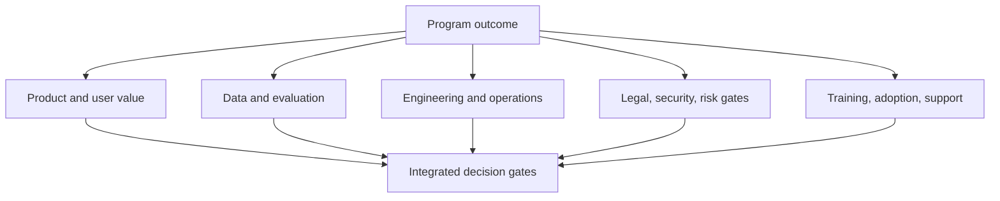

# AI Program Manager

> [!info] October 13, 2026 update
> Use [[US Career and Governance Update — October 2026]] for current U.S. evidence and a role-family work-product exercise. Pair it with [[Model and Agent Lifecycle Management]] to explain how a technical change affects users, risk, cost, and communication. Older profile claims retain their original verification dates.

> [!abstract] Mission
> Coordinate people, evidence, dependencies, governance, and change so a set of AI workstreams produces an accountable outcome.

## Responsibilities

- Define program charter, outcomes, workstreams, ownership, interfaces, roadmap, budget, and decision cadence.
- Maintain dependency, risk, assumption, issue, and decision records; surface evidence gaps early.
- Integrate data readiness, evaluation, privacy/security review, procurement, model/vendor changes, rollout, training, support, and incident readiness.
- Establish stage gates with entry/exit evidence, not status theater.
- Coordinate executives, [[AI Product Manager]], engineering, design, governance, vendors, operations, and affected teams.
- Measure realized outcome and adoption after delivery; close or redirect weak initiatives.

## Boundaries

- [[AI Product Manager]] owns product/user decisions; the program manager owns coordination and delivery across linked work.
- [[AI Transformation Lead]] changes the enterprise operating model and portfolio; the program manager may run one major transformation program.
- Project manager is typically narrower and time-bound; program management integrates related projects and benefits.

## Levels

| Level | Scope | Evidence |
|---|---|---|
| Coordinator / associate | One workstream’s schedule, actions, documentation | Accurate dependency/risk log and decision-ready reporting |
| Program manager | Multi-function initiative and staged launch | Integrated plan with evidence-based gates and benefits tracking |
| Senior | Multiple products/vendors or regulated/high-stakes program | Resolves systemic dependencies and runs incident/escalation cadence |
| Director | Portfolio operating system and executive governance | Comparable investment metrics, resource allocation, stop decisions |

## Prerequisites and competencies

- Program/project fundamentals, facilitation, negotiation, budgeting, procurement/vendor management, change management, and executive communication.
- AI lifecycle literacy sufficient to sequence data, prototype, eval, security/privacy, human factors, release, monitoring, and incident work.
- Competence in outcome decomposition, RACI/decision rights, critical paths, dependency mapping, stage-gate design, RAID/decision logs, benefits realization, and vendor exit planning.
- Ability to distinguish “model works in demo” from “organization can operate system safely.”

## Study sequence

1. Map an AI lifecycle and define deliverables/owners from discovery through retirement.
2. Practice outcome decomposition and dependency mapping on a three-workstream case.
3. Build quality, risk, operations, adoption, and economics gates with named evidence.
4. Run tabletop scenarios: data unavailable, evaluation fails, vendor changes model, legal issue, harmful output, usage spike.
5. Design communication for executives, builders, operators, affected workers, and customers.
6. Produce a complete program binder and retrospective with benefits realized.

## Tools

- **Free-first:** Obsidian, spreadsheets, Mermaid/Gantt, GitHub Projects, Linear/Trello free tiers, shared calendars, open risk/register templates.
- **Paid:** Jira/Confluence, Asana, Monday.com, Smartsheet, Airtable, Productboard, ServiceNow; cloud cost/observability and vendor-governance platforms.
- Choose a tool after defining information needs, owners, cadence, and access—not as a substitute for them.

## Knowledge check

1. What makes an AI program gate evidence-based?
2. Why track assumptions separately from risks?
3. Name five workstreams commonly missed in an AI launch.
4. What is benefits realization?
5. What belongs in vendor exit planning?

> [!success]- Answers
> 1. It names a decision owner, criteria, required artifacts/results, threshold, exception path, and recorded decision. 2. Assumptions are beliefs the plan depends on; they require validation and may become risks/issues. 3. Data rights/quality, evaluation, privacy/security, human factors/accessibility, governance, change/training, support, monitoring, incident response, procurement—any five. 4. Measuring whether promised outcomes actually occurred and persist. 5. Data export/deletion, replacement capability, migration/testing, contractual rights, continuity, documentation, and costs.

## Flashcards

Program:: Coordinated related work managed to obtain benefits not available from managing it separately.
Dependency:: A required input, decision, capability, or event that one workstream needs from another.
Decision gate:: A point where authorized people examine specified evidence and approve, constrain, redirect, or stop work.
RAID log:: A record of risks, assumptions, issues, and dependencies.
Benefits realization:: The discipline of tracking whether intended value becomes observable and sustained.
Red status:: A request for decision or intervention, not a moral judgment about a team.

## Interview preparation

- Walk through rescuing a program that has a demo but no evaluation, data approval, or support model.
- Explain how you would coordinate a vendor model deprecation in 60 days.
- Present one conflict between speed and evidence; show the bounded option and decision owner.
- Bring anonymized artifacts: charter, dependency map, gate checklist, executive update, and retrospective.

## Suggested projects

- **Beginner:** one-page program charter plus stakeholder/RACI and dependency diagram.
- **Intermediate:** 12-week launch plan with five workstreams, RAID/decision logs, quality/risk/ops gates, and tabletop notes.
- **Advanced:** portfolio operating model with intake, scoring, shared controls, evaluation service dependencies, resource allocation, benefits tracking, vendor exit, and stop criteria.

## Sources

Checked **2026-08-12**.

- [NIST — AI RMF Playbook](https://airc.nist.gov/airmf-resources/playbook/) — lifecycle actions useful for program decomposition.
- [NIST — AI RMF](https://www.nist.gov/itl/ai-risk-management-framework).
- [O*NET — Project Management Specialists](https://www.onetonline.org/link/summary/13-1082.00) — U.S. occupational analog.
- [U.S. GAO — AI Accountability Framework](https://www.gao.gov/products/gao-21-519sp) — governance, data, performance, monitoring.
