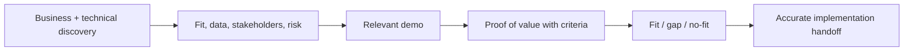

# AI Sales Engineer

> [!info] October 13, 2026 update
> Use [[US Career and Governance Update — October 2026]] for current U.S. evidence and a role-family work-product exercise. Pair it with [[Model and Agent Lifecycle Management]] to explain how a technical change affects users, risk, cost, and communication. Older profile claims retain their original verification dates.

> [!abstract] Mission
> Help a prospective customer determine—honestly and technically—whether a product can solve a valuable problem within their constraints.

## Responsibilities

- Discover desired outcome, current workflow/baseline, systems/data, security/privacy, buying process, stakeholders, success criteria, and constraints.
- Translate features into a customer-specific architecture and value hypothesis.
- Build demos and proofs of value using representative cases, explicit acceptance criteria, and honest limitations.
- Answer technical/security questionnaires with product, [[AI Solutions Architect]], legal, and security partners; never invent commitments.
- Track product gaps, competitive evidence, objections, evaluation results, and handoff details.
- Protect trust: distinguish available, configurable, roadmap, partner-delivered, and unsupported capability.

## Boundaries

- Account executives own commercial process; the sales engineer owns technical discovery and proof.
- [[AI Solutions Architect]] typically goes deeper into target architecture and delivery; titles may overlap.
- [[AI Customer Success Manager]] owns post-sale adoption and outcomes; a complete handoff prevents expectation debt.

## Levels

| Level | Scope | Evidence |
|---|---|---|
| Associate | Demo and technical support for bounded deals | Reproducible demo, accurate notes, strong discovery questions |
| Sales engineer | Own technical cycle and POV | Mutual criteria and transparent fit/gap recommendation |
| Senior | Enterprise/security-heavy/multi-stakeholder deal | Aligns executive value, architects, risk, procurement, and operators |
| Principal / leader | Demo systems, enablement, field-product feedback | Raises win quality and reduces failed handoffs/mis-selling |

## Prerequisites and competencies

- Consultative discovery, presentation, facilitation, objection handling, business value, APIs/data/cloud, AI patterns/evaluation, security/privacy vocabulary, and concise technical writing.
- Must demo failure recovery, citations/evidence, controls, and admin/observability—not only a perfect output.
- Understand total deployment work: data preparation, integrations, evaluation, change, review, support, governance, and cost.
- Know when to say “not fit,” narrow scope, or bring an authorized specialist.

## Study sequence

1. Learn one platform deeply from official docs, including limits, data handling, and common failure modes.
2. Practice discovery around outcome, baseline, stakeholders, data, decision, risks, timeline, and evidence.
3. Build a modular demo mapped to three personas; include failure and recovery.
4. Design a 2–4 week POV with customer-supplied representative cases, owners, thresholds, and stop conditions.
5. Practice security/privacy and procurement questions using verified written sources.
6. Produce an implementation-ready handoff and a product-feedback synthesis.

## Tools

- **Free-first:** Postman/curl, GitHub, VS Code, Loom/free recording, Obsidian, spreadsheets, Mermaid, vendor sandboxes/free tiers, local models.
- **Paid:** CRM and sales-engagement tools, demo platforms, cloud/model APIs, Gong-style conversation intelligence, proposal/security questionnaire systems.
- Record no customer secrets in personal tools; follow approved demo-data and recording policies.

## Knowledge check

1. What makes a proof of value different from a demo?
2. Why define mutual success criteria before building?
3. Name four discovery dimensions beyond features.
4. What is expectation debt?
5. How should you answer an unknown security question?

> [!success]- Answers
> 1. A POV tests a customer-specific hypothesis with representative data/workflow and criteria; a demo illustrates capability. 2. It prevents moving targets and makes a decision possible. 3. Outcome/baseline, people, data, systems, risks, operations, economics, decision process, timing—any four. 4. Future delivery/adoption harm created by vague or inflated pre-sale commitments. 5. Say what you know, record the question, route it to the authorized source, and return a cited written answer—never guess.

## Flashcards

Technical win:: Verified agreement that the solution meets the buyer’s defined technical and operational criteria.
Proof of value:: A bounded test connecting technical capability to a measurable customer outcome.
Demo contract:: The audience, scenario, assumptions, data, capabilities, limits, and desired next decision for a demo.
Mutual action plan:: Shared owners, actions, evidence, dependencies, and dates leading to a decision.
No-fit:: An evidence-backed conclusion that the product should not be sold for the proposed use under current conditions.
Handoff debt:: Missing context, commitments, constraints, or evidence that burdens implementation and success teams.

## Interview preparation

- Run a 15-minute discovery role-play before giving any solution.
- Demo one use case and intentionally trigger a failure; recover and explain controls.
- Answer “Does your AI hallucinate?” with task-specific evaluation, mitigation, limits, and accountability rather than a blanket assurance.
- Bring discovery notes, demo storyboard, POV plan/results, architecture, objection matrix, and handoff.

## Suggested projects

- **Beginner:** persona-specific 8-minute demo with discovery guide and limitations sheet.
- **Intermediate:** full POV packet using 40 cases, mutual criteria, architecture, security assumptions, cost estimate, results, and fit/gap decision.
- **Advanced:** reusable pre-sales kit: modular demo, discovery taxonomy, competitive evidence ledger, security-answer workflow, handoff template, and field-to-product insights.

## Sources

Checked **2026-08-12**.

- [O*NET — Sales Engineers](https://www.onetonline.org/link/summary/41-9031.00) — U.S. occupational analog.
- [NIST — AI RMF FAQs](https://www.nist.gov/itl/ai-risk-management-framework/ai-risk-management-framework-faqs).
- [OpenAI — API documentation](https://developers.openai.com/api/docs/) — example official source for current capability/limit verification.
