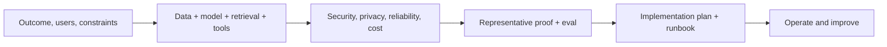

# AI Solutions Architect

> [!info] October 13, 2026 update
> Use [[US Career and Governance Update — October 2026]] for current U.S. evidence and a role-family work-product exercise. Pair it with [[Model and Agent Lifecycle Management]] to explain how a technical change affects users, risk, cost, and communication. Older profile claims retain their original verification dates.

> [!abstract] Mission
> Design a feasible, secure, testable, operable AI solution that fits a customer’s real systems, data, people, constraints, and outcome.

## Responsibilities

- Lead technical discovery: workload, users, stakes, systems, data classification/rights, identity, compliance, volume, latency, availability, and budget.
- Select patterns—direct model call, retrieval, structured output, tool calling, deterministic workflow, agent, fine-tuning, human review—based on evidence.
- Produce context/data-flow, trust-boundary, sequence, deployment, and failure-mode diagrams.
- Define evaluation dataset, acceptance thresholds, security testing, observability, capacity/cost, rollout, rollback, and operational ownership.
- Prototype risky assumptions, document tradeoffs, and hand off to customer/implementation teams.
- Stay vendor-aware but preserve requirements, portability, and an exit plan.

## Boundaries

- Unlike [[AI Sales Engineer]], owns deeper architecture feasibility and implementation guidance, not primarily the sales proof.
- Unlike [[Technical AI Product Manager]], usually designs for a customer/use case rather than owning a shared product roadmap.
- Unlike an ML engineer, may prototype but does not necessarily build or train production components.

## Levels

| Level | Scope | Readiness evidence |
|---|---|---|
| Associate | Bounded reference pattern under review | Correct data flow, API prototype, eval and limitations |
| Architect | End-to-end customer solution | Defensible architecture with security, cost, operations, and handoff |
| Senior | Complex enterprise/high-stakes/multi-system design | Resolves competing constraints and validates failure/scale assumptions |
| Principal | Reusable patterns, governance, field feedback to product | Reference architectures and review standards adopted across teams |

## Prerequisites and competencies

- APIs/HTTP/JSON, authentication/authorization, cloud/network/data basics, databases and vector retrieval, model inference, prompt/context/tool design, queues/caching, CI/CD, logs/traces/metrics, threat modeling, and cost modeling.
- Strong discovery, diagramming, facilitation, technical writing, and executive translation.
- Can identify trust boundaries, least privilege, sensitive-data movement, prompt injection/tool abuse, dependency failure, review burden, and model/vendor change.
- Certifications can support platform vocabulary but do not replace a working prototype and design defense.

## Study sequence

1. Diagram three AI patterns and explain when a deterministic component beats generation.
2. Build direct-prompt, retrieval, and tool-use prototypes against one task and test each.
3. Add identity, permission checks, schemas, citations, logging/redaction, timeouts, retries, and human approval.
4. Run quality/safety/security/latency/cost evals over representative and adversarial cases.
5. Model capacity and unit economics; design graceful degradation and vendor exit.
6. Deliver architecture decision records, implementation phases, test/acceptance plan, and runbook.

## Tools

- **Free/local:** diagrams.net/Mermaid, VS Code, GitHub, Docker, Python, Postman/curl, Ollama, PostgreSQL/pgvector, promptfoo/DeepEval, OpenTelemetry, OWASP threat-model resources.
- **Paid/managed:** AWS Bedrock, Microsoft Foundry, Vertex AI, model APIs, managed vector databases, API gateways, secrets/identity services, LangSmith/Arize/Phoenix, Datadog.
- Compare with a requirements-and-evidence matrix; “enterprise” branding is not an architecture control.

## Knowledge check

1. When is retrieval preferable to fine-tuning?
2. Why is a data-flow diagram insufficient without trust boundaries?
3. What makes tool-using AI riskier than text generation?
4. Name four operational acceptance measures.
5. What should an architecture decision record preserve?

> [!success]- Answers
> 1. When knowledge changes, needs source traceability/access control, or can be supplied at inference without changing behavior. 2. Trust boundaries show where authority or exposure changes and controls are needed. 3. It can take consequential actions against systems/data; validate schemas, identity, authorization, scope, confirmation, and idempotency. 4. Availability, tail latency, error/timeout rate, capacity, unit cost, recovery time, observability coverage—any four. 5. Context, considered options, decision, evidence, tradeoffs, consequences, owner, date, and review trigger.

## Flashcards

Reference architecture:: A reusable, documented solution pattern with components, relationships, controls, and decision guidance.
Trust boundary:: A point where data or execution crosses between zones with different trust or authority.
Retrieval-augmented generation:: Supplying selected external context to a model at inference time to support a task.
Least privilege:: Granting only the minimum access needed for the task and duration.
Graceful degradation:: Safe reduced behavior when a dependency, budget, or quality condition fails.
Architecture fitness function:: An automated or repeatable check showing whether a design continues to meet a quality attribute.

## Interview preparation

- Whiteboard an enterprise document assistant; cover permissions, freshness, citations, injection, evaluation, logs, and deletion.
- Explain a build/buy/model choice and what evidence would reverse it.
- Diagnose a prototype that works but has high p99 latency and review cost.
- Bring architecture diagrams, ADRs, eval results, threat model, cost model, and handoff plan.

## Suggested projects

- **Beginner:** three-pattern comparison for one use case with diagrams and 30-case results.
- **Intermediate:** permission-aware retrieval assistant with citations, injection tests, structured output, traces, cost/latency, and runbook.
- **Advanced:** multi-tenant reference architecture with identity, data classification, model gateway/routing, tool approvals, eval pipeline, observability, incident/rollback, capacity, and vendor exit.

## Sources

Checked **2026-08-12**.

- [NIST — Generative AI Profile](https://doi.org/10.6028/NIST.AI.600-1).
- [NIST — AI Resource Center](https://airc.nist.gov/).
- [Anthropic — Tool use overview](https://platform.claude.com/docs/en/agents-and-tools/tool-use/overview).
- [Microsoft Foundry — Evaluate generative AI apps](https://learn.microsoft.com/azure/ai-foundry/how-to/evaluate-generative-ai-app).
