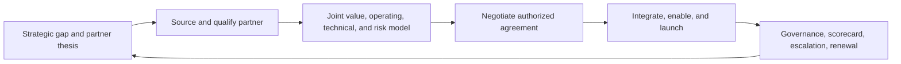

# AI Strategic Partnerships Manager

> [!info] October 13, 2026 update
> Use [[US Career and Governance Update — October 2026]] for current U.S. evidence and a role-family work-product exercise. Pair it with [[Model and Agent Lifecycle Management]] to explain how a technical change affects users, risk, cost, and communication. Older profile claims retain their original verification dates.

> [!abstract] Mission
> Create and operate durable partnerships that combine complementary AI capabilities, distribution, data, research, infrastructure, or market access into measurable mutual value with controlled risk.

## Responsibilities

- Translate company and product strategy into partner theses: which missing capability, distribution, infrastructure, research, or customer outcome requires collaboration.
- Source and qualify partners for strategic fit, complementarity, incremental value, technical feasibility, reputation, data/security posture, economics, and execution capacity.
- Co-design the value proposition, product/integration scope, joint go-to-market, success measures, governance, decision rights, dependencies, and exit conditions.
- Orchestrate product, engineering, solutions, sales, finance, legal, privacy, security, policy, operations, communications, and executive sponsors.
- Negotiate business terms within delegated authority and maintain a clear assumptions/approvals ledger; legal and finance owners approve their domains.
- Operate the partnership through roadmap reviews, launch readiness, enablement, pipeline or adoption evidence, service issues, disputes, risk changes, renewals, and orderly exits.

## Adjacent-role boundaries

- [[AI Enterprise Account Executive]] sells to a customer and owns a commercial account; partnerships creates a mutual multi-party capability, distribution, integration, or co-market motion. Some deals contain both.
- [[AI Product Manager]] owns product direction; the partnerships manager brings external evidence and operates dependencies but cannot trade roadmap control informally.
- [[AI Program Manager]] coordinates delivery; the partnerships manager owns external relationship, joint value, agreement, and governance.
- [[AI Solutions Architect]] designs technical feasibility and integration; partnerships connects that work to strategy, economics, and counterpart commitments.
- Business development titles often overlap. Judge the role by whether it owns opportunity creation, partner operation, direct sales, investments, licensing, or a mixture.
- Legal, privacy, security, procurement, policy, and finance remain accountable for their approvals; relationship strength does not waive controls.

## Levels

| Level | Scope | Evidence of readiness |
|---|---|---|
| Associate / coordinator | Research, pipeline hygiene, meeting and launch operations | Accurate partner briefs, dependencies, decisions, and follow-through |
| Partnerships manager | Owns a bounded partner or program lifecycle | Launches mutual value with clear governance, economics, and measurement |
| Senior / lead | Strategic, technical, regulated, or multi-product partners | Resolves complex incentives, dependencies, executive issues, and risk |
| Director / head | Portfolio thesis, team, operating model, capital and ecosystem choices | Improves portfolio incrementality, resilience, execution, and strategic option value |

## Prerequisites and competencies

- Strategy, relationship building, negotiation, executive communication, financial modeling, product thinking, program execution, and conflict resolution.
- Working literacy in AI product architecture, APIs, data rights, model/provider dependencies, evaluation, security/privacy, safety, and commercialization.
- Ability to model counterfactual incrementality: what happens with the partnership versus independently, through another partner, or not at all.
- Governance design: decision rights, steering cadence, escalation, performance data, confidentiality, change control, continuity, termination, and transition.
- Cultural and incentive empathy without losing documentation, evidence, or duty to one’s own organization.

## Study sequence

1. Map one AI ecosystem: customers, platforms, model providers, cloud/infrastructure, data/content, integrators, researchers, regulators, and substitutes.
2. Write three partner theses with strategic gap, mutual contribution, beneficiary, counterfactual, risk, and measurable outcome.
3. Build a diligence checklist covering strategy, product/technical fit, data and IP, security/privacy, safety, economics, reputation, capacity, and concentration.
4. Design a joint operating model: workstreams, RACI/decision rights, roadmap interface, launch gates, scorecard, steering, escalation, and exit.
5. Simulate a term-sheet negotiation with reservation points, alternatives, approvals, assumptions, and unresolved issues clearly separated.
6. Run a quarterly business review and renewal/exit decision from evidence; capture how partner learning changes product and ecosystem strategy.

## Tools

- **Free-first:** Obsidian, spreadsheets, Mermaid, public filings and official partner documentation, GitHub, shared project templates, simple CRM, and financial-model templates.
- **Paid:** CRM/partner-relationship management, data rooms and e-signature, project/portfolio management, BI, financial planning, vendor-risk/GRC, market intelligence, and integration observability.
- Use approved storage for confidential roadmaps, negotiation positions, personal data, security evidence, and agreements. Generative tools must not receive restricted deal material without authorization.

## Knowledge check

1. What distinguishes a strategic partnership from an ordinary vendor purchase?
2. What is partnership incrementality?
3. Why define decision rights before launch?
4. Who approves legal and financial terms?
5. What belongs in a partnership scorecard?
6. When is an orderly exit a successful management decision?

> [!success]- Answers
> 1. Both parties contribute meaningful, interdependent capabilities to create joint value and operate a shared motion; purchasing alone is primarily buyer-supplier. 2. The value caused by the partnership relative to a credible alternative, including displacement, cannibalization, cost, and risk. 3. Interdependent teams otherwise stall, duplicate authority, or resolve conflicts through informal influence. 4. Authorized legal, finance, security, privacy, and executive owners in their respective domains—not the partnerships manager acting alone. 5. Outcomes, leading indicators, contributions, economics, technical/service performance, customer/partner experience, dependencies, risks, decisions, and corrective actions. 6. When the thesis no longer holds, risk exceeds appetite, performance does not justify investment, or a better alternative exists—and contractual, customer, data, and continuity obligations are handled.

## Flashcards

What is a partner thesis?:: A testable case that two parties’ complementary contributions can create strategic value neither would achieve as effectively alone.
What is counterfactual value?:: The result expected without this partnership or under the best alternative.
What is a joint operating model?:: The roles, decisions, workstreams, cadence, data, escalation, controls, and change process used to run the partnership.
What is a reservation point?:: The least favorable authorized deal a party will accept before choosing its best alternative.
What is concentration risk?:: Exposure created when a critical capability, revenue stream, distribution path, or infrastructure depends too heavily on one partner.
What is a partnership scorecard?:: Shared evidence connecting joint objectives and contributions to outcomes, economics, performance, risk, and actions.
What is an exit plan?:: Predefined contractual and operational steps for transition, data handling, customer continuity, communications, and residual obligations.

## Interview preparation

- Present a partnership thesis and explain why build, buy, sell, license, invest, or do nothing is weaker under stated assumptions.
- Map both parties’ incentives, contributions, non-negotiables, risks, and executive decision rights; identify where incentives may diverge after launch.
- Negotiate a fictional AI platform partnership without giving away an unapproved roadmap, data right, security commitment, exclusivity, or minimum.
- Diagnose an underperforming partnership using technical, adoption, commercial, operational, and relationship evidence.
- Bring a partner brief, diligence matrix, value/economics model, joint operating plan, scorecard, and renewal/exit recommendation.

## Suggested projects

- **Beginner:** Map an AI ecosystem and write one partner thesis with mutual value, contributions, beneficiaries, alternatives, risks, and falsification criteria.
- **Intermediate:** Build a synthetic partnership launch pack: diligence, technical/product scope, value model, term assumptions, governance, enablement, scorecard, and escalation.
- **Advanced:** Design a three-partner portfolio with scenario economics, concentration and third-party risk, roadmap conflicts, executive governance, quarterly reviews, and orderly exit playbooks.

## Sources

All sources were checked **2026-08-12**.

- [OpenAI — Platform Product Partnerships Lead](https://openai.com/careers/platform-product-partnerships-lead-san-francisco/) — current U.S. posting on full-lifecycle partners, commercial/technical agreements, product and engineering work, distribution, and co-marketing.
- [OpenAI — Partner Manager, Cloud Service Provider Partnerships](https://openai.com/careers/partner-manager-cloud-service-provider-partnerships-san-francisco/) — current U.S. posting on relationship, operating plans, roadmap/launch dependencies, and adoption.
- [OpenAI — Strategic Partnerships, Special Situations](https://openai.com/careers/strategic-partnerships-special-situations-san-francisco/) — current U.S. posting on integrated strategy, negotiation, joint go-to-market, and enterprise deployment.
- [OpenAI — Academic Research Partnerships & Programs Lead](https://openai.com/careers/academic-research-partnerships-and-programs-lead-san-francisco/) — current U.S. posting illustrating research-partnership pipelines, pilots, and technical/institutional blockers.
- [OpenAI — Strategic Finance, Partnerships](https://openai.com/careers/strategic-finance-partnerships-san-francisco/) — current U.S. posting on unit economics, pricing, deal guardrails, incrementality, and performance.
- [NIST — AI RMF Core](https://airc.nist.gov/airmf-resources/airmf/5-sec-core/) — third-party risk, accountability, monitoring, and governance actions.
- [NIST — AI Actor Tasks](https://airc.nist.gov/airmf-resources/airmf/appendices/app-a-descriptions-of-ai-actor-tasks/) — lifecycle roles spanning procurement, acquisition, governance, oversight, operation, and third parties.

Related: [[Solutions, Go-to-Market and Developer Relations Careers]] · [[AI Enterprise Account Executive]] · [[AI Product Manager]]
