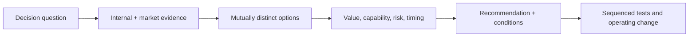

# AI Strategy Consultant

> [!abstract] Mission
> Help a client make defensible choices about AI value, capability, operating model, investment, partnership, and risk under uncertainty.

## Responsibilities

- Frame executive decisions and hypotheses; research industry, customer, competitor, technology, regulatory, workforce, and vendor context.
- Assess current capabilities, data, processes, governance, change capacity, economics, and constraints.
- Build use-case portfolios and scenarios; compare build/buy/partner, central/federated, and model/vendor strategies.
- Quantify value ranges and total cost with explicit assumptions and sensitivities.
- Recommend an operating model, capability roadmap, experiments, risk posture, and decision gates.
- Communicate in decision-ready narratives and support leaders without overstating certainty.

## Boundaries

- [[AI Business Analyst]] goes deeper into process and requirements.
- [[AI Transformation Lead]] owns sustained internal adoption and organizational change; a consultant may advise or catalyze it.
- [[AI Product Manager]] owns a product’s user outcome and backlog.
- Strategy is not a catalog of use cases or vendors; it is a coherent set of choices and exclusions.

## Levels

| Level | Work | Evidence |
|---|---|---|
| Analyst / associate | Research, interviews, models, slides, source verification | Traceable facts, clean analysis, explicit assumptions |
| Consultant | Own workstream and client synthesis | Option model and recommendation tied to evidence |
| Manager / principal | Lead engagement, executive alignment, quality | Resolves conflicting incentives and scopes feasible roadmap |
| Partner / independent lead | Shape agenda, trust, portfolio, commercial accountability | Repeatable point of view updated by outcomes and disconfirming evidence |

## Prerequisites and competencies

- Structured problem solving, research, interviewing, financial modeling, operations/organization design, storytelling, facilitation, and executive presence.
- AI stack and market literacy without vendor hype; evaluation, data, security/privacy, adoption, and regulatory awareness.
- Strong at issue trees, hypotheses, scenario/sensitivity analysis, capability maturity, operating models, portfolio prioritization, and recommendation logic.
- Ethical requirement: label fact, client data, estimate, inference, and opinion; disclose uncertainty and conflicts.

## Study sequence

1. Learn an industry value chain and choose one consequential executive decision.
2. Build a source ledger and fact base using primary, dated evidence.
3. Interview mock stakeholders; identify incentives, current economics, failure costs, and constraints.
4. Develop three coherent options including “optimize without AI” and explicit non-goals.
5. Build value/cost/risk sensitivities and a capability gap assessment.
6. Deliver a 15-slide recommendation plus appendix, 90-day tests, and 18-month conditional roadmap.

## Tools

- **Free-first:** Obsidian, spreadsheets, Python/Colab, Mermaid, official government datasets, SEC EDGAR for public companies, vendor docs, Google Slides/LibreOffice.
- **Paid:** PowerPoint, Excel, Pitch/Canva, research/databases, market intelligence, expert networks, enterprise model assistants, scenario/planning tools.
- Verify commercial-tool claims with official documentation and contracts; never present vendor marketing as independent evidence.

## Knowledge check

1. What distinguishes strategy from a roadmap?
2. Why include a non-AI option?
3. What belongs in a value sensitivity analysis?
4. What is an operating-model choice?
5. Why separate fact from inference?

> [!success]- Answers
> 1. Strategy is a linked set of choices about where/how to win and what not to do; a roadmap sequences actions. 2. It exposes whether AI creates incremental value and prevents solution-first framing. 3. Volume, adoption, achievable quality, review/rework, unit cost, integration, change, failure, and timing assumptions. 4. Decision rights, structure, processes, capabilities, incentives, governance, funding, and shared platforms. 5. So decision makers can test assumptions, update the view, and avoid false certainty.

## Flashcards

Strategic choice:: A commitment that allocates scarce resources and excludes meaningful alternatives.
Issue tree:: A structured decomposition of a decision question into collectively sufficient, non-overlapping lines of analysis.
Sensitivity analysis:: Testing how a conclusion changes when uncertain inputs change.
Use-case portfolio:: A governed set of opportunities balanced by value, feasibility, risk, learning, and shared capability.
Build-buy-partner:: A choice about acquiring capability internally, externally, or jointly—including long-term control and exit.
Decision condition:: Evidence or event that would cause a recommendation to change.

## Interview preparation

- Practice a market-entry or enterprise-adoption case without assuming AI is the answer.
- Defend sources and calculations cell by cell; state confidence and what would falsify the recommendation.
- Explain a case where attractive value was outweighed by capability, risk, timing, or lock-in.
- Prepare one executive synthesis and one detailed appendix showing traceability.

## Suggested projects

- **Beginner:** five-page AI opportunity memo for one U.S. industry, with primary-source ledger and three options.
- **Intermediate:** use-case portfolio with scoring logic, sensitivity model, capability assessment, operating-model recommendation, and 90-day experiments.
- **Advanced:** board-style strategy for a public-company scenario: competitive thesis, build/buy/partner, workforce and governance, financial ranges, scenarios, roadmap, stop conditions, and dissenting view.

## Sources

Checked **2026-08-12**.

- [O*NET — Management Analysts](https://www.onetonline.org/link/summary/13-1111.00) — U.S. management-consulting occupational analog, updated 2026.
- [White House — America’s AI Action Plan](https://www.whitehouse.gov/releases/2025/07/white-house-unveils-americas-ai-action-plan/) — current U.S. federal policy context, not a commercial forecast.
- [NIST — AI RMF](https://www.nist.gov/itl/ai-risk-management-framework).
- [U.S. GAO — AI competitiveness and policy options](https://www.gao.gov/products/gao-26-107624) — 2026 U.S. competitiveness framework.
