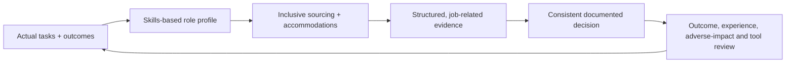

# AI Talent and Recruiting Specialist

> [!abstract] Mission
> Define real AI work and skills, find and assess people through accessible and job-related processes, and use recruiting technology without outsourcing lawful human accountability.

## Responsibilities

- Analyze tasks/outcomes and separate must-have entry skills from learnable, team-complementary, and credential-proxy requirements.
- Create accurate role profiles across AI product, engineering, data, creative, governance, human operations and domain hybrids.
- Build inclusive sourcing and accessible application/assessment/interview/accommodation processes.
- Use structured interviews, work samples and calibrated rubrics; train interviewers and document decisions.
- Evaluate AI-enabled recruiting vendors/use: scope, data, accessibility, validation, notices, bias audit/impact where applicable, human review, security/privacy, monitoring and contracts.
- Monitor candidate experience, funnel, process consistency, selection outcomes, performance/retention relevance and complaints; partner with HR/legal/EEO/privacy.

## Boundaries

- Recruiter runs talent acquisition; HR business partner supports broader employee organization needs; workforce planner forecasts capabilities; hiring manager owns role and selection accountability. Teams combine them.
- This role recruits people for AI work and may use AI tools; it is not [[Data Annotator and AI Rater]] or [[AI Trainer and Educator]].
- A vendor score is input, not responsibility transfer. Federal anti-discrimination law can apply to AI-enabled employment decisions.

## Levels

| Level | Scope | Evidence |
|---|---|---|
| Coordinator / sourcer | Candidate process and talent research | Accurate role literacy, accessible communication, clean records |
| Recruiter | End-to-end role family and structured selection | Job-related evidence and fair consistent process |
| Senior / lead | Hard-to-fill/leadership, workforce plan, tool governance | Better quality/experience without arbitrary barriers |
| Director | Talent strategy, vendor/analytics governance, interviewer system | Sustainable capability pipeline and defensible process |

## Prerequisites and competencies

- Recruiting/HR fundamentals, job analysis, structured interviewing, work-sample design, sourcing, stakeholder negotiation, EEO/ADA/accommodation and privacy literacy, HR analytics.
- AI role taxonomy and enough technical/product/governance vocabulary to challenge inflated descriptions and assess evidence.
- At cutoff, NYC Local Law 144 covers defined AEDTs and requires specified bias audit/public information/notices; Illinois employment-AI provisions were effective January 1, 2026; always verify applicability/current rules with counsel.
- Never infer protected traits, scrape/use data without authority, or let generated résumés/interview notes become unverified personnel records.

## Study sequence

1. Map 20 AI roles by tasks/artifacts rather than buzzwords; interview practitioners.
2. Conduct job analysis and write skills-based profile with level anchors and accessible alternatives.
3. Create structured interview/work sample, behavioral anchors, scoring and interviewer calibration.
4. Map candidate data and accommodations; review an AI vendor against DOL/EEOC and applicable state/local requirements.
5. Simulate selection; calculate funnel/selection rates cautiously and investigate process causes with legal/statistical partners.
6. Validate predictive relevance and candidate/employee outcomes; revise requirements and tool use.

## Tools

- **Free-first:** O*NET, NIST/NICE role-structure concepts, Obsidian, spreadsheets, structured interview/rubric templates, accessible job posting checkers, official EEOC/DOL/state/local sources.
- **Paid:** ATS/CRM, sourcing platforms, skills-assessment/interview systems, labor-market data, scheduling, analytics, recruiting AI—only after legal, accessibility, privacy, validity and procurement review.

## Knowledge check

1. Why start with tasks rather than degrees or years?
2. What makes an interview structured?
3. Does an AI vendor assume the employer’s legal responsibility?
4. What is an accommodation path?
5. Why monitor post-hire outcomes?

> [!success]- Answers
> 1. Tasks reveal job-related capability and reduce arbitrary proxies. 2. Same job-related questions/conditions, behavioral anchors, trained interviewers, independent scoring and documented combination rule. 3. No; employers and other covered entities retain obligations; contracts and audits do not erase responsibility. 4. Accessible process to request and receive effective alternatives/adjustments without retaliation or unnecessary disclosure. 5. Selection consistency alone does not establish job relevance, performance, retention, inequity or harm; validate the process over time.

## Flashcards

Job analysis:: Systematic identification of work tasks, context, knowledge, skills, abilities and other job-related requirements.
Structured interview:: Standardized job-related questions, anchored scoring and interviewer process designed for comparability and validity.
Work sample:: Assessment requiring performance of representative job tasks under defined conditions.
Skills-based hiring:: Selecting based on demonstrated relevant capabilities while removing unjustified credential/experience proxies.
Adverse impact:: A substantially different selection effect that may trigger legal scrutiny; formula and legal significance require context.
Reasonable accommodation:: Modification or adjustment enabling a qualified person with a disability to access/application/work, subject to applicable law.

## Interview preparation

- Translate “10 years of GenAI experience” into real level-appropriate tasks and evidence.
- Explain review of an AI screening vendor: facts, law/counsel, validity, accessibility, data, bias audit/notice, human review, monitoring and exit.
- Handle a hiring manager demanding unstructured “culture fit.”
- Bring task analysis, skills profile, structured interview, work sample/rubric, vendor-risk review and funnel/outcome dashboard.

## Suggested projects

- **Beginner:** skills-based role profile and structured interview for one vault AI role.
- **Intermediate:** accessible hiring kit with work sample, rubric, calibration, candidate notice/accommodation path, data map, adverse-impact monitoring plan and interviewer training.
- **Advanced:** U.S. AI-recruiting governance playbook mapping federal EEOC/DOL plus NYC/Illinois scenarios, vendor due diligence, validation, notices/audits, privacy/security, appeals, monitoring, incidents and contract/exit clauses.

## Sources

Checked **2026-08-12**.

- [EEOC — Artificial Intelligence and the ADA](https://www.eeoc.gov/eeoc-disability-related-resources/artificial-intelligence-and-ada).
- [EEOC — Recruiting, hiring or promoting employees](https://www.eeoc.gov/employers/small-business/3-im-recruiting-hiring-or-promoting-employees).
- [U.S. Department of Labor — AI & Inclusive Hiring Framework announcement](https://www.dol.gov/newsroom/releases/odep/odep20240924).
- [NYC DCWP — Automated Employment Decision Tools](https://www.nyc.gov/site/dca/about/automated-employment-decision-tools.page).
- [Illinois General Assembly — Illinois Human Rights Act](https://www.ilga.gov/legislation/ILCS/details?ActID=2266&ActName=Illinois+Human+Rights+Act.&ChapAct=775%20ILCS%205/).
