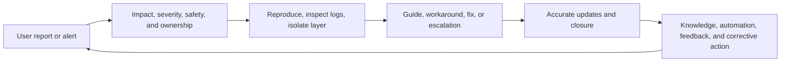

# AI Technical Support and User Operations Specialist

> [!info] October 13, 2026 update
> Use [[US Career and Governance Update — October 2026]] for current U.S. evidence and a role-family work-product exercise. Pair it with [[Model and Agent Lifecycle Management]] to explain how a technical change affects users, risk, cost, and communication. Older profile claims retain their original verification dates.

> [!abstract] Mission
> Restore users and customers to safe, successful use of an AI product by diagnosing issues reproducibly, communicating clearly, coordinating incidents and escalations, and turning repeated problems into product, knowledge, and operational improvements.

## Responsibilities

- Handle tickets and live interactions with empathy, precise intake, identity and entitlement checks, scope/severity assessment, and safe data handling.
- Troubleshoot AI product behavior, APIs, authentication, rate limits, integrations, data/file handling, retrieval, tool calls, latency, billing/usage, and production incidents.
- Reproduce issues with the smallest safe example; inspect request IDs, timestamps, versions, logs, network traces, status, configuration, and evaluation cases.
- Distinguish expected model variability, prompt/context problems, product defects, customer code, third-party dependencies, service incidents, abuse/safety cases, and documentation gaps.
- Own communication through resolution or formal handoff: state known facts, unknowns, impact, workaround, next owner, next update, and closure evidence.
- Turn recurring work into knowledge articles, diagnostics, routing, automation, launch readiness, product feedback, trend reports, retrospectives, and verified corrective actions.

## Adjacent-role boundaries

- [[AI Customer Success Manager]] owns adoption, value, and relationship plans; support owns diagnosis, resolution, escalation, and reusable problem prevention.
- [[AI Sales Engineer]] handles pre-sale technical proof; support handles live product use and production issues after access or deployment.
- Product and engineering own product decisions and code changes; support supplies reproducible evidence and customer impact without assigning an unsupported root cause.
- Site reliability/incident engineering restores service; user operations coordinates customer impact, support workstreams, and communications within its authority.
- [[AI Trust and Safety Operations Specialist]] handles abuse, harmful behavior, and enforcement; support must recognize and route those signals without conducting an unauthorized investigation.
- [[AI Developer Relations and Advocate]] teaches and engages a broad developer community; support resolves individual or patterned cases under service processes.

## Levels

| Level | Scope | Evidence of readiness |
|---|---|---|
| Associate support specialist | Documented product issues and supervised escalation | Complete intake, safe reproduction, accurate guidance, clean case records |
| Technical support / user ops specialist | Ambiguous API, integration, model-behavior, and customer-impact cases | Isolates the failing layer and owns a no-surprises resolution or handoff |
| Senior / escalation specialist | Production incidents, strategic customers, launches, systemic patterns | Leads cross-team diagnosis and turns recurrence into durable improvement |
| Lead / support operations manager | Coverage, severity model, tooling, QA, knowledge, automation, incident interface | Improves user outcome, quality, resilience, and prevention—not only ticket deflection |

## Prerequisites and competencies

- Empathy, active listening, concise writing, expectation setting, de-escalation, hypothesis-driven troubleshooting, prioritization, and calm incident behavior.
- Technical literacy in HTTP/APIs, JSON, authentication, logs, browser developer tools, command line, Git, basic scripting/SQL, cloud concepts, and observability.
- AI literacy in probabilistic outputs, prompt/context and retrieval, tool use, evaluations, versioning, safety controls, privacy, and the difference between a model and a product system.
- Evidence discipline: separate symptom, impact, reproduction, observation, hypothesis, attempted action, result, cause, workaround, and verified resolution.
- Security and privacy judgment: request the minimum data, redact secrets, use approved upload paths, and never ask a user to disable a control merely to make troubleshooting easier.

## Study sequence

1. Learn one AI product end to end: UI, API, authentication, limits, data handling, status, common errors, safety routing, and support commitments.
2. Practice HTTP/API basics with curl or Postman; capture request/response, IDs, timestamps, version, latency, headers, and structured error details safely.
3. Build a troubleshooting tree across client, configuration, data/context, model behavior, provider/service, integration, and policy/safety layers.
4. Solve synthetic tickets using minimal reproducible examples, controlled variable changes, expectation setting, and closure verification.
5. Run a customer-impact incident tabletop with severity, command, communication cadence, status updates, handoffs, recovery, and retrospective.
6. Analyze a case set to improve one knowledge article, diagnostic, automation, routing rule, launch checklist, or product requirement; verify that it reduces user effort without hiding failures.

## Tools

- **Free-first:** browser developer tools, curl, Postman free tier, VS Code, Git/GitHub, Python, SQLite/DuckDB, Obsidian, Mermaid, vendor status/docs, local synthetic tests, and screen recording with consent.
- **Paid:** Zendesk or Salesforce Service Cloud, PagerDuty/incident.io, Datadog/Sentry, Statuspage, enterprise CRM, call intelligence, knowledge-management, session-replay, observability, and approved model APIs.
- Automation may summarize or route, but a named owner remains accountable for high-impact decisions, customer commitments, data exposure, and incident communications.

## Knowledge check

1. What is a minimal reproducible example?
2. Why is “the model is broken” not yet a diagnosis?
3. What information belongs in an escalation?
4. When should support route a case to trust and safety?
5. Why should an incident update separate facts from hypotheses?
6. What makes ticket deflection an incomplete success metric?

> [!success]- Answers
> 1. The smallest safe input, configuration, steps, environment, and evidence that reliably shows the issue. 2. The symptom could arise from instructions, context, retrieval, tool calls, configuration, version, customer code, provider service, or expected variability; the failing layer is unproven. 3. User/business impact, severity, timestamps/IDs, environment/version, reproduction, observations, actions/results, safe evidence, current workaround, owner, and requested decision. 4. When the case indicates abuse, harmful behavior, exploitation, policy violation, or a safety-risk pattern rather than ordinary product failure. 5. Hypotheses can change; presenting them as facts creates confusion, bad decisions, and loss of trust. 6. It may reduce ticket count while increasing user effort, failed self-service, repeat contacts, hidden harm, or abandonment; measure resolution and experience too.

## Flashcards

What is a reproducible issue?:: A problem that can be demonstrated under specified steps, input, configuration, environment, and version.
What is layer isolation?:: Using evidence and controlled changes to identify whether the issue lies in client, config, data/context, model, tool, integration, or service.
What is severity?:: A defined assessment of impact, scope, urgency, safety, and required response—not the customer’s emotional intensity alone.
What is an incident update?:: A time-stamped statement of impact, known facts, actions, owner, workaround, and next update without unsupported promises.
What is verified resolution?:: Evidence that the user’s intended workflow works or an accepted alternative/closure condition has been met.
What is case deflection?:: Avoiding assisted support through successful self-service or automation; it is valuable only when users actually resolve their need safely.
What is a corrective action?:: An owned, time-bound change intended to reduce recurrence or impact and later checked for effectiveness.

## Interview preparation

- Live-debug a synthetic API failure while narrating hypotheses, evidence, safety checks, controlled tests, and when you would escalate.
- Explain an apparently wrong AI answer without defaulting to “hallucination”; inspect task definition, expected answer, context, tools, version, and evaluation evidence.
- Write a customer incident update that is useful but makes no invented root-cause or recovery-time claim.
- Show how five similar tickets become a knowledge, automation, documentation, product, or monitoring change—and how you would measure the result.
- Bring sample case notes, a troubleshooting tree, minimal reproduction, escalation packet, knowledge article, incident timeline, and corrective-action tracker.

## Suggested projects

- **Beginner:** Solve and document 20 synthetic AI product tickets with safe intake, reproduction, diagnosis, response, closure test, and knowledge links.
- **Intermediate:** Build a local API support lab that generates authentication, schema, timeout, rate-limit, retrieval, tool, and variable-output cases plus a routing/diagnostic assistant evaluated against a gold set.
- **Advanced:** Run a production-incident simulation with parallel technical and customer workstreams; deliver severity reasoning, timeline, updates, status entry, executive brief, retrospective, corrective actions, and effectiveness review.

## Sources

All sources were checked **2026-08-12**.

- [OpenAI — AI Support Engineer, San Francisco](https://openai.com/careers/ai-support-engineer-san-francisco-san-francisco/) — current U.S. posting on tickets/calls, APIs, authentication, integrations, production incidents, logs, reproduction, escalation, scripting, and automation.
- [OpenAI — Lead, Incidents & Escalations, User Operations](https://openai.com/careers/lead-incidents-and-escalations-user-operations-san-francisco/) — current U.S. posting on incident command, triage, severity, communications, status pages, retrospectives, and corrective action.
- [OpenAI — Strategy & Operations Programs, Support](https://openai.com/careers/strategy-and-operations-programs-support-san-francisco/) — current U.S. posting on support systems, process, self-service, automation, scaling, and change.
- [OpenAI — Product Engagement Specialist, User Operations](https://openai.com/careers/product-engagement-specialist-user-operations-san-francisco/) — current U.S. posting on launch readiness and measurable support-to-product feedback systems.
- [O*NET — Computer User Support Specialists](https://www.onetonline.org/link/summary/15-1232.00) — U.S. Department of Labor occupational analog, updated 2026.
- [NIST — SP 800-61 Rev. 3, Incident Response Recommendations](https://csrc.nist.gov/pubs/sp/800/61/r3/final) — April 2025 final guidance integrating incident response with cybersecurity risk management.
- [NIST — AI RMF Core](https://airc.nist.gov/airmf-resources/airmf/5-sec-core/) — response, recovery, monitoring, documentation, affected-actor feedback, and accountability actions.

Related: [[Solutions, Go-to-Market and Developer Relations Careers]] · [[AI Customer Success Manager]] · [[AI Trust and Safety Operations Specialist]]
