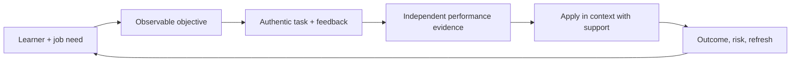

# AI Trainer and Educator

> [!abstract] Mission
> Build verifiable AI literacy and job capability through accurate instruction, authentic practice, feedback, assessment, accessibility, and transfer into real work or study.

## Responsibilities

- Analyze learners, jobs, prerequisites, environment, risks, accessibility, and desired transfer.
- Write observable objectives; sequence concepts, demonstrations, deliberate practice, feedback, retrieval, and assessment.
- Teach AI foundations, task framing, verification/evaluation, privacy/security, responsible use, workflow redesign, and role-specific tools.
- Build labs using safe/public/synthetic data; design authentic assessments that remain valid when learners have AI access.
- Facilitate inclusively, correct misconceptions, support managers/coaches, and create performance aids/communities.
- Measure reaction only as a weak signal; prioritize learning, application, workflow outcome, quality, and harm indicators. Date and refresh volatile material.

## Boundaries

- [[AI Talent and Recruiting Specialist]] identifies/selects talent; trainer develops capability.
- [[AI Customer Success Manager]] owns customer outcome/adoption; educator designs and delivers learning within that plan.
- “AI trainer” can also mean model-data work; see [[Human-Feedback Specialist]] and [[Data Annotator and AI Rater]].

## Levels

| Level | Scope | Evidence |
|---|---|---|
| Facilitator / junior designer | Bounded lesson and practice | Accurate delivery, accessible materials, learner performance |
| Educator/designer | Role pathway and assessment | Learners transfer skill into authentic task |
| Senior | Multi-audience/high-stakes curriculum and faculty enablement | Valid assessment, measurable outcomes, refresh governance |
| Lead | Academy strategy, capability framework, learning operations | Portfolio aligned to jobs and responsible organizational practice |

## Prerequisites and competencies

- Adult learning/instructional design, facilitation, assessment, feedback, curriculum mapping, multimedia/accessibility, measurement, and subject-matter verification.
- AI literacy broad enough to demonstrate, evaluate, and explain limits; deeper role expertise for specialized courses.
- Can distinguish knowledge quiz from performance assessment and AI-assisted work from independent competence.
- Never use unverifiable AI output as course authority; cite primary sources, version screenshots, and schedule review.

## Study sequence

1. Conduct a learner/job task analysis and define observable entry-to-advanced outcomes.
2. Map prerequisites and misconceptions; build short retrieval/flashcard practice.
3. Design worked example → guided practice → faded support → independent authentic task.
4. Create rubric, parallel assessment forms, academic/workplace integrity rules, and accessibility checks.
5. Pilot; collect performance/error evidence; revise instruction and tool setup.
6. Measure transfer 30–90 days later and build quarterly/current-event refresh workflow.

## Tools

- **Free-first:** Obsidian, Markdown, H5P, Moodle/open LMS, Anki, Jupyter/Colab, OBS, LibreOffice, GitHub, WCAG resources, free vendor learning sandboxes.
- **Paid:** enterprise LMS/LXP, Articulate/Captivate, model subscriptions/APIs, virtual labs, webinar/video platforms, assessment/proctoring tools used carefully.
- Ensure a free or institution-provided learning path; paid tools can be taught through comparisons, screenshots, and optional labs.

## Knowledge check

1. What makes a learning objective observable?
2. Why is a satisfaction survey insufficient?
3. How can assessment remain valid with AI access?
4. What is faded support?
5. Why version training content?

> [!success]- Answers
> 1. It names a performance, conditions, and criteria that can be observed/scored. 2. Enjoyment does not establish learning, transfer, outcome, or safety. 3. Define permitted use, require process/evidence/defense, use authentic novel tasks, verify artifacts, and separately assess independent knowledge where needed. 4. Scaffolding is gradually removed as competence grows. 5. Tools, policies, models, interfaces, and guidance change; date/version supports accuracy and reproducibility.

## Flashcards

Transfer:: Use of learned capability in the target work or life context after instruction.
Authentic assessment:: A task resembling the decisions, constraints, and outputs of real performance.
Retrieval practice:: Strengthening learning by recalling information rather than rereading it.
Scaffolding:: Temporary support that enables performance and is reduced as learners gain capability.
Construct validity:: Whether an assessment actually measures the intended capability rather than unrelated factors.
AI literacy:: Ability to understand, use, evaluate, and make informed decisions about AI in context—not simply operate a chatbot.

## Interview preparation

- Teach a complex AI concept in five minutes, then adapt it for a novice, executive, and practitioner.
- Redesign a “prompt tricks” workshop into a task/evaluation/privacy-centered learning experience.
- Explain how you measured work transfer rather than completion.
- Bring analysis, objectives, curriculum map, lesson, practice, rubric, pilot evidence, accessibility check, and refresh log.

## Suggested projects

- **Beginner:** 30-minute AI literacy lesson with objective, pre-check, demonstration, practice, quiz, answer rationale, and accessible handout.
- **Intermediate:** four-module role course with flashcards, authentic project/rubric, interview prep, free-first tools, paid-tool comparison, and pilot report.
- **Advanced:** enterprise or community AI academy with role pathways, prerequisites, diagnostic placement, facilitator certification, lab/data safety, assessment integrity, manager transfer routines, outcome dashboard, and quarterly source review.

## Sources

Checked **2026-08-12**.

- [O*NET — Training and Development Specialists](https://www.onetonline.org/link/summary/13-1151.00) — U.S. occupational analog; software skills updated 2026.
- [U.S. Department of Education — AI guidance and education priority](https://www.ed.gov/about/news/press-release/us-department-of-education-issues-guidance-artificial-intelligence-use-schools-proposes-additional-supplemental-priority).
- [W3C — WCAG 2 Overview](https://www.w3.org/WAI/standards-guidelines/wcag/).
- [NIST — AI Resource Center](https://airc.nist.gov/).
